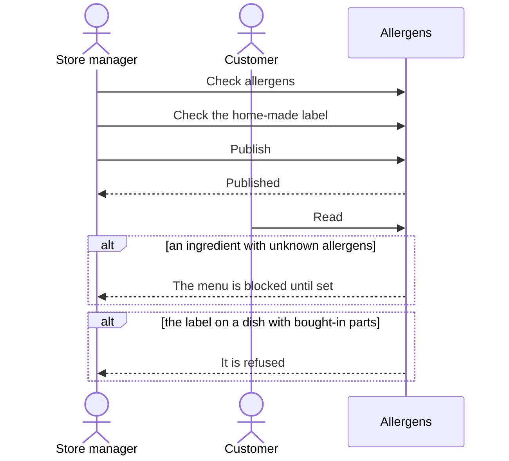

🏠 [Specs](../../../../README.md) › 🏷️ [Sectors](../../../README.md) ›
🍽️ [SC06 Restaurant and hospitality](../../README.md) › 📝 [Use cases](../README.md) ›
📝 [Use cases: FL-SC06-01 Menus and food safety](README.md) › 📝 UC-SC06-02 Show allergens and the home-made label

# 📝 UC-SC06-02 Show allergens and the home-made label

**Status:** ✅ specified

## Summary

The manager checks each dish's allergens, which come from its recipe's ingredients, and the home-made label where it
qualifies; guests read them on menus, QR menus and kiosks.

## Personas

- [U23 Store manager](../../../../01-users/personas/u23-store-manager.md)
- [U09 Customer](../../../../01-users/personas/u09-customer.md)

## Goal

Guests always see the right allergens.

## Trigger

A menu is published or a recipe changes.

## Frequency

At each menu or recipe change.

## Preconditions

- The SC06 sector pack is installed for the company,
  [UC-F14-02](../../../../02-functional/f14-plugin-store/use-cases/01-find-and-install/uc-f14-02-install-a-plugin-or-sector-pack.md),
  and its users have their roles,
  [UC-F1-06](../../../../02-functional/f01-administration/use-cases/04-edit-a-role/uc-f01-06-edit-a-role-and-its-record-rules.md).

## Postconditions

- **Success:** the menu shows each dish's allergens and labels.
- **Failed:** the menu stays unpublished.

## Main flow

1. The manager checks the dish's allergens on
   [S-SC06-02 Allergens](../../screens/01-menus-and-food-safety/s-sc06-02-allergens.md), taken from its ingredients
   ([BR-SC06-02](../../business-rules/br-sc06-02-dishes-carry-their-allergens.md)).
2. Simple-ERP offers the label only if the recipe qualifies
   ([BR-SC06-03](../../business-rules/br-sc06-03-home-made-only-when-it-is.md)).
3. The manager publishes the menu.
4. Guests read allergens on the QR menu,
   [UC-F10-12](../../../../02-functional/f10-point-of-sale/use-cases/05-self-order-and-kiosk/uc-f10-12-self-order-by-qr-at-the-table.md).

## Alternative flows

- 4a. An allergen filter: guests filter out dishes holding an allergen.

## Error flows

- 1e. An ingredient with unknown allergens: the menu is blocked until set.
- 2e. The label on a dish with bought-in parts: it is refused.
- Any step: a call to a service or an outside system fails: it is retried first
  ([BR-F3-32](../../../../02-functional/f03-assistant/business-rules/br-f03-32-retry-before-an-error.md)), then the
  error message pattern ([D122](../../../../06-decisions/ux/d122-error-message-standard.md)) says what failed; what was
  typed is kept.

## Business rules

- [BR-SC06-02 Dishes carry their allergens](../../business-rules/br-sc06-02-dishes-carry-their-allergens.md)
- [BR-SC06-03 Home-made only when it is](../../business-rules/br-sc06-03-home-made-only-when-it-is.md)

## Entities

- [E-SC06-02 Menu dish](../../data/e-sc06-02-menu-dish.md)

## Permissions

The store manager and customer roles; the record rules of their role and site apply,
[UC-F1-06](../../../../02-functional/f01-administration/use-cases/04-edit-a-role/uc-f01-06-edit-a-role-and-its-record-rules.md).

## Notifications

None beyond the in-app updates of the records concerned.

## Audit events

Every creation, change and state change of menu dish records, with who, when and the values before and after (T3).

## AI involvement

The AI assistant answers questions on the menu dish records of this use case, with links, and prepares them as drafts
the user confirms. It works within the user's rights,
[BR-F3-34](../../../../02-functional/f03-assistant/business-rules/br-f03-34-every-capability-is-reachable-from-the-assistant.md),
and never deletes or does anything irreversible without the user's confirmation,
[BR-F3-07](../../../../02-functional/f03-assistant/business-rules/br-f03-07-no-deletes-no-irreversible-acts.md).

## API, MCP and A2A exposure

Through the API and webhooks (T5) and the MCP and A2A gateway (T6), with the caller's rights,
[BR-F3-34](../../../../02-functional/f03-assistant/business-rules/br-f03-34-every-capability-is-reachable-from-the-assistant.md),
reading, creating and changing the records of this use case; nothing irreversible without a person's confirmation.

## Screens

- [S-SC06-02 Allergens](../../screens/01-menus-and-food-safety/s-sc06-02-allergens.md)

## Flowchart

See [FL-SC06-01 Menus and food safety](../../flows/fl-sc06-01-menus-and-food-safety.md#flowchart).

## Sequence diagram

## Acceptance criteria

1. **Given** the example restaurant group's Pesto pasta with nuts and milk **when** the QR menu opens **then** the dish
   shows nuts and milk.
2. **Given** a guest filtering nuts **when** she opens the QR menu **then** guests filter out dishes holding an
   allergen.
3. **Given** a new sauce base without allergens **when** the menu is published **then** the menu is blocked until set.

## Non-functional notes

[D408](../../../../06-decisions/technical/d408-performance-and-profiles.md)'s targets
([performance](../../../../05-non-functional/performance.md)): 95 % of screens within 1 second; lists paged on the
server, the first page within 1 second; reports within 5 seconds or in the background. WCAG 2.2 AA and RGAA
([D46](../../../../06-decisions/ux/d46-accessibility-standard.md)).

## Regulatory references

Legal values from the France country pack:
[CR-FR-107 Allergen information in restaurants](../../../../10-country-packs/france/consumer/cr-fr-107-allergen-information.md),
[CR-FR-108 The home-made label (fait maison)](../../../../10-country-packs/france/consumer/cr-fr-108-home-made-label.md).

## Related use cases

- [UC-SC06-01 Cost recipes and build menus](uc-sc06-01-cost-recipes-and-build-menus.md)

## Open questions

None.

---

⬅️ [UC-SC06-01 Cost recipes and build menus](uc-sc06-01-cost-recipes-and-build-menus.md) · ⬆️ [Up](README.md) ·
➡️ [UC-SC06-03 Keep food-hygiene records](uc-sc06-03-keep-food-hygiene-records.md)
