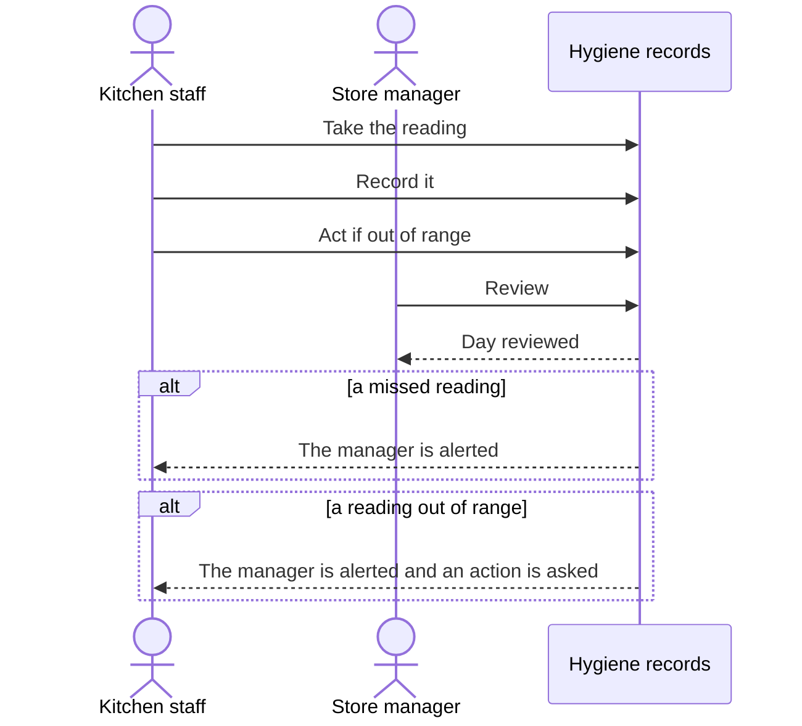

🏠 [Specs](../../../../README.md) › 🏷️ [Sectors](../../../README.md) ›
🍽️ [SC06 Restaurant and hospitality](../../README.md) › 📝 [Use cases](../README.md) ›
📝 [Use cases: FL-SC06-01 Menus and food safety](README.md) › 📝 UC-SC06-03 Keep food-hygiene records

# 📝 UC-SC06-03 Keep food-hygiene records

**Status:** ✅ specified

## Summary

Kitchen staff take temperature, cleaning, delivery and oil readings on schedule on the tablet; an out-of-range or missed
reading alerts the manager.

## Personas

- [U19 Kitchen staff](../../../../01-users/personas/u19-kitchen-staff.md)
- [U23 Store manager](../../../../01-users/personas/u23-store-manager.md)

## Goal

Hygiene records complete and on time.

## Trigger

The hygiene schedule.

## Frequency

Several readings a day.

## Preconditions

- The SC06 sector pack is installed for the company,
  [UC-F14-02](../../../../02-functional/f14-plugin-store/use-cases/01-find-and-install/uc-f14-02-install-a-plugin-or-sector-pack.md),
  and its users have their roles,
  [UC-F1-06](../../../../02-functional/f01-administration/use-cases/04-edit-a-role/uc-f01-06-edit-a-role-and-its-record-rules.md).

## Postconditions

- **Success:** readings are recorded; deviations have actions.
- **Failed:** the gap is shown and the manager alerted.

## Main flow

1. The kitchen staff opens the due reading on
   [S-SC06-03 Hygiene records](../../screens/01-menus-and-food-safety/s-sc06-03-hygiene-records.md).
2. The kitchen staff records value, time and name.
3. Out of range, the staff records the action taken.
4. The manager reviews the day's records ([BR-SC06-05](../../business-rules/br-sc06-05-hygiene-records-on-time.md)).

## Alternative flows

- 2a. Probe sensors: readings come through the sensors' connector (T12).

## Error flows

- 2e. A missed reading: the manager is alerted.
- 3e. A reading out of range: the manager is alerted and an action is asked.
- Any step: a call to a service or an outside system fails: it is retried first
  ([BR-F3-32](../../../../02-functional/f03-assistant/business-rules/br-f03-32-retry-before-an-error.md)), then the
  error message pattern ([D122](../../../../06-decisions/ux/d122-error-message-standard.md)) says what failed; what was
  typed is kept.

## Business rules

- [BR-SC06-05 Hygiene records on time](../../business-rules/br-sc06-05-hygiene-records-on-time.md)

## Entities

- [E-SC06-03 Hygiene record](../../data/e-sc06-03-hygiene-record.md)

## Permissions

The kitchen staff and store manager roles; the record rules of their role and site apply,
[UC-F1-06](../../../../02-functional/f01-administration/use-cases/04-edit-a-role/uc-f01-06-edit-a-role-and-its-record-rules.md).

## Notifications

None beyond the in-app updates of the records concerned.

## Audit events

Every creation, change and state change of hygiene record records, with who, when and the values before and after (T3).

## AI involvement

The AI assistant answers questions on the hygiene record records of this use case, with links, and prepares them as
drafts the user confirms. It works within the user's rights,
[BR-F3-34](../../../../02-functional/f03-assistant/business-rules/br-f03-34-every-capability-is-reachable-from-the-assistant.md),
and never deletes or does anything irreversible without the user's confirmation,
[BR-F3-07](../../../../02-functional/f03-assistant/business-rules/br-f03-07-no-deletes-no-irreversible-acts.md).

## API, MCP and A2A exposure

Through the API and webhooks (T5) and the MCP and A2A gateway (T6), with the caller's rights,
[BR-F3-34](../../../../02-functional/f03-assistant/business-rules/br-f03-34-every-capability-is-reachable-from-the-assistant.md),
reading, creating and changing the records of this use case; nothing irreversible without a person's confirmation.

## Screens

- [S-SC06-03 Hygiene records](../../screens/01-menus-and-food-safety/s-sc06-03-hygiene-records.md)

## Flowchart

See [FL-SC06-01 Menus and food safety](../../flows/fl-sc06-01-menus-and-food-safety.md#flowchart).

## Sequence diagram

## Acceptance criteria

1. **Given** the example restaurant group's cold room read at 2 °C at 08:00 by A. V. **when** it is recorded **then**
   the reading is in range.
2. **Given** the cold room reading of 08:00 not taken **when** it is 08:30 **then** the manager is alerted.
3. **Given** the cold room at 7 °C **when** it is recorded **then** the manager is alerted and an action is asked.

## Non-functional notes

The kitchen tablet keeps readings offline,
[UC-F2-22](../../../../02-functional/f02-no-code-configuration/use-cases/09-portals-and-offline-forms/uc-f02-22-fill-a-form-offline-on-the-phone.md).
[D408](../../../../06-decisions/technical/d408-performance-and-profiles.md)'s targets
([performance](../../../../05-non-functional/performance.md)): 95 % of screens within 1 second; lists paged on the
server, the first page within 1 second; reports within 5 seconds or in the background. WCAG 2.2 AA and RGAA
([D46](../../../../06-decisions/ux/d46-accessibility-standard.md)).

## Regulatory references

Legal values from the France country pack:
[CR-FR-110 Food hygiene and its records](../../../../10-country-packs/france/hospitality/cr-fr-110-food-hygiene-records.md).

## Related use cases

- [UC-SC06-04 Manage perishables, waste and counts](../02-kitchen-stock-and-staff/uc-sc06-04-manage-perishables-waste-and-counts.md)

## Open questions

None.

---

⬅️ [UC-SC06-02 Show allergens and the home-made label](uc-sc06-02-show-allergens-and-the-home-made-label.md) ·
⬆️ [Up](README.md) · ➡️ [UC-SC06-04](../02-kitchen-stock-and-staff/uc-sc06-04-manage-perishables-waste-and-counts.md)
