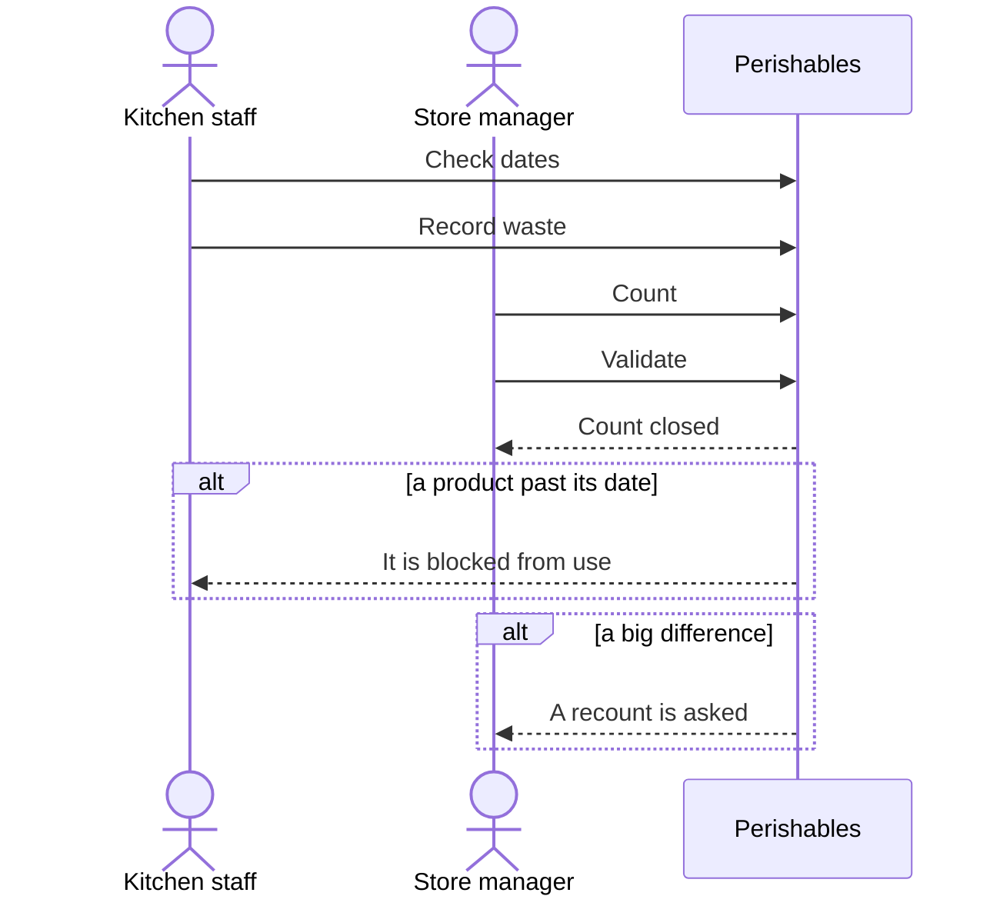

🏠 [Specs](../../../../README.md) › 🏷️ [Sectors](../../../README.md) ›
🍽️ [SC06 Restaurant and hospitality](../../README.md) › 📝 [Use cases](../README.md) ›
📝 [Use cases: FL-SC06-02 Kitchen stock and staff](README.md) › 📝 UC-SC06-04 Manage perishables, waste and counts

# 📝 UC-SC06-04 Manage perishables, waste and counts

**Status:** ✅ specified

## Summary

Kitchen staff check use-by dates, record waste with its reason, count stock and donate unsold food.

## Personas

- [U19 Kitchen staff](../../../../01-users/personas/u19-kitchen-staff.md)
- [U23 Store manager](../../../../01-users/personas/u23-store-manager.md)

## Goal

Less waste, stock right, nothing used past its date.

## Trigger

Daily checks and weekly counts.

## Frequency

Daily.

## Preconditions

- The SC06 sector pack is installed for the company,
  [UC-F14-02](../../../../02-functional/f14-plugin-store/use-cases/01-find-and-install/uc-f14-02-install-a-plugin-or-sector-pack.md),
  and its users have their roles,
  [UC-F1-06](../../../../02-functional/f01-administration/use-cases/04-edit-a-role/uc-f01-06-edit-a-role-and-its-record-rules.md).

## Postconditions

- **Success:** waste is recorded and stock counted.
- **Failed:** the count stays open.

## Main flow

1. The kitchen staff checks use-by dates on
   [S-SC06-04 Perishables](../../screens/02-kitchen-stock-and-staff/s-sc06-04-perishables.md).
2. The staff records waste with its reason; stock goes down.
3. The manager counts the kitchen stock,
   [UC-F7-07](../../../../02-functional/f07-purchasing-and-stock/use-cases/05-count-trace-and-analyse/uc-f07-07-count-stock.md).
4. The manager validates the differences.

## Alternative flows

- 2a. Unsold food donated: it goes to a food-aid partner with a slip.

## Error flows

- 1e. A product past its date: it is blocked from use.
- 4e. A big difference: a recount is asked.
- Any step: a call to a service or an outside system fails: it is retried first
  ([BR-F3-32](../../../../02-functional/f03-assistant/business-rules/br-f03-32-retry-before-an-error.md)), then the
  error message pattern ([D122](../../../../06-decisions/ux/d122-error-message-standard.md)) says what failed; what was
  typed is kept.

## Business rules

- [BR-SC06-05 Hygiene records on time](../../business-rules/br-sc06-05-hygiene-records-on-time.md)

## Entities

- [E-SC06-04 Waste record](../../data/e-sc06-04-waste-record.md)

## Permissions

The kitchen staff and store manager roles; the record rules of their role and site apply,
[UC-F1-06](../../../../02-functional/f01-administration/use-cases/04-edit-a-role/uc-f01-06-edit-a-role-and-its-record-rules.md).

## Notifications

None beyond the in-app updates of the records concerned.

## Audit events

Every creation, change and state change of waste record records, with who, when and the values before and after (T3).

## AI involvement

The AI assistant answers questions on the waste record records of this use case, with links, and prepares them as drafts
the user confirms. It works within the user's rights,
[BR-F3-34](../../../../02-functional/f03-assistant/business-rules/br-f03-34-every-capability-is-reachable-from-the-assistant.md),
and never deletes or does anything irreversible without the user's confirmation,
[BR-F3-07](../../../../02-functional/f03-assistant/business-rules/br-f03-07-no-deletes-no-irreversible-acts.md).

## API, MCP and A2A exposure

Through the API and webhooks (T5) and the MCP and A2A gateway (T6), with the caller's rights,
[BR-F3-34](../../../../02-functional/f03-assistant/business-rules/br-f03-34-every-capability-is-reachable-from-the-assistant.md),
reading, creating and changing the records of this use case; nothing irreversible without a person's confirmation.

## Screens

- [S-SC06-04 Perishables](../../screens/02-kitchen-stock-and-staff/s-sc06-04-perishables.md)

## Flowchart

See [FL-SC06-02 Kitchen stock and staff](../../flows/fl-sc06-02-kitchen-stock-and-staff.md#flowchart).

## Sequence diagram

## Acceptance criteria

1. **Given** the example restaurant group's 2 kg of salad expired **when** waste is recorded **then** stock drops by 2
   kg with the reason expired.
2. **Given** salad past its date **when** a dish using it is sent to the kitchen **then** it is blocked from use.

## Non-functional notes

[D408](../../../../06-decisions/technical/d408-performance-and-profiles.md)'s targets
([performance](../../../../05-non-functional/performance.md)): 95 % of screens within 1 second; lists paged on the
server, the first page within 1 second; reports within 5 seconds or in the background. WCAG 2.2 AA and RGAA
([D46](../../../../06-decisions/ux/d46-accessibility-standard.md)).

## Regulatory references

Legal values from the France country pack:
[CR-FR-095 Donation of unsold food](../../../../10-country-packs/france/environment/cr-fr-095-unsold-food-donation.md).

## Related use cases

- [UC-SC06-03 Keep food-hygiene records](../01-menus-and-food-safety/uc-sc06-03-keep-food-hygiene-records.md)

## Open questions

None.

---

⬅️ [UC-SC06-03 Keep food-hygiene records](../01-menus-and-food-safety/uc-sc06-03-keep-food-hygiene-records.md) ·
⬆️ [Up](README.md) · ➡️ [UC-SC06-05 Share tips](uc-sc06-05-share-tips.md)
