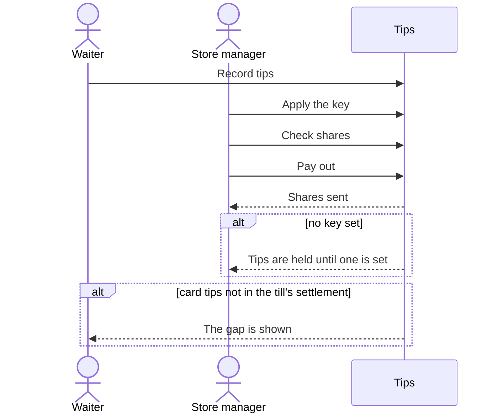

🏠 [Specs](../../../../README.md) › 🏷️ [Sectors](../../../README.md) ›
🍽️ [SC06 Restaurant and hospitality](../../README.md) › 📝 [Use cases](../README.md) ›
📝 [Use cases: FL-SC06-02 Kitchen stock and staff](README.md) › 📝 UC-SC06-05 Share tips

# 📝 UC-SC06-05 Share tips

**Status:** ✅ specified

## Summary

The manager collects card and cash tips, applies the agreed sharing key, and sends each person's share to payroll or
pays it out.

## Personas

- [U23 Store manager](../../../../01-users/personas/u23-store-manager.md)
- [U18 Waiter](../../../../01-users/personas/u18-waiter.md)

## Goal

Tips reach the staff by the agreed key.

## Trigger

The end of the period.

## Frequency

Weekly or monthly.

## Preconditions

- The SC06 sector pack is installed for the company,
  [UC-F14-02](../../../../02-functional/f14-plugin-store/use-cases/01-find-and-install/uc-f14-02-install-a-plugin-or-sector-pack.md),
  and its users have their roles,
  [UC-F1-06](../../../../02-functional/f01-administration/use-cases/04-edit-a-role/uc-f01-06-edit-a-role-and-its-record-rules.md).

## Postconditions

- **Success:** each person's share is paid or sent to payroll.
- **Failed:** the tips stay held.

## Main flow

1. Waiters' card tips come from the till and cash tips are recorded on
   [S-SC06-05 Tips](../../screens/02-kitchen-stock-and-staff/s-sc06-05-tips.md)
   ([BR-SC06-07](../../business-rules/br-sc06-07-tips-reach-the-staff.md)).
2. The manager applies the agreed key by hours or role.
3. The manager checks each person's share.
4. Shares go to payroll,
   [UC-F13-03](../../../../02-functional/f13-payroll/use-cases/02-monthly-pay-run/uc-f13-03-collect-pay-inputs-from-f9.md).

## Alternative flows

- 2a. Tips by service: each service is shared among the staff on it.

## Error flows

- 2e. No key set: tips are held until one is set.
- 1e. Card tips not in the till's settlement: the gap is shown.
- Any step: a call to a service or an outside system fails: it is retried first
  ([BR-F3-32](../../../../02-functional/f03-assistant/business-rules/br-f03-32-retry-before-an-error.md)), then the
  error message pattern ([D122](../../../../06-decisions/ux/d122-error-message-standard.md)) says what failed; what was
  typed is kept.

## Business rules

- [BR-SC06-07 Tips reach the staff](../../business-rules/br-sc06-07-tips-reach-the-staff.md)

## Entities

- [E-SC06-05 Staff benefit](../../data/e-sc06-05-staff-benefit.md)

## Permissions

The store manager and waiter roles; the record rules of their role and site apply,
[UC-F1-06](../../../../02-functional/f01-administration/use-cases/04-edit-a-role/uc-f01-06-edit-a-role-and-its-record-rules.md).

## Notifications

None beyond the in-app updates of the records concerned.

## Audit events

Every creation, change and state change of staff benefit records, with who, when and the values before and after (T3).

## AI involvement

The AI assistant answers questions on the staff benefit records of this use case, with links, and prepares them as
drafts the user confirms. It works within the user's rights,
[BR-F3-34](../../../../02-functional/f03-assistant/business-rules/br-f03-34-every-capability-is-reachable-from-the-assistant.md),
and never deletes or does anything irreversible without the user's confirmation,
[BR-F3-07](../../../../02-functional/f03-assistant/business-rules/br-f03-07-no-deletes-no-irreversible-acts.md).

## API, MCP and A2A exposure

Through the API and webhooks (T5) and the MCP and A2A gateway (T6), with the caller's rights,
[BR-F3-34](../../../../02-functional/f03-assistant/business-rules/br-f03-34-every-capability-is-reachable-from-the-assistant.md),
reading, creating and changing the records of this use case; nothing irreversible without a person's confirmation.

## Screens

- [S-SC06-05 Tips](../../screens/02-kitchen-stock-and-staff/s-sc06-05-tips.md)

## Flowchart

See [FL-SC06-02 Kitchen stock and staff](../../flows/fl-sc06-02-kitchen-stock-and-staff.md#flowchart).

## Sequence diagram

## Acceptance criteria

1. **Given** the example restaurant group's 84 EUR of tips in November shared by hours **when** T. G. worked a third of
   the hours **then** T. G.'s share is 28 EUR.
2. **Given** 84 EUR of card tips and no key **when** the period ends **then** tips are held until one is set.

## Non-functional notes

[D408](../../../../06-decisions/technical/d408-performance-and-profiles.md)'s targets
([performance](../../../../05-non-functional/performance.md)): 95 % of screens within 1 second; lists paged on the
server, the first page within 1 second; reports within 5 seconds or in the background. WCAG 2.2 AA and RGAA
([D46](../../../../06-decisions/ux/d46-accessibility-standard.md)).

## Regulatory references

Legal values from the France country pack:
[CR-FR-113 Tips and their sharing](../../../../10-country-packs/france/labour/cr-fr-113-tips-sharing.md).

## Related use cases

- [UC-SC06-06 Record staff meals](uc-sc06-06-record-staff-meals.md)

## Open questions

None.

---

⬅️ [UC-SC06-04 Manage perishables, waste and counts](uc-sc06-04-manage-perishables-waste-and-counts.md) ·
⬆️ [Up](README.md) · ➡️ [UC-SC06-06 Record staff meals](uc-sc06-06-record-staff-meals.md)
