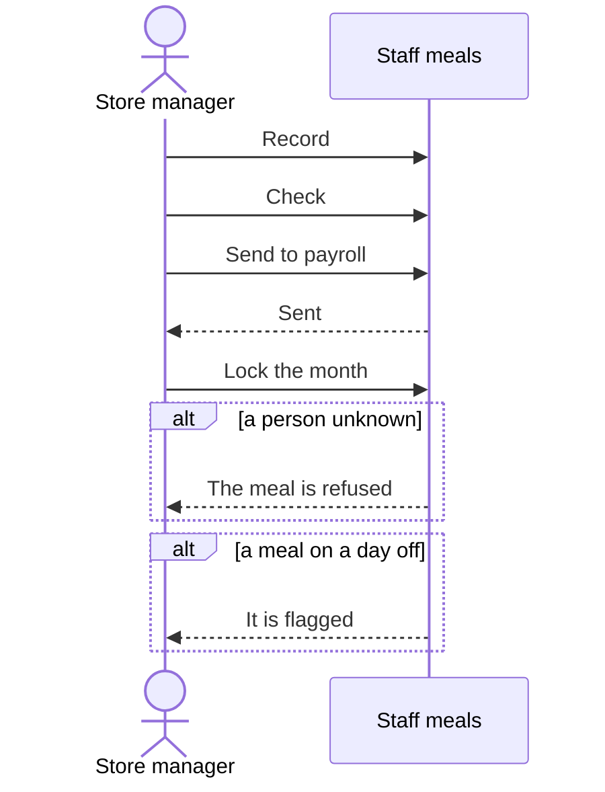

🏠 [Specs](../../../../README.md) › 🏷️ [Sectors](../../../README.md) ›
🍽️ [SC06 Restaurant and hospitality](../../README.md) › 📝 [Use cases](../README.md) ›
📝 [Use cases: FL-SC06-02 Kitchen stock and staff](README.md) › 📝 UC-SC06-06 Record staff meals

# 📝 UC-SC06-06 Record staff meals

**Status:** ✅ specified

## Summary

The manager records staff meals per person, checks them and sends them to payroll as a benefit in kind under the
hotels-and-restaurants agreement.

## Personas

- [U23 Store manager](../../../../01-users/personas/u23-store-manager.md)

## Goal

Staff meals declared correctly.

## Trigger

Each service.

## Frequency

Daily; sent monthly.

## Preconditions

- The SC06 sector pack is installed for the company,
  [UC-F14-02](../../../../02-functional/f14-plugin-store/use-cases/01-find-and-install/uc-f14-02-install-a-plugin-or-sector-pack.md),
  and its users have their roles,
  [UC-F1-06](../../../../02-functional/f01-administration/use-cases/04-edit-a-role/uc-f01-06-edit-a-role-and-its-record-rules.md).

## Postconditions

- **Success:** meals are sent to payroll.
- **Failed:** meals stay to check.

## Main flow

1. The manager records meals per person on
   [S-SC06-06 Staff meals](../../screens/02-kitchen-stock-and-staff/s-sc06-06-staff-meals.md).
2. The manager checks them against the shifts,
   [UC-F9-15](../../../../02-functional/f09-hr-and-projects/use-cases/06-plan-and-deliver-work/uc-f09-15-plan-shifts.md).
3. Meals go to payroll as a benefit, [BR-SC06-08](../../business-rules/br-sc06-08-staff-meals-recorded.md),
   [UC-F13-30](../../../../02-functional/f13-payroll/use-cases/09-collective-agreements-by-family/uc-f13-30-apply-the-hotels-and-restaurants-agreement.md).
4. Once payroll has run, the month is locked.

## Alternative flows

- 1a. Meal vouchers instead: no meal is recorded; vouchers follow payroll.

## Error flows

- 1e. A person unknown: the meal is refused.
- 2e. A meal on a day off: it is flagged.
- Any step: a call to a service or an outside system fails: it is retried first
  ([BR-F3-32](../../../../02-functional/f03-assistant/business-rules/br-f03-32-retry-before-an-error.md)), then the
  error message pattern ([D122](../../../../06-decisions/ux/d122-error-message-standard.md)) says what failed; what was
  typed is kept.

## Business rules

- [BR-SC06-08 Staff meals recorded](../../business-rules/br-sc06-08-staff-meals-recorded.md)

## Entities

- [E-SC06-05 Staff benefit](../../data/e-sc06-05-staff-benefit.md)

## Permissions

The store manager roles; the record rules of their role and site apply,
[UC-F1-06](../../../../02-functional/f01-administration/use-cases/04-edit-a-role/uc-f01-06-edit-a-role-and-its-record-rules.md).

## Notifications

None beyond the in-app updates of the records concerned.

## Audit events

Every creation, change and state change of staff benefit records, with who, when and the values before and after (T3).

## AI involvement

The AI assistant answers questions on the staff benefit records of this use case, with links, and prepares them as
drafts the user confirms. It works within the user's rights,
[BR-F3-34](../../../../02-functional/f03-assistant/business-rules/br-f03-34-every-capability-is-reachable-from-the-assistant.md),
and never deletes or does anything irreversible without the user's confirmation,
[BR-F3-07](../../../../02-functional/f03-assistant/business-rules/br-f03-07-no-deletes-no-irreversible-acts.md).

## API, MCP and A2A exposure

Through the API and webhooks (T5) and the MCP and A2A gateway (T6), with the caller's rights,
[BR-F3-34](../../../../02-functional/f03-assistant/business-rules/br-f03-34-every-capability-is-reachable-from-the-assistant.md),
reading, creating and changing the records of this use case; nothing irreversible without a person's confirmation.

## Screens

- [S-SC06-06 Staff meals](../../screens/02-kitchen-stock-and-staff/s-sc06-06-staff-meals.md)

## Flowchart

See [FL-SC06-02 Kitchen stock and staff](../../flows/fl-sc06-02-kitchen-stock-and-staff.md#flowchart).

## Sequence diagram

## Acceptance criteria

1. **Given** the example restaurant group's T. G. with 20 meals in November **when** they are sent **then** payroll gets
   20 meals for T. G..
2. **Given** a meal for a person not on staff **when** it is recorded **then** the meal is refused.

## Non-functional notes

[D408](../../../../06-decisions/technical/d408-performance-and-profiles.md)'s targets
([performance](../../../../05-non-functional/performance.md)): 95 % of screens within 1 second; lists paged on the
server, the first page within 1 second; reports within 5 seconds or in the background. WCAG 2.2 AA and RGAA
([D46](../../../../06-decisions/ux/d46-accessibility-standard.md)).

## Regulatory references

Legal values from the France country pack:
[CR-FR-114 Staff meals as a benefit in kind](../../../../10-country-packs/france/labour/cr-fr-114-staff-meals-benefit.md).

## Related use cases

- [UC-SC06-05 Share tips](uc-sc06-05-share-tips.md)

## Open questions

None.

---

⬅️ [UC-SC06-05 Share tips](uc-sc06-05-share-tips.md) · ⬆️ [Up](README.md) ·
➡️ [UC-SC06-07](../03-rooms-and-bookings/uc-sc06-07-manage-rooms-room-types-and-rates.md)
