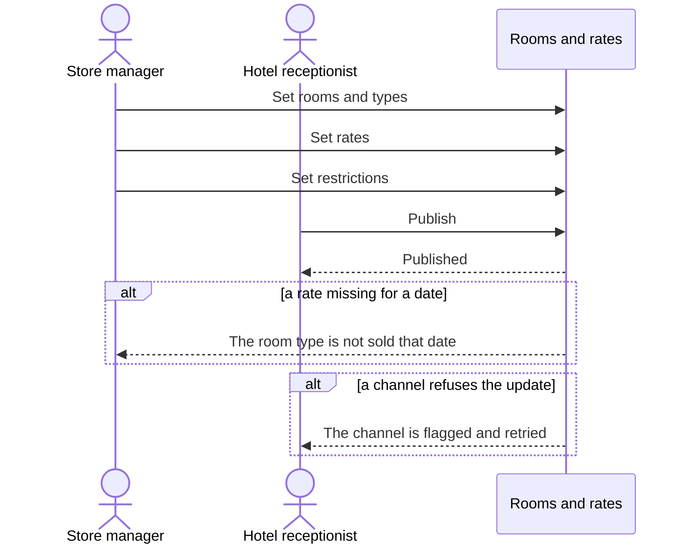

🏠 [Specs](../../../../README.md) › 🏷️ [Sectors](../../../README.md) ›
🍽️ [SC06 Restaurant and hospitality](../../README.md) › 📝 [Use cases](../README.md) ›
📝 [Use cases: FL-SC06-03 Rooms and bookings](README.md) › 📝 UC-SC06-07 Manage rooms, room types and rates

# 📝 UC-SC06-07 Manage rooms, room types and rates

**Status:** ✅ specified

## Summary

The manager sets rooms and room types as bookable resources of the shared booking engine, sets rate plans per date and
publishes them to the direct channel and channel managers.

## Personas

- [U23 Store manager](../../../../01-users/personas/u23-store-manager.md)
- [U28 Hotel receptionist](../../../../01-users/personas/u28-hotel-receptionist.md)

## Goal

Every room sellable at the right price on every channel.

## Trigger

Opening, a season or a rate change.

## Frequency

Weekly rate changes.

## Preconditions

- The SC06 sector pack is installed for the company,
  [UC-F14-02](../../../../02-functional/f14-plugin-store/use-cases/01-find-and-install/uc-f14-02-install-a-plugin-or-sector-pack.md),
  and its users have their roles,
  [UC-F1-06](../../../../02-functional/f01-administration/use-cases/04-edit-a-role/uc-f01-06-edit-a-role-and-its-record-rules.md).

## Postconditions

- **Success:** rates and availability are published.
- **Failed:** the old rates stay.

## Main flow

1. The manager sets rooms and types on
   [S-SC06-07 Rooms and rates](../../screens/03-rooms-and-bookings/s-sc06-07-rooms-and-rates.md) as bookable resources,
   [UC-F2-18](../../../../02-functional/f02-no-code-configuration/use-cases/08-views-and-bookings/uc-f02-18-make-a-record-type-bookable.md).
2. The manager sets rate plans per type and date
   ([BR-SC06-10](../../business-rules/br-sc06-10-rates-by-date-and-room-type.md)).
3. The manager sets minimum stays and closed dates.
4. Rates go to the direct booking page and channel managers (T12).

## Alternative flows

- 3a. A minimum stay: a Saturday arrival needs 2 nights.

## Error flows

- 2e. A rate missing for a date: the room type is not sold that date.
- 4e. A channel refuses the update: the channel is flagged and retried.
- Any step: a call to a service or an outside system fails: it is retried first
  ([BR-F3-32](../../../../02-functional/f03-assistant/business-rules/br-f03-32-retry-before-an-error.md)), then the
  error message pattern ([D122](../../../../06-decisions/ux/d122-error-message-standard.md)) says what failed; what was
  typed is kept.

## Business rules

- [BR-SC06-10 Rates by date and room type](../../business-rules/br-sc06-10-rates-by-date-and-room-type.md)
- [BR-F2-19 Booking rules decide who books what and when](../../../../02-functional/f02-no-code-configuration/business-rules/br-f02-19-booking-rules-decide-who-books-what-and-when.md)

## Entities

- [E-SC06-06 Hotel room](../../data/e-sc06-06-hotel-room.md)
- [E-SC06-07 Rate plan](../../data/e-sc06-07-rate-plan.md)
- [E-F2-17 Bookable resource setting](../../../../02-functional/f02-no-code-configuration/data/e-f02-17-bookable-resource-setting.md)

## Permissions

The store manager and hotel receptionist roles; the record rules of their role and site apply,
[UC-F1-06](../../../../02-functional/f01-administration/use-cases/04-edit-a-role/uc-f01-06-edit-a-role-and-its-record-rules.md).

## Notifications

None beyond the in-app updates of the records concerned.

## Audit events

Every creation, change and state change of room, rate plan, bookable resource setting records, with who, when and the
values before and after (T3).

## AI involvement

The AI assistant answers questions on the room, rate plan, bookable resource setting records of this use case, with
links, and prepares them as drafts the user confirms. It works within the user's rights,
[BR-F3-34](../../../../02-functional/f03-assistant/business-rules/br-f03-34-every-capability-is-reachable-from-the-assistant.md),
and never deletes or does anything irreversible without the user's confirmation,
[BR-F3-07](../../../../02-functional/f03-assistant/business-rules/br-f03-07-no-deletes-no-irreversible-acts.md).

## API, MCP and A2A exposure

Through the API and webhooks (T5) and the MCP and A2A gateway (T6), with the caller's rights,
[BR-F3-34](../../../../02-functional/f03-assistant/business-rules/br-f03-34-every-capability-is-reachable-from-the-assistant.md),
reading, creating and changing the records of this use case; nothing irreversible without a person's confirmation.

## Screens

- [S-SC06-07 Rooms and rates](../../screens/03-rooms-and-bookings/s-sc06-07-rooms-and-rates.md)

## Flowchart

See [FL-SC06-03 Rooms and bookings](../../flows/fl-sc06-03-rooms-and-bookings.md#flowchart).

## Sequence diagram

## Acceptance criteria

1. **Given** the example restaurant group's double flexible at 145 EUR on Saturdays **when** it is published **then**
   every channel sells a double on Saturday at 145 EUR.
2. **Given** double rooms with no rate on 24 December **when** rates are published **then** the room type is not sold
   that date.

## Non-functional notes

[D408](../../../../06-decisions/technical/d408-performance-and-profiles.md)'s targets
([performance](../../../../05-non-functional/performance.md)): 95 % of screens within 1 second; lists paged on the
server, the first page within 1 second; reports within 5 seconds or in the background. WCAG 2.2 AA and RGAA
([D46](../../../../06-decisions/ux/d46-accessibility-standard.md)).

## Regulatory references

None specific to this use case; the sector's legal rules are listed in [SC06 regulatory](../../regulatory.md).

## Related use cases

- [UC-SC06-08 Take bookings directly and through channel managers](uc-sc06-08-take-bookings-directly-and-through-channel-managers.md)

## Open questions

None.

---

⬅️ [UC-SC06-06 Record staff meals](../02-kitchen-stock-and-staff/uc-sc06-06-record-staff-meals.md) ·
⬆️ [Up](README.md) · ➡️ [UC-SC06-08](uc-sc06-08-take-bookings-directly-and-through-channel-managers.md)
