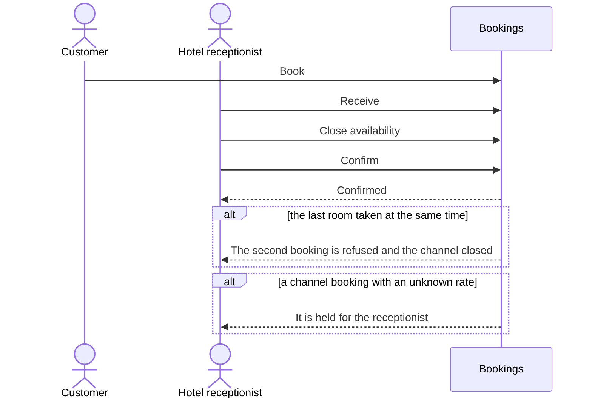

🏠 [Specs](../../../../README.md) › 🏷️ [Sectors](../../../README.md) ›
🍽️ [SC06 Restaurant and hospitality](../../README.md) › 📝 [Use cases](../README.md) ›
📝 [Use cases: FL-SC06-03 Rooms and bookings](README.md) ›
📝 UC-SC06-08 Take bookings directly and through channel managers

# 📝 UC-SC06-08 Take bookings directly and through channel managers

**Status:** ✅ specified

## Summary

The receptionist receives bookings from the direct page and channel managers through the shared booking engine; each
booking closes the room everywhere at once and is confirmed to the guest.

## Personas

- [U28 Hotel receptionist](../../../../01-users/personas/u28-hotel-receptionist.md)
- [U09 Customer](../../../../01-users/personas/u09-customer.md)

## Goal

No overbooking across channels.

## Trigger

A guest books.

## Frequency

Many a day.

## Preconditions

- The SC06 sector pack is installed for the company,
  [UC-F14-02](../../../../02-functional/f14-plugin-store/use-cases/01-find-and-install/uc-f14-02-install-a-plugin-or-sector-pack.md),
  and its users have their roles,
  [UC-F1-06](../../../../02-functional/f01-administration/use-cases/04-edit-a-role/uc-f01-06-edit-a-role-and-its-record-rules.md).

## Postconditions

- **Success:** the booking is confirmed and availability updated everywhere.
- **Failed:** the booking is refused and the guest told.

## Main flow

1. The guest books on the booking page or a channel,
   [UC-F2-19](../../../../02-functional/f02-no-code-configuration/use-cases/08-views-and-bookings/uc-f02-19-book-a-resource.md).
2. The receptionist sees it on [S-SC06-08 Bookings](../../screens/03-rooms-and-bookings/s-sc06-08-bookings.md) with its
   channel.
3. The room type's availability drops on every channel,
   [BR-SC06-09](../../business-rules/br-sc06-09-no-overbooking-across-channels.md),
   [BR-F2-18](../../../../02-functional/f02-no-code-configuration/business-rules/br-f02-18-one-booking-per-resource-and-slot.md).
4. The guest gets the confirmation.

## Alternative flows

- 1a. A group booking: several rooms are held as a block until a date.

## Error flows

- 3e. The last room taken at the same time: the second booking is refused and the channel closed.
- 2e. A channel booking with an unknown rate: it is held for the receptionist.
- Any step: a call to a service or an outside system fails: it is retried first
  ([BR-F3-32](../../../../02-functional/f03-assistant/business-rules/br-f03-32-retry-before-an-error.md)), then the
  error message pattern ([D122](../../../../06-decisions/ux/d122-error-message-standard.md)) says what failed; what was
  typed is kept.

## Business rules

- [BR-SC06-09 No overbooking across channels](../../business-rules/br-sc06-09-no-overbooking-across-channels.md)
- [BR-F2-18 One booking per resource and slot](../../../../02-functional/f02-no-code-configuration/business-rules/br-f02-18-one-booking-per-resource-and-slot.md)

## Entities

- [E-SC06-08 Room reservation](../../data/e-sc06-08-room-reservation.md)
- [E-F2-18 Resource booking](../../../../02-functional/f02-no-code-configuration/data/e-f02-18-resource-booking.md)

## Permissions

The hotel receptionist and customer roles; the record rules of their role and site apply,
[UC-F1-06](../../../../02-functional/f01-administration/use-cases/04-edit-a-role/uc-f01-06-edit-a-role-and-its-record-rules.md).

## Notifications

- The guest gets the confirmation by email.

## Audit events

Every creation, change and state change of booking, booking records, with who, when and the values before and after
(T3).

## AI involvement

The AI assistant answers questions on the booking, booking records of this use case, with links, and prepares them as
drafts the user confirms. It works within the user's rights,
[BR-F3-34](../../../../02-functional/f03-assistant/business-rules/br-f03-34-every-capability-is-reachable-from-the-assistant.md),
and never deletes or does anything irreversible without the user's confirmation,
[BR-F3-07](../../../../02-functional/f03-assistant/business-rules/br-f03-07-no-deletes-no-irreversible-acts.md).

## API, MCP and A2A exposure

Through the API and webhooks (T5) and the MCP and A2A gateway (T6), with the caller's rights,
[BR-F3-34](../../../../02-functional/f03-assistant/business-rules/br-f03-34-every-capability-is-reachable-from-the-assistant.md),
reading, creating and changing the records of this use case; nothing irreversible without a person's confirmation.

## Screens

- [S-SC06-08 Bookings](../../screens/03-rooms-and-bookings/s-sc06-08-bookings.md)

## Flowchart

See [FL-SC06-03 Rooms and bookings](../../flows/fl-sc06-03-rooms-and-bookings.md#flowchart).

## Sequence diagram

## Acceptance criteria

1. **Given** the example restaurant group's J. M. booking 2 nights in a double through Channel A **when** the booking
   arrives **then** double availability drops by 1 on every channel.
2. **Given** one double left booked on the direct page and Channel A **when** both arrive **then** the second booking is
   refused and the channel closed.

## Non-functional notes

[D408](../../../../06-decisions/technical/d408-performance-and-profiles.md)'s targets
([performance](../../../../05-non-functional/performance.md)): 95 % of screens within 1 second; lists paged on the
server, the first page within 1 second; reports within 5 seconds or in the background. WCAG 2.2 AA and RGAA
([D46](../../../../06-decisions/ux/d46-accessibility-standard.md)).

## Regulatory references

None specific to this use case; the sector's legal rules are listed in [SC06 regulatory](../../regulatory.md).

## Related use cases

- [UC-SC06-09 Check guests in and out](../04-stay-and-folio/uc-sc06-09-check-guests-in-and-out.md)

## Open questions

None.

---

⬅️ [UC-SC06-07 Manage rooms, room types and rates](uc-sc06-07-manage-rooms-room-types-and-rates.md) ·
⬆️ [Up](README.md) ·
➡️ [UC-SC06-09 Check guests in and out](../04-stay-and-folio/uc-sc06-09-check-guests-in-and-out.md)
