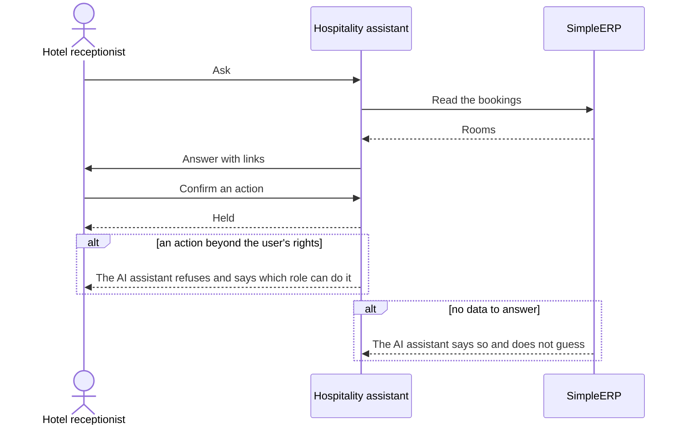

🏠 [Specs](../../../../README.md) › 🏷️ [Sectors](../../../README.md) ›
🍽️ [SC06 Restaurant and hospitality](../../README.md) › 📝 [Use cases](../README.md) ›
📝 [Use cases: FL-SC06-03 Rooms and bookings](README.md) ›
📝 UC-SC06-15 Ask the AI assistant about the hotel or restaurant

# 📝 UC-SC06-15 Ask the AI assistant about the hotel or restaurant

**Status:** ✅ specified

## Summary

The receptionist or manager asks the AI assistant about arrivals, free rooms or a dish's allergens, within their role's
rights.

## Personas

- [U28 Hotel receptionist](../../../../01-users/personas/u28-hotel-receptionist.md)
- [U23 Store manager](../../../../01-users/personas/u23-store-manager.md)

## Goal

Answers without hunting through screens.

## Trigger

A question to the AI assistant.

## Frequency

Daily.

## Preconditions

- The SC06 sector pack is installed for the company,
  [UC-F14-02](../../../../02-functional/f14-plugin-store/use-cases/01-find-and-install/uc-f14-02-install-a-plugin-or-sector-pack.md),
  and its users have their roles,
  [UC-F1-06](../../../../02-functional/f01-administration/use-cases/04-edit-a-role/uc-f01-06-edit-a-role-and-its-record-rules.md).

## Postconditions

- **Success:** the answer cites the records, or the prepared action is confirmed.
- **Failed:** the AI assistant says it cannot answer or act, and why.

## Main flow

1. The receptionist asks on
   [S-SC06-15 Hospitality assistant](../../screens/03-rooms-and-bookings/s-sc06-15-hospitality-assistant.md): "Which
   doubles are free tonight?".
2. The AI assistant reads rooms and bookings within the user's rights.
3. The AI assistant lists them with their status.
4. The receptionist asks to hold one; the AI assistant prepares the booking and creates it once confirmed,
   [UC-F3-03](../../../../02-functional/f03-assistant/use-cases/03-act-through-the-assistant/uc-f03-03-have-the-assistant-create-or-change-records.md).

## Alternative flows

- 1a. A menu translated: the AI assistant drafts the menu in English for the manager to check.

## Error flows

- 4e. An action beyond the user's rights: the AI assistant refuses and says which role can do it.
- 2e. No data to answer: the AI assistant says so and does not guess.
- Any step: a call to a service or an outside system fails: it is retried first
  ([BR-F3-32](../../../../02-functional/f03-assistant/business-rules/br-f03-32-retry-before-an-error.md)), then the
  error message pattern ([D122](../../../../06-decisions/ux/d122-error-message-standard.md)) says what failed; what was
  typed is kept.

## Business rules

- [BR-SC06-01 Hospitality follows the country pack](../../business-rules/br-sc06-01-hospitality-follows-the-country-pack.md)
- [BR-F3-34 All capabilities via the AI assistant](../../../../02-functional/f03-assistant/business-rules/br-f03-34-every-capability-is-reachable-from-the-assistant.md)
- [BR-F3-07 No deletes, no irreversible acts](../../../../02-functional/f03-assistant/business-rules/br-f03-07-no-deletes-no-irreversible-acts.md)

## Entities

- [E-SC06-08 Room reservation](../../data/e-sc06-08-room-reservation.md)
- [E-SC06-02 Menu dish](../../data/e-sc06-02-menu-dish.md)

## Permissions

The hotel receptionist and store manager roles; the record rules of their role and site apply,
[UC-F1-06](../../../../02-functional/f01-administration/use-cases/04-edit-a-role/uc-f01-06-edit-a-role-and-its-record-rules.md).

## Notifications

None beyond the in-app updates of the records concerned.

## Audit events

Every creation, change and state change of booking, menu dish records, with who, when and the values before and after
(T3).

## AI involvement

The AI assistant answers questions on the booking, menu dish records of this use case, with links, and prepares them as
drafts the user confirms. It works within the user's rights,
[BR-F3-34](../../../../02-functional/f03-assistant/business-rules/br-f03-34-every-capability-is-reachable-from-the-assistant.md),
and never deletes or does anything irreversible without the user's confirmation,
[BR-F3-07](../../../../02-functional/f03-assistant/business-rules/br-f03-07-no-deletes-no-irreversible-acts.md).

## API, MCP and A2A exposure

Through the API and webhooks (T5) and the MCP and A2A gateway (T6), with the caller's rights,
[BR-F3-34](../../../../02-functional/f03-assistant/business-rules/br-f03-34-every-capability-is-reachable-from-the-assistant.md),
reading, creating and changing the records of this use case; nothing irreversible without a person's confirmation.

## Screens

- [S-SC06-15 Hospitality assistant](../../screens/03-rooms-and-bookings/s-sc06-15-hospitality-assistant.md)

## Flowchart

See [FL-SC06-03 Rooms and bookings](../../flows/fl-sc06-03-rooms-and-bookings.md#flowchart).

## Sequence diagram

## Acceptance criteria

1. **Given** the example restaurant group's 2 doubles free tonight **when** the receptionist asks **then** the AI
   assistant lists the 2 rooms.
2. **Given** the lunch menu **when** the manager asks **then** the AI assistant drafts the menu in English for the
   manager to check.
3. **Given** a waiter asking to change a rate **when** he asks **then** the AI assistant refuses and says which role can
   do it.

## Non-functional notes

[D408](../../../../06-decisions/technical/d408-performance-and-profiles.md)'s targets
([performance](../../../../05-non-functional/performance.md)): 95 % of screens within 1 second; lists paged on the
server, the first page within 1 second; reports within 5 seconds or in the background. WCAG 2.2 AA and RGAA
([D46](../../../../06-decisions/ux/d46-accessibility-standard.md)).

## Regulatory references

None specific to this use case; the sector's legal rules are listed in [SC06 regulatory](../../regulatory.md).

## Related use cases

- [UC-SC06-08 Take bookings directly and through channel managers](uc-sc06-08-take-bookings-directly-and-through-channel-managers.md)

## Open questions

None.

---

⬅️ [UC-SC06-14](../05-taxes-and-performance/uc-sc06-14-follow-occupancy-revenue-per-room-and-covers.md) ·
⬆️ [Up](README.md) ·
➡️ [UC-SC06-16 Rent campsite pitches](../06-campsites-catering-groups-and-pricing/uc-sc06-16-rent-campsite-pitches.md)
