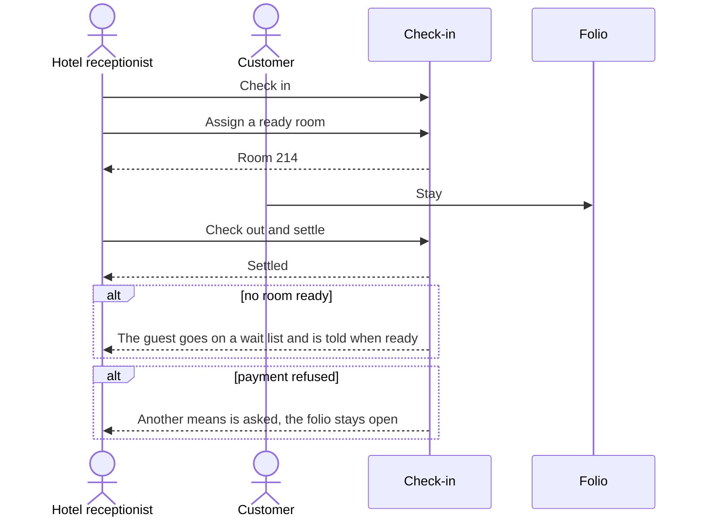

🏠 [Specs](../../../../README.md) › 🏷️ [Sectors](../../../README.md) ›
🍽️ [SC06 Restaurant and hospitality](../../README.md) › 📝 [Use cases](../README.md) ›
📝 [Use cases: FL-SC06-04 Stay and folio](README.md) › 📝 UC-SC06-09 Check guests in and out

# 📝 UC-SC06-09 Check guests in and out

**Status:** ✅ specified

## Summary

The receptionist checks the guest in with identity and a ready room, and at departure settles the folio with the tourist
tax.

## Personas

- [U28 Hotel receptionist](../../../../01-users/personas/u28-hotel-receptionist.md)
- [U09 Customer](../../../../01-users/personas/u09-customer.md)

## Goal

Smooth arrivals and departures, nothing unbilled.

## Trigger

A guest arrives or leaves.

## Frequency

Many a day.

## Preconditions

- The SC06 sector pack is installed for the company,
  [UC-F14-02](../../../../02-functional/f14-plugin-store/use-cases/01-find-and-install/uc-f14-02-install-a-plugin-or-sector-pack.md),
  and its users have their roles,
  [UC-F1-06](../../../../02-functional/f01-administration/use-cases/04-edit-a-role/uc-f01-06-edit-a-role-and-its-record-rules.md).

## Postconditions

- **Success:** the guest is in a ready room; at departure the folio is settled.
- **Failed:** the guest waits for a room, or the folio stays open.

## Main flow

1. The receptionist finds the booking on [S-SC06-09 Check-in](../../screens/04-stay-and-folio/s-sc06-09-check-in.md) and
   records the guest's identity.
2. Only a clean, inspected room is offered
   ([BR-SC06-13](../../business-rules/br-sc06-13-rooms-ready-before-arrival.md)).
3. The guest charges extras to the room ([UC-SC06-11](uc-sc06-11-merge-room-restaurant-and-bar-on-one-folio.md)).
4. The receptionist settles the folio with the tourist tax
   ([BR-SC06-11](../../business-rules/br-sc06-11-one-folio-per-stay.md)).

## Alternative flows

- 1a. Online check-in: the guest fills identity before arrival.

## Error flows

- 2e. No room ready: the guest goes on a wait list and is told when ready.
- 4e. Payment refused: another means is asked; the folio stays open.
- Any step: a call to a service or an outside system fails: it is retried first
  ([BR-F3-32](../../../../02-functional/f03-assistant/business-rules/br-f03-32-retry-before-an-error.md)), then the
  error message pattern ([D122](../../../../06-decisions/ux/d122-error-message-standard.md)) says what failed; what was
  typed is kept.

## Business rules

- [BR-SC06-13 Rooms ready before arrival](../../business-rules/br-sc06-13-rooms-ready-before-arrival.md)
- [BR-SC06-11 One folio per stay](../../business-rules/br-sc06-11-one-folio-per-stay.md)
- [BR-SC06-15 Guest data kept no longer than needed](../../business-rules/br-sc06-15-guest-data-kept-no-longer-than-needed.md)

## Entities

- [E-SC06-08 Room reservation](../../data/e-sc06-08-room-reservation.md)
- [E-SC06-09 Folio](../../data/e-sc06-09-folio.md)

## Permissions

The hotel receptionist and customer roles; the record rules of their role and site apply,
[UC-F1-06](../../../../02-functional/f01-administration/use-cases/04-edit-a-role/uc-f01-06-edit-a-role-and-its-record-rules.md).

## Notifications

None beyond the in-app updates of the records concerned.

## Audit events

Every creation, change and state change of booking, folio records, with who, when and the values before and after (T3).

## AI involvement

The AI assistant answers questions on the booking, folio records of this use case, with links, and prepares them as
drafts the user confirms. It works within the user's rights,
[BR-F3-34](../../../../02-functional/f03-assistant/business-rules/br-f03-34-every-capability-is-reachable-from-the-assistant.md),
and never deletes or does anything irreversible without the user's confirmation,
[BR-F3-07](../../../../02-functional/f03-assistant/business-rules/br-f03-07-no-deletes-no-irreversible-acts.md).

## API, MCP and A2A exposure

Through the API and webhooks (T5) and the MCP and A2A gateway (T6), with the caller's rights,
[BR-F3-34](../../../../02-functional/f03-assistant/business-rules/br-f03-34-every-capability-is-reachable-from-the-assistant.md),
reading, creating and changing the records of this use case; nothing irreversible without a person's confirmation.

## Screens

- [S-SC06-09 Check-in](../../screens/04-stay-and-folio/s-sc06-09-check-in.md)
- [S-SC06-11 Folio](../../screens/04-stay-and-folio/s-sc06-11-folio.md)

## Flowchart

See [FL-SC06-04 Stay and folio](../../flows/fl-sc06-04-stay-and-folio.md#flowchart).

## Sequence diagram

## Acceptance criteria

1. **Given** the example restaurant group's booking B-881 for J. M., 2 nights in 214 **when** he checks out **then** the
   folio is settled with 2 nights, the bar and the tourist tax.
2. **Given** J. M. arriving at 13:00 with no double inspected **when** check-in starts **then** the guest goes on a wait
   list and is told when ready.

## Non-functional notes

[D408](../../../../06-decisions/technical/d408-performance-and-profiles.md)'s targets
([performance](../../../../05-non-functional/performance.md)): 95 % of screens within 1 second; lists paged on the
server, the first page within 1 second; reports within 5 seconds or in the background. WCAG 2.2 AA and RGAA
([D46](../../../../06-decisions/ux/d46-accessibility-standard.md)).

## Regulatory references

None specific to this use case; the sector's legal rules are listed in [SC06 regulatory](../../regulatory.md).

## Related use cases

- [UC-SC06-10 Run housekeeping](uc-sc06-10-run-housekeeping.md)
- [UC-SC06-12 Collect the tourist tax](../05-taxes-and-performance/uc-sc06-12-collect-the-tourist-tax.md)

## Open questions

None.

---

⬅️ [UC-SC06-08](../03-rooms-and-bookings/uc-sc06-08-take-bookings-directly-and-through-channel-managers.md) ·
⬆️ [Up](README.md) · ➡️ [UC-SC06-10 Run housekeeping](uc-sc06-10-run-housekeeping.md)
