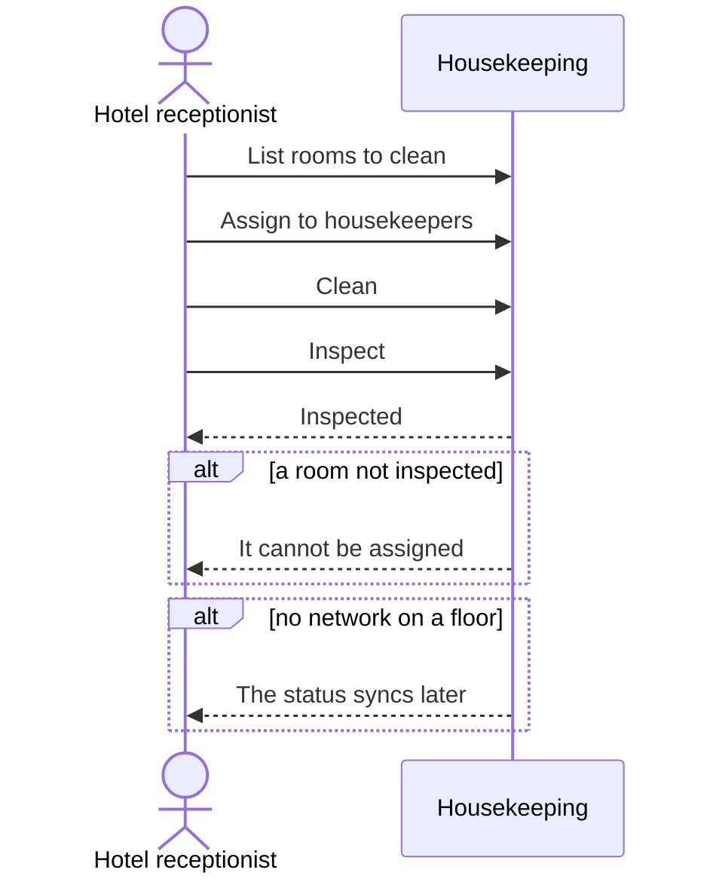

🏠 [Specs](../../../../README.md) › 🏷️ [Sectors](../../../README.md) ›
🍽️ [SC06 Restaurant and hospitality](../../README.md) › 📝 [Use cases](../README.md) ›
📝 [Use cases: FL-SC06-04 Stay and folio](README.md) › 📝 UC-SC06-10 Run housekeeping

# 📝 UC-SC06-10 Run housekeeping

**Status:** ✅ specified

## Summary

The receptionist lists rooms to clean, housekeepers clean and report issues on the phone, and rooms are inspected before
they can be assigned.

## Personas

- [U28 Hotel receptionist](../../../../01-users/personas/u28-hotel-receptionist.md)

## Goal

Rooms clean and inspected before arrival.

## Trigger

Departures and stays each morning.

## Frequency

Daily.

## Preconditions

- The SC06 sector pack is installed for the company,
  [UC-F14-02](../../../../02-functional/f14-plugin-store/use-cases/01-find-and-install/uc-f14-02-install-a-plugin-or-sector-pack.md),
  and its users have their roles,
  [UC-F1-06](../../../../02-functional/f01-administration/use-cases/04-edit-a-role/uc-f01-06-edit-a-role-and-its-record-rules.md).

## Postconditions

- **Success:** rooms are inspected and assignable.
- **Failed:** the room stays dirty and not assignable.

## Main flow

1. The receptionist lists today's rooms on
   [S-SC06-10 Housekeeping](../../screens/04-stay-and-folio/s-sc06-10-housekeeping.md).
2. Rooms are assigned to housekeepers.
3. Housekeepers mark rooms clean on the phone,
   [UC-F2-22](../../../../02-functional/f02-no-code-configuration/use-cases/09-portals-and-offline-forms/uc-f02-22-fill-a-form-offline-on-the-phone.md).
4. The room is inspected and becomes assignable.

## Alternative flows

- 3a. A maintenance issue: it is reported with a photo and the room blocked if needed,
  [UC-F12-06](../../../../02-functional/f12-manufacturing/use-cases/03-make-the-products/uc-f12-06-consume-components-trace-lots-and-serials.md).

## Error flows

- 4e. A room not inspected: it cannot be assigned.
- 3e. No network on a floor: the status syncs later.
- Any step: a call to a service or an outside system fails: it is retried first
  ([BR-F3-32](../../../../02-functional/f03-assistant/business-rules/br-f03-32-retry-before-an-error.md)), then the
  error message pattern ([D122](../../../../06-decisions/ux/d122-error-message-standard.md)) says what failed; what was
  typed is kept.

## Business rules

- [BR-SC06-13 Rooms ready before arrival](../../business-rules/br-sc06-13-rooms-ready-before-arrival.md)

## Entities

- [E-SC06-06 Hotel room](../../data/e-sc06-06-hotel-room.md)
- [E-SC06-10 Housekeeping task](../../data/e-sc06-10-housekeeping-task.md)

## Permissions

The hotel receptionist roles; the record rules of their role and site apply,
[UC-F1-06](../../../../02-functional/f01-administration/use-cases/04-edit-a-role/uc-f01-06-edit-a-role-and-its-record-rules.md).

## Notifications

None beyond the in-app updates of the records concerned.

## Audit events

Every creation, change and state change of room, housekeeping task records, with who, when and the values before and
after (T3).

## AI involvement

The AI assistant answers questions on the room, housekeeping task records of this use case, with links, and prepares
them as drafts the user confirms. It works within the user's rights,
[BR-F3-34](../../../../02-functional/f03-assistant/business-rules/br-f03-34-every-capability-is-reachable-from-the-assistant.md),
and never deletes or does anything irreversible without the user's confirmation,
[BR-F3-07](../../../../02-functional/f03-assistant/business-rules/br-f03-07-no-deletes-no-irreversible-acts.md).

## API, MCP and A2A exposure

Through the API and webhooks (T5) and the MCP and A2A gateway (T6), with the caller's rights,
[BR-F3-34](../../../../02-functional/f03-assistant/business-rules/br-f03-34-every-capability-is-reachable-from-the-assistant.md),
reading, creating and changing the records of this use case; nothing irreversible without a person's confirmation.

## Screens

- [S-SC06-10 Housekeeping](../../screens/04-stay-and-folio/s-sc06-10-housekeeping.md)

## Flowchart

See [FL-SC06-04 Stay and folio](../../flows/fl-sc06-04-stay-and-folio.md#flowchart).

## Sequence diagram

## Acceptance criteria

1. **Given** the example restaurant group's room 214 on 11 November **when** it is inspected **then** it can be
   assigned.
2. **Given** room 214 clean but not inspected **when** a guest is checked in **then** it cannot be assigned.

## Non-functional notes

[D408](../../../../06-decisions/technical/d408-performance-and-profiles.md)'s targets
([performance](../../../../05-non-functional/performance.md)): 95 % of screens within 1 second; lists paged on the
server, the first page within 1 second; reports within 5 seconds or in the background. WCAG 2.2 AA and RGAA
([D46](../../../../06-decisions/ux/d46-accessibility-standard.md)).

## Regulatory references

None specific to this use case; the sector's legal rules are listed in [SC06 regulatory](../../regulatory.md).

## Related use cases

- [UC-SC06-09 Check guests in and out](uc-sc06-09-check-guests-in-and-out.md)

## Open questions

None.

---

⬅️ [UC-SC06-09 Check guests in and out](uc-sc06-09-check-guests-in-and-out.md) · ⬆️ [Up](README.md) ·
➡️ [UC-SC06-11 Merge room, restaurant and bar on one folio](uc-sc06-11-merge-room-restaurant-and-bar-on-one-folio.md)
