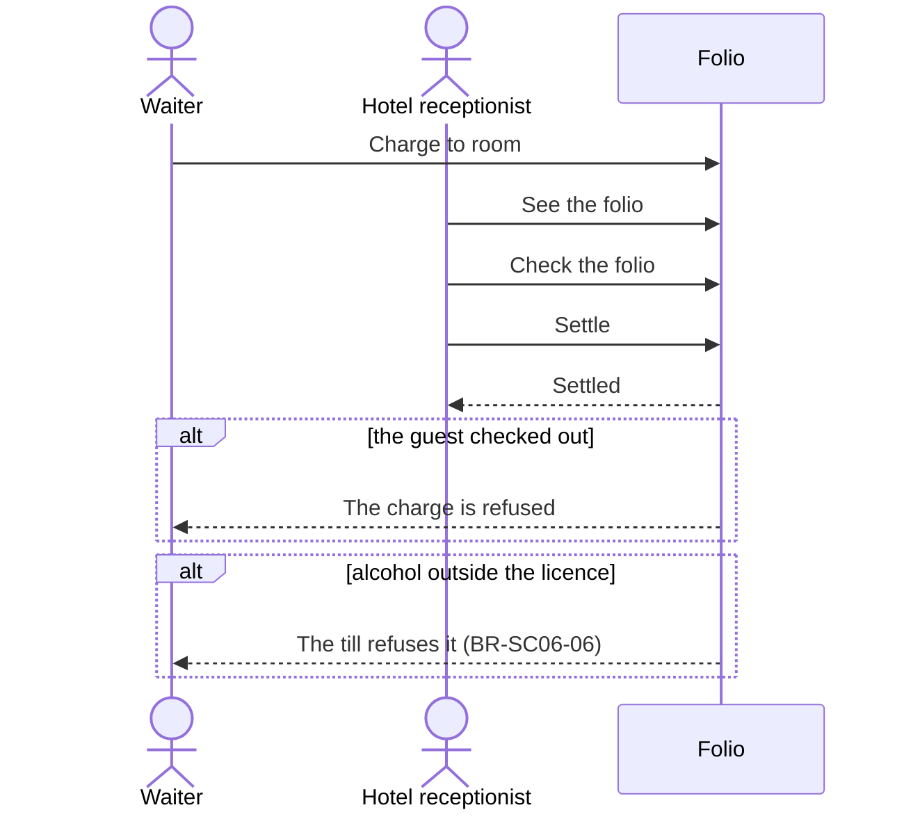

🏠 [Specs](../../../../README.md) › 🏷️ [Sectors](../../../README.md) ›
🍽️ [SC06 Restaurant and hospitality](../../README.md) › 📝 [Use cases](../README.md) ›
📝 [Use cases: FL-SC06-04 Stay and folio](README.md) › 📝 UC-SC06-11 Merge room, restaurant and bar on one folio

# 📝 UC-SC06-11 Merge room, restaurant and bar on one folio

**Status:** ✅ specified

## Summary

Waiters charge restaurant and bar bills to a guest's room; the receptionist sees one folio per stay and settles it at
departure.

## Personas

- [U28 Hotel receptionist](../../../../01-users/personas/u28-hotel-receptionist.md)
- [U18 Waiter](../../../../01-users/personas/u18-waiter.md)

## Goal

One bill per stay, nothing left unbilled.

## Trigger

A guest charges to the room.

## Frequency

Many a day.

## Preconditions

- The SC06 sector pack is installed for the company,
  [UC-F14-02](../../../../02-functional/f14-plugin-store/use-cases/01-find-and-install/uc-f14-02-install-a-plugin-or-sector-pack.md),
  and its users have their roles,
  [UC-F1-06](../../../../02-functional/f01-administration/use-cases/04-edit-a-role/uc-f01-06-edit-a-role-and-its-record-rules.md).

## Postconditions

- **Success:** the charge is on the folio.
- **Failed:** the charge is paid at the till.

## Main flow

1. The waiter charges the bill to the room at the till,
   [UC-F10-03](../../../../02-functional/f10-point-of-sale/use-cases/02-sell-at-the-counter/uc-f10-03-take-payment.md).
2. The receptionist sees it on [S-SC06-11 Folio](../../screens/04-stay-and-folio/s-sc06-11-folio.md).
3. The receptionist checks charges before departure.
4. The folio is settled ([BR-SC06-11](../../business-rules/br-sc06-11-one-folio-per-stay.md)).

## Alternative flows

- 4a. A split folio: company and private charges are split between payers.

## Error flows

- 1e. The guest checked out: the charge is refused.
- 1f. Alcohol outside the licence: the till refuses it
  ([BR-SC06-06](../../business-rules/br-sc06-06-alcohol-sold-within-the-licence.md)).
- Any step: a call to a service or an outside system fails: it is retried first
  ([BR-F3-32](../../../../02-functional/f03-assistant/business-rules/br-f03-32-retry-before-an-error.md)), then the
  error message pattern ([D122](../../../../06-decisions/ux/d122-error-message-standard.md)) says what failed; what was
  typed is kept.

## Business rules

- [BR-SC06-11 One folio per stay](../../business-rules/br-sc06-11-one-folio-per-stay.md)
- [BR-SC06-06 Alcohol sold within the licence](../../business-rules/br-sc06-06-alcohol-sold-within-the-licence.md)

## Entities

- [E-SC06-09 Folio](../../data/e-sc06-09-folio.md)

## Permissions

The hotel receptionist and waiter roles; the record rules of their role and site apply,
[UC-F1-06](../../../../02-functional/f01-administration/use-cases/04-edit-a-role/uc-f01-06-edit-a-role-and-its-record-rules.md).

## Notifications

None beyond the in-app updates of the records concerned.

## Audit events

Every creation, change and state change of folio records, with who, when and the values before and after (T3).

## AI involvement

The AI assistant answers questions on the folio records of this use case, with links, and prepares them as drafts the
user confirms. It works within the user's rights,
[BR-F3-34](../../../../02-functional/f03-assistant/business-rules/br-f03-34-every-capability-is-reachable-from-the-assistant.md),
and never deletes or does anything irreversible without the user's confirmation,
[BR-F3-07](../../../../02-functional/f03-assistant/business-rules/br-f03-07-no-deletes-no-irreversible-acts.md).

## API, MCP and A2A exposure

Through the API and webhooks (T5) and the MCP and A2A gateway (T6), with the caller's rights,
[BR-F3-34](../../../../02-functional/f03-assistant/business-rules/br-f03-34-every-capability-is-reachable-from-the-assistant.md),
reading, creating and changing the records of this use case; nothing irreversible without a person's confirmation.

## Screens

- [S-SC06-11 Folio](../../screens/04-stay-and-folio/s-sc06-11-folio.md)

## Flowchart

See [FL-SC06-04 Stay and folio](../../flows/fl-sc06-04-stay-and-folio.md#flowchart).

## Sequence diagram

## Acceptance criteria

1. **Given** the example restaurant group's bar bill of 18 EUR to room 214 **when** it is charged **then** folio B-881
   shows 18 EUR bar.
2. **Given** a bar bill to room 214 after check-out **when** it is charged **then** the charge is refused.

## Non-functional notes

[D408](../../../../06-decisions/technical/d408-performance-and-profiles.md)'s targets
([performance](../../../../05-non-functional/performance.md)): 95 % of screens within 1 second; lists paged on the
server, the first page within 1 second; reports within 5 seconds or in the background. WCAG 2.2 AA and RGAA
([D46](../../../../06-decisions/ux/d46-accessibility-standard.md)).

## Regulatory references

Legal values from the France country pack:
[CR-FR-109 Alcohol licences](../../../../10-country-packs/france/hospitality/cr-fr-109-alcohol-licences.md).

## Related use cases

- [UC-SC06-09 Check guests in and out](uc-sc06-09-check-guests-in-and-out.md)

## Open questions

None.

---

⬅️ [UC-SC06-10 Run housekeeping](uc-sc06-10-run-housekeeping.md) · ⬆️ [Up](README.md) ·
➡️ [UC-SC06-12 Collect the tourist tax](../05-taxes-and-performance/uc-sc06-12-collect-the-tourist-tax.md)
