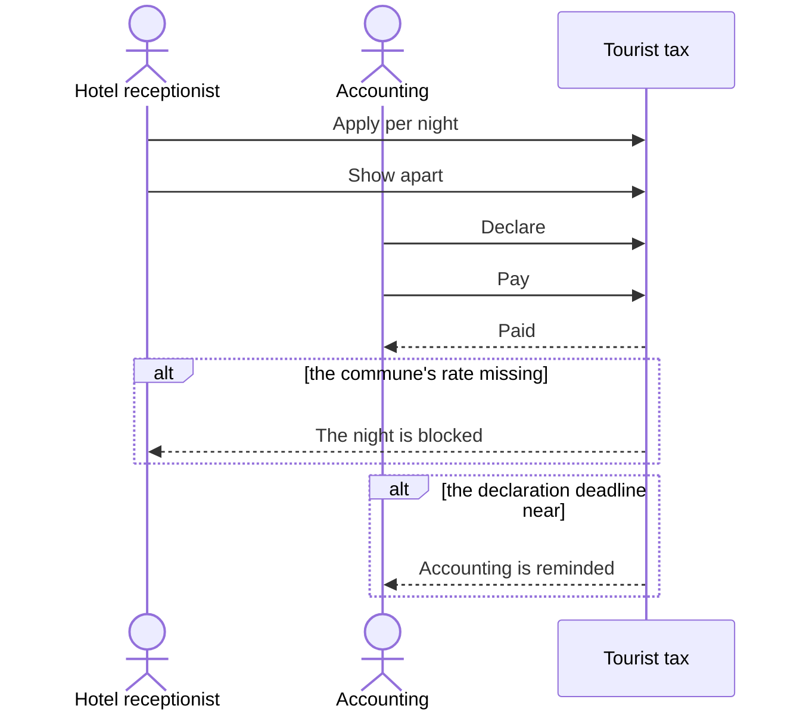

🏠 [Specs](../../../../README.md) › 🏷️ [Sectors](../../../README.md) ›
🍽️ [SC06 Restaurant and hospitality](../../README.md) › 📝 [Use cases](../README.md) ›
📝 [Use cases: FL-SC06-05 Taxes and performance](README.md) › 📝 UC-SC06-12 Collect the tourist tax

# 📝 UC-SC06-12 Collect the tourist tax

**Status:** ✅ specified

## Summary

Each taxable night carries the commune's tourist tax, shown apart on the folio; accounting declares and pays it.

## Personas

- [U28 Hotel receptionist](../../../../01-users/personas/u28-hotel-receptionist.md)
- [U05 Accounting](../../../../01-users/personas/u05-accounting.md)

## Goal

The tourist tax collected and paid right.

## Trigger

Each night; each declaration period.

## Frequency

Nightly; declared per the commune.

## Preconditions

- The SC06 sector pack is installed for the company,
  [UC-F14-02](../../../../02-functional/f14-plugin-store/use-cases/01-find-and-install/uc-f14-02-install-a-plugin-or-sector-pack.md),
  and its users have their roles,
  [UC-F1-06](../../../../02-functional/f01-administration/use-cases/04-edit-a-role/uc-f01-06-edit-a-role-and-its-record-rules.md).

## Postconditions

- **Success:** the tax is collected and declared.
- **Failed:** the declaration is held.

## Main flow

1. Each taxable night gets the tax on
   [S-SC06-12 Tourist tax](../../screens/05-taxes-and-performance/s-sc06-12-tourist-tax.md)
   ([BR-SC06-12](../../business-rules/br-sc06-12-tourist-tax-on-every-night.md)).
2. The folio shows it apart.
3. Accounting declares the period's nights.
4. Accounting pays the commune,
   [UC-F8-04](../../../../02-functional/f08-accounting/use-cases/02-purchase-to-pay/uc-f08-04-pay-suppliers.md).

## Alternative flows

- 1a. Exempt guests: minors and other exempt guests carry no tax.

## Error flows

- 1e. The commune's rate missing: the night is blocked.
- 3e. The declaration deadline near: accounting is reminded.
- Any step: a call to a service or an outside system fails: it is retried first
  ([BR-F3-32](../../../../02-functional/f03-assistant/business-rules/br-f03-32-retry-before-an-error.md)), then the
  error message pattern ([D122](../../../../06-decisions/ux/d122-error-message-standard.md)) says what failed; what was
  typed is kept.

## Business rules

- [BR-SC06-12 Tourist tax on every night](../../business-rules/br-sc06-12-tourist-tax-on-every-night.md)

## Entities

- [E-SC06-11 Tourist tax line](../../data/e-sc06-11-tourist-tax-line.md)

## Permissions

The hotel receptionist and accounting roles; the record rules of their role and site apply,
[UC-F1-06](../../../../02-functional/f01-administration/use-cases/04-edit-a-role/uc-f01-06-edit-a-role-and-its-record-rules.md).

## Notifications

None beyond the in-app updates of the records concerned.

## Audit events

Every creation, change and state change of tourist tax line records, with who, when and the values before and after
(T3).

## AI involvement

The AI assistant answers questions on the tourist tax line records of this use case, with links, and prepares them as
drafts the user confirms. It works within the user's rights,
[BR-F3-34](../../../../02-functional/f03-assistant/business-rules/br-f03-34-every-capability-is-reachable-from-the-assistant.md),
and never deletes or does anything irreversible without the user's confirmation,
[BR-F3-07](../../../../02-functional/f03-assistant/business-rules/br-f03-07-no-deletes-no-irreversible-acts.md).

## API, MCP and A2A exposure

Through the API and webhooks (T5) and the MCP and A2A gateway (T6), with the caller's rights,
[BR-F3-34](../../../../02-functional/f03-assistant/business-rules/br-f03-34-every-capability-is-reachable-from-the-assistant.md),
reading, creating and changing the records of this use case; nothing irreversible without a person's confirmation.

## Screens

- [S-SC06-12 Tourist tax](../../screens/05-taxes-and-performance/s-sc06-12-tourist-tax.md)

## Flowchart

See [FL-SC06-05 Taxes and performance](../../flows/fl-sc06-05-taxes-and-performance.md#flowchart).

## Sequence diagram

## Acceptance criteria

1. **Given** the example restaurant group's B-881 with 2 nights, 2 adults, rate 2.30 EUR **when** the folio is built
   **then** the tax shows 9.20 EUR apart.
2. **Given** a new year without the rate **when** a night is billed **then** the night is blocked.

## Non-functional notes

[D408](../../../../06-decisions/technical/d408-performance-and-profiles.md)'s targets
([performance](../../../../05-non-functional/performance.md)): 95 % of screens within 1 second; lists paged on the
server, the first page within 1 second; reports within 5 seconds or in the background. WCAG 2.2 AA and RGAA
([D46](../../../../06-decisions/ux/d46-accessibility-standard.md)).

## Regulatory references

Legal values from the France country pack:
[CR-FR-111 Tourist tax (taxe de séjour)](../../../../10-country-packs/france/tax-and-vat/cr-fr-111-tourist-tax.md).

## Related use cases

- [UC-SC06-09 Check guests in and out](../04-stay-and-folio/uc-sc06-09-check-guests-in-and-out.md)

## Open questions

None.

---

⬅️ [UC-SC06-11](../04-stay-and-folio/uc-sc06-11-merge-room-restaurant-and-bar-on-one-folio.md) · ⬆️ [Up](README.md) ·
➡️ [UC-SC06-13 Accept meal vouchers](uc-sc06-13-accept-meal-vouchers.md)
