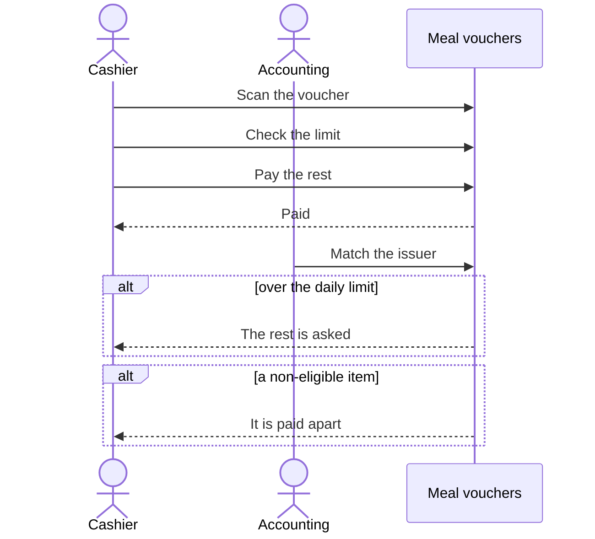

🏠 [Specs](../../../../README.md) › 🏷️ [Sectors](../../../README.md) ›
🍽️ [SC06 Restaurant and hospitality](../../README.md) › 📝 [Use cases](../README.md) ›
📝 [Use cases: FL-SC06-05 Taxes and performance](README.md) › 📝 UC-SC06-13 Accept meal vouchers

# 📝 UC-SC06-13 Accept meal vouchers

**Status:** ✅ specified

## Summary

The cashier or waiter accepts meal vouchers at the till within the daily limit and for eligible food, and the guest pays
the rest.

## Personas

- [U17 Cashier](../../../../01-users/personas/u17-cashier.md)
- [U18 Waiter](../../../../01-users/personas/u18-waiter.md)
- [U05 Accounting](../../../../01-users/personas/u05-accounting.md)

## Goal

Vouchers accepted within the rules.

## Trigger

A guest pays with a meal voucher.

## Frequency

Many at lunch.

## Preconditions

- The SC06 sector pack is installed for the company,
  [UC-F14-02](../../../../02-functional/f14-plugin-store/use-cases/01-find-and-install/uc-f14-02-install-a-plugin-or-sector-pack.md),
  and its users have their roles,
  [UC-F1-06](../../../../02-functional/f01-administration/use-cases/04-edit-a-role/uc-f01-06-edit-a-role-and-its-record-rules.md).

## Postconditions

- **Success:** the voucher pays its eligible part and the rest is paid.
- **Failed:** the voucher is refused.

## Main flow

1. The cashier scans the card voucher on
   [S-SC06-13 Meal vouchers](../../screens/05-taxes-and-performance/s-sc06-13-meal-vouchers.md),
   [UC-F10-21](../../../../02-functional/f10-point-of-sale/use-cases/08-vouchers-and-age-checks/uc-f10-21-accept-meal-vouchers-within-the-daily-cap.md).
2. The till checks the daily limit and eligible items
   ([BR-SC06-14](../../business-rules/br-sc06-14-meal-vouchers-within-limits.md)).
3. The guest pays the rest another way.
4. Accounting matches the issuer's payment,
   [UC-F10-24](../../../../02-functional/f10-point-of-sale/use-cases/09-cash-and-settlements/uc-f10-24-match-card-terminal-settlements-net-of-fees.md).

## Alternative flows

- 1a. Paper vouchers: they are counted and sent to the issuer.

## Error flows

- 2e. Over the daily limit: the rest is asked.
- 2f. A non-eligible item: it is paid apart.
- Any step: a call to a service or an outside system fails: it is retried first
  ([BR-F3-32](../../../../02-functional/f03-assistant/business-rules/br-f03-32-retry-before-an-error.md)), then the
  error message pattern ([D122](../../../../06-decisions/ux/d122-error-message-standard.md)) says what failed; what was
  typed is kept.

## Business rules

- [BR-SC06-14 Meal vouchers within limits](../../business-rules/br-sc06-14-meal-vouchers-within-limits.md)

## Entities

- [E-SC06-12 Meal voucher payment](../../data/e-sc06-12-meal-voucher-payment.md)

## Permissions

The cashier, waiter and accounting roles; the record rules of their role and site apply,
[UC-F1-06](../../../../02-functional/f01-administration/use-cases/04-edit-a-role/uc-f01-06-edit-a-role-and-its-record-rules.md).

## Notifications

None beyond the in-app updates of the records concerned.

## Audit events

Every creation, change and state change of meal voucher payment records, with who, when and the values before and after
(T3).

## AI involvement

The AI assistant answers questions on the meal voucher payment records of this use case, with links, and prepares them
as drafts the user confirms. It works within the user's rights,
[BR-F3-34](../../../../02-functional/f03-assistant/business-rules/br-f03-34-every-capability-is-reachable-from-the-assistant.md),
and never deletes or does anything irreversible without the user's confirmation,
[BR-F3-07](../../../../02-functional/f03-assistant/business-rules/br-f03-07-no-deletes-no-irreversible-acts.md).

## API, MCP and A2A exposure

Through the API and webhooks (T5) and the MCP and A2A gateway (T6), with the caller's rights,
[BR-F3-34](../../../../02-functional/f03-assistant/business-rules/br-f03-34-every-capability-is-reachable-from-the-assistant.md),
reading, creating and changing the records of this use case; nothing irreversible without a person's confirmation.

## Screens

- [S-SC06-13 Meal vouchers](../../screens/05-taxes-and-performance/s-sc06-13-meal-vouchers.md)

## Flowchart

See [FL-SC06-05 Taxes and performance](../../flows/fl-sc06-05-taxes-and-performance.md#flowchart).

## Sequence diagram

## Acceptance criteria

1. **Given** the example restaurant group's lunch order 2026-000184 of 18 EUR **when** a voucher pays 12 EUR **then** 6
   EUR is left to pay.
2. **Given** a voucher for 30 EUR on a 30 EUR bill **when** the limit is lower **then** the rest is asked.

## Non-functional notes

[D408](../../../../06-decisions/technical/d408-performance-and-profiles.md)'s targets
([performance](../../../../05-non-functional/performance.md)): 95 % of screens within 1 second; lists paged on the
server, the first page within 1 second; reports within 5 seconds or in the background. WCAG 2.2 AA and RGAA
([D46](../../../../06-decisions/ux/d46-accessibility-standard.md)).

## Regulatory references

Legal values from the France country pack:
[CR-FR-112 Meal vouchers (titres-restaurant)](../../../../10-country-packs/france/payments/cr-fr-112-meal-vouchers.md).

## Related use cases

- [UC-SC06-14 Follow occupancy, revenue per room and covers](uc-sc06-14-follow-occupancy-revenue-per-room-and-covers.md)

## Open questions

None.

---

⬅️ [UC-SC06-12 Collect the tourist tax](uc-sc06-12-collect-the-tourist-tax.md) · ⬆️ [Up](README.md) ·
➡️ [UC-SC06-14](uc-sc06-14-follow-occupancy-revenue-per-room-and-covers.md)
