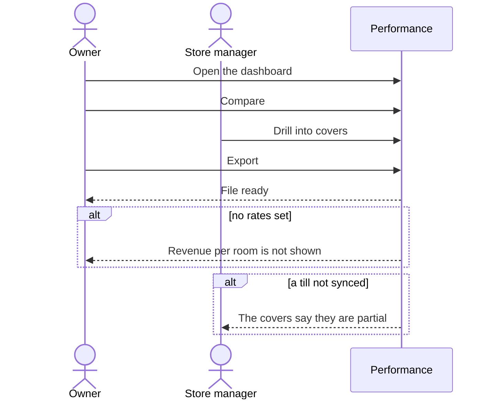

🏠 [Specs](../../../../README.md) › 🏷️ [Sectors](../../../README.md) ›
🍽️ [SC06 Restaurant and hospitality](../../README.md) › 📝 [Use cases](../README.md) ›
📝 [Use cases: FL-SC06-05 Taxes and performance](README.md) › 📝 UC-SC06-14 Follow occupancy, revenue per room and covers

# 📝 UC-SC06-14 Follow occupancy, revenue per room and covers

**Status:** ✅ specified

## Summary

The owner and managers follow occupancy, average rate, revenue per available room and covers, and compare venues.

## Personas

- [U13 Owner](../../../../01-users/personas/u13-owner.md)
- [U23 Store manager](../../../../01-users/personas/u23-store-manager.md)

## Goal

Know how each venue performs.

## Trigger

Daily look, monthly review.

## Frequency

Daily.

## Preconditions

- The SC06 sector pack is installed for the company,
  [UC-F14-02](../../../../02-functional/f14-plugin-store/use-cases/01-find-and-install/uc-f14-02-install-a-plugin-or-sector-pack.md),
  and its users have their roles,
  [UC-F1-06](../../../../02-functional/f01-administration/use-cases/04-edit-a-role/uc-f01-06-edit-a-role-and-its-record-rules.md).

## Postconditions

- **Success:** figures are read and compared.
- **Failed:** missing figures are shown with the reason.

## Main flow

1. The owner opens [S-SC06-14 Performance](../../screens/05-taxes-and-performance/s-sc06-14-performance.md).
2. The owner compares venues and periods.
3. The manager sees covers by service,
   [UC-F10-28](../../../../02-functional/f10-point-of-sale/use-cases/11-store-reports/uc-f10-28-read-hourly-sales-staff-performance-and-basket-analysis.md).
4. The owner exports.

## Alternative flows

- 2a. A forecast: next month's occupancy from bookings on hand.

## Error flows

- 1e. No rates set: revenue per room is not shown.
- 3e. A till not synced: the covers say they are partial.
- Any step: a call to a service or an outside system fails: it is retried first
  ([BR-F3-32](../../../../02-functional/f03-assistant/business-rules/br-f03-32-retry-before-an-error.md)), then the
  error message pattern ([D122](../../../../06-decisions/ux/d122-error-message-standard.md)) says what failed; what was
  typed is kept.

## Business rules

- [BR-SC06-10 Rates by date and room type](../../business-rules/br-sc06-10-rates-by-date-and-room-type.md)

## Entities

- [E-SC06-07 Rate plan](../../data/e-sc06-07-rate-plan.md)
- [E-SC06-09 Folio](../../data/e-sc06-09-folio.md)

## Permissions

The owner and store manager roles; the record rules of their role and site apply,
[UC-F1-06](../../../../02-functional/f01-administration/use-cases/04-edit-a-role/uc-f01-06-edit-a-role-and-its-record-rules.md).

## Notifications

None beyond the in-app updates of the records concerned.

## Audit events

Every creation, change and state change of rate plan, folio records, with who, when and the values before and after
(T3).

## AI involvement

The AI assistant answers questions on the rate plan, folio records of this use case, with links, and prepares them as
drafts the user confirms. It works within the user's rights,
[BR-F3-34](../../../../02-functional/f03-assistant/business-rules/br-f03-34-every-capability-is-reachable-from-the-assistant.md),
and never deletes or does anything irreversible without the user's confirmation,
[BR-F3-07](../../../../02-functional/f03-assistant/business-rules/br-f03-07-no-deletes-no-irreversible-acts.md).

## API, MCP and A2A exposure

Through the API and webhooks (T5) and the MCP and A2A gateway (T6), with the caller's rights,
[BR-F3-34](../../../../02-functional/f03-assistant/business-rules/br-f03-34-every-capability-is-reachable-from-the-assistant.md),
reading, creating and changing the records of this use case; nothing irreversible without a person's confirmation.

## Screens

- [S-SC06-14 Performance](../../screens/05-taxes-and-performance/s-sc06-14-performance.md)

## Flowchart

See [FL-SC06-05 Taxes and performance](../../flows/fl-sc06-05-taxes-and-performance.md#flowchart).

## Sequence diagram

## Acceptance criteria

1. **Given** the example restaurant group's hotel with 30 rooms, 24 sold at 145 EUR on a Saturday **when** the day is
   shown **then** occupancy is 80 % and revenue per available room 116 EUR.
2. **Given** a new hotel without rates **when** the dashboard opens **then** revenue per room is not shown.

## Non-functional notes

[D408](../../../../06-decisions/technical/d408-performance-and-profiles.md)'s targets
([performance](../../../../05-non-functional/performance.md)): 95 % of screens within 1 second; lists paged on the
server, the first page within 1 second; reports within 5 seconds or in the background. WCAG 2.2 AA and RGAA
([D46](../../../../06-decisions/ux/d46-accessibility-standard.md)).

## Regulatory references

None specific to this use case; the sector's legal rules are listed in [SC06 regulatory](../../regulatory.md).

## Related use cases

- [UC-SC06-07 Manage rooms, room types and rates](../03-rooms-and-bookings/uc-sc06-07-manage-rooms-room-types-and-rates.md)

## Open questions

None.

---

⬅️ [UC-SC06-13 Accept meal vouchers](uc-sc06-13-accept-meal-vouchers.md) · ⬆️ [Up](README.md) ·
➡️ [UC-SC06-15](../03-rooms-and-bookings/uc-sc06-15-ask-the-assistant-about-the-hotel-or-restaurant.md)
