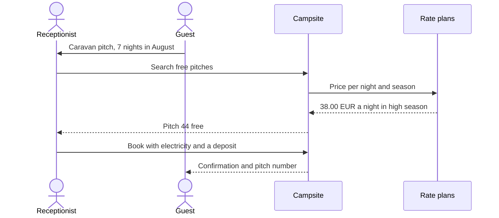

🏠 [Specs](../../../../README.md) › 🏷️ [Sectors](../../../README.md) ›
🍽️ [SC06 Restaurant and hospitality](../../README.md) › 📝 [Use cases](../README.md) ›
📝 [Use cases: FL-SC06-06 Campsites, catering, groups, pricing and licences](README.md) ›
📝 UC-SC06-16 Rent campsite pitches

# 📝 UC-SC06-16 Rent campsite pitches

**Status:** ✅ specified

## Summary

A campsite manages pitches rather than rooms: each pitch has a type, an area, an electric supply and a price that
follows the season grid. The receptionist books pitches for tents, caravans, motorhomes and mobile homes, the guest
books and pays from the phone, and the tourist tax and the options (electricity, dog, extra vehicle) are added to the
stay.

## Personas

- [U28 Hotel receptionist](../../../../01-users/personas/u28-hotel-receptionist.md)
- [U09 Customer](../../../../01-users/personas/u09-customer.md)

## Goal

Every pitch is sold at the price of its season, type and number of people, with the tourist tax and options on the bill,
and no pitch is booked twice for the same night.

## Trigger

A guest asks for a pitch, the season grid changes, or a guest arrives or leaves.

## Frequency

Dozens of bookings a day in summer, with a few weeks of high season.

## Preconditions

- The pitches are entered with their type and equipment ([E-SC06-13 Pitch](../../data/e-sc06-13-pitch.md)).
- The season grid and the options are entered in the rate plans
  ([E-SC06-07 Rate plan](../../data/e-sc06-07-rate-plan.md)).
- The classification of the campsite is entered for the tourist tax
  ([E-SC06-11 Tourist tax line](../../data/e-sc06-11-tourist-tax-line.md)).

## Postconditions

- **Succeeded:** the pitch is booked ([E-SC06-08 Room reservation](../../data/e-sc06-08-room-reservation.md)) for its
  nights at the price of its season, with the options and the tourist tax added to the folio
  ([E-SC06-09 Folio](../../data/e-sc06-09-folio.md)).
- **Failed:** the pitch stays free, no folio is opened and the reason (not available, no price for the date) is shown.

## Main flow

1. The receptionist opens the campsite screen
   ([S-SC06-16](../../screens/06-campsites-catering-groups-and-pricing/s-sc06-16-campsite.md)) and chooses the dates and
   the type of pitch.
2. simple-ERP lists the free pitches of that type with the price of each night from the season grid
   ([BR-SC06-16](../../business-rules/br-sc06-16-pitch-prices-follow-the-season-grid.md)).
3. The receptionist chooses a pitch, adds the people, the vehicles and the options, and takes a deposit.
4. The guest receives the confirmation with the pitch number and the arrival instructions on the phone.
5. At arrival the receptionist checks the guest in on the pitch
   ([UC-SC06-09](../04-stay-and-folio/uc-sc06-09-check-guests-in-and-out.md)) and notes the vehicle plate.
6. At departure the folio is closed with the nights, the options and the tourist tax
   ([UC-SC06-11](../04-stay-and-folio/uc-sc06-11-merge-room-restaurant-and-bar-on-one-folio.md)).

## Alternative flows

- 2a. The guest has no preference: simple-ERP proposes the free pitch that leaves the fewest gaps in the calendar.
- 3a. The stay spans two seasons: each night is priced at its own season.
- 5a. The guest leaves early: the unused nights are refunded or kept according to the rate plan's conditions.

## Error flows

- 2e. No price exists for a date in the grid: the booking is refused and the grid gap is named.
- 3e. The pitch is too small for the vehicle and the awning declared: the receptionist is warned and proposes a larger
  one.
- 5e. A foreign guest has no registration form on arrival: check-in is held until it is completed.
- Any step: a service does not answer; the call is retried first
  ([BR-F3-32](../../../../02-functional/f03-assistant/business-rules/br-f03-32-retry-before-an-error.md)), then the
  message follows the error pattern ([D122](../../../../06-decisions/ux/d122-error-message-standard.md)) and what the
  user typed stays on the screen.

## Business rules

- [BR-SC06-16](../../business-rules/br-sc06-16-pitch-prices-follow-the-season-grid.md)
- [BR-SC06-12](../../business-rules/br-sc06-12-tourist-tax-on-every-night.md)

## Entities

- [E-SC06-13 Pitch](../../data/e-sc06-13-pitch.md): created, changed
- [E-SC06-08 Room reservation](../../data/e-sc06-08-room-reservation.md): created, the booking of the pitch
- [E-SC06-07 Rate plan](../../data/e-sc06-07-rate-plan.md): read, the season grid and the options
- [E-SC06-11 Tourist tax line](../../data/e-sc06-11-tourist-tax-line.md): created, the tourist tax per adult and night

## Permissions

Receptionist books, checks in and out, and changes the grid when allowed. The owner reads the occupancy by
type; the guest sees only their own booking.

## Notifications

The guest, by email and SMS: the confirmation, the arrival instructions and a reminder two days before. The
receptionist, in the app: a pitch is blocked by maintenance on a booked night.

## Audit events

Each booking, price computed with its season, option, deposit, check-in, check-out and refund, who and when.

## AI involvement

No AI step of its own. The AI assistant may open the screen and prefill it from the user's words; the user checks and
confirms
[BR-F3-07](../../../../02-functional/f03-assistant/business-rules/br-f03-07-no-deletes-no-irreversible-acts.md).

## API, MCP and A2A exposure

T5 operations of the capability for the personas above: create, read, update and list. The MCP tool of the
capability may read and propose, never confirm alone. No A2A skill.

## Screens

- [S-SC06-16](../../screens/06-campsites-catering-groups-and-pricing/s-sc06-16-campsite.md)

## Flowchart

See
[FL-SC06-06 Campsites, catering, groups, pricing and licences](../../flows/fl-sc06-06-campsites-catering-groups-and-pricing.md#flowchart).

## Sequence diagram

## Acceptance criteria

1. **Given** a high-season price of 38.00 EUR a night for a caravan pitch and 7 nights **when** the pitch is booked with
   electricity at 4.50 EUR a night **then** the stay shows 297.50 EUR before the tourist tax.
2. **Given** a stay of 5 nights that starts in mid season and ends in high season **when** the price is computed
   **then** each night is priced at its own season.
3. **Given** a pitch already booked for one night of the stay **when** the receptionist chooses it **then** it is not
   offered for those dates.
4. **Given** a date with no price in the grid **when** the receptionist searches **then** no pitch is offered and the
   grid gap is named.

## Non-functional notes

The screen answers within 2 seconds for 10,000 records; every change is audited.

## Regulatory references

A campsite collects the tourist tax for each adult and each night at the rate of the commune, which depends
on the classification of the campsite, and pays it to the commune. Guests from outside the country fill in a
registration form on arrival. Prices shown to consumers include VAT and the tourist tax is shown apart. The France-pack
rule is written later. Related: [CR-FR-111](../../../../10-country-packs/france/tax-and-vat/cr-fr-111-tourist-tax.md),
[CR-FR-034](../../../../10-country-packs/france/consumer/cr-fr-034-prices-shown-including-vat.md),
[CR-FR-008 VAT rates](../../../../10-country-packs/france/tax-and-vat/cr-fr-008-vat-rates.md).

## Related use cases

- [UC-SC06-17 Quote and deliver catering](uc-sc06-17-quote-and-deliver-catering.md)
- [UC-SC06-08](../03-rooms-and-bookings/uc-sc06-08-take-bookings-directly-and-through-channel-managers.md)
- [UC-SC06-12](../05-taxes-and-performance/uc-sc06-12-collect-the-tourist-tax.md)
- [UC-F11-07](../../../../02-functional/f11-online-shop/use-cases/02-shop-and-check-out/uc-f11-07-choose-delivery-or-click-collect.md)

## Open questions

None.

---

⬅️ [UC-SC06-15](../03-rooms-and-bookings/uc-sc06-15-ask-the-assistant-about-the-hotel-or-restaurant.md) ·
⬆️ [Up](README.md) · ➡️ [UC-SC06-17 Quote and deliver catering](uc-sc06-17-quote-and-deliver-catering.md)
