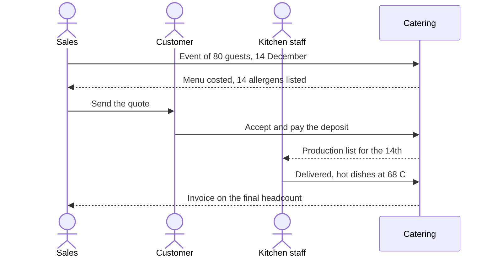

🏠 [Specs](../../../../README.md) › 🏷️ [Sectors](../../../README.md) ›
🍽️ [SC06 Restaurant and hospitality](../../README.md) › 📝 [Use cases](../README.md) ›
📝 [Use cases: FL-SC06-06 Campsites, catering, groups, pricing and licences](README.md) ›
📝 UC-SC06-17 Quote and deliver catering

# 📝 UC-SC06-17 Quote and deliver catering

**Status:** ✅ specified

## Summary

A restaurant or caterer prepares meals for an event away from its kitchen. Sales quotes the menu per head, the allergens
of each dish, the staff, the equipment hire and the delivery, the customer accepts, and the kitchen prepares and
delivers on the day with the cold chain recorded.

## Personas

- [U03 Sales](../../../../01-users/personas/u03-sales.md)
- [U19 Kitchen staff](../../../../01-users/personas/u19-kitchen-staff.md)

## Goal

Every catering quote lists the allergens of its dishes, is costed from the recipes, and is delivered at the agreed time
and temperature.

## Trigger

A customer asks for a quote for an event, accepts it, or the day before the delivery.

## Frequency

A few orders a week, more before the holidays.

## Preconditions

- The dishes and their recipes exist with their allergens ([E-SC06-02 Menu dish](../../data/e-sc06-02-menu-dish.md),
  [E-F12-25 Recipe](../../../../02-functional/f12-manufacturing/data/e-f12-25-recipe.md)).
- The customer is a record
  ([E-F6-01](../../../../02-functional/f06-customers-and-sales/data/e-f06-01-customer-record.md)).
- The kitchen's capacity per day is entered in the settings.

## Postconditions

- **Succeeded:** the order is saved ([E-SC06-14 Catering order](../../data/e-sc06-14-catering-order.md)) with its menu,
  headcount, allergens, price, deposit and delivery slot, and the kitchen's production list is ready.
- **Failed:** the quote is not sent while an allergen is missing, and no order is confirmed above the kitchen's capacity
  for the day.

## Main flow

1. Sales opens the catering screen
   ([S-SC06-17](../../screens/06-campsites-catering-groups-and-pricing/s-sc06-17-catering.md)) and enters the event, the
   date, the place and the headcount.
2. Sales chooses dishes and drinks per head: SimpleERP costs them from the recipes and lists their allergens
   ([BR-SC06-17](../../business-rules/br-sc06-17-catering-quotes-list-allergens.md)).
3. Sales adds the staff, the equipment hire and the delivery and sends the quote
   [UC-F6-03](../../../../02-functional/f06-customers-and-sales/use-cases/01-lead-to-quote/uc-f06-03-create-and-send-a-quote.md).
4. The customer accepts and pays the deposit
   [UC-F6-04](../../../../02-functional/f06-customers-and-sales/use-cases/02-quote-to-order/uc-f06-04-accept-or-sign-a-quote.md).
5. The kitchen sees the production list and the shopping needs for the day
   [UC-F7-05](../../../../02-functional/f07-purchasing-and-stock/use-cases/03-replenish/uc-f07-05-replenish-stock.md).
6. On the day the kitchen staff record the departure, the temperatures and the delivery, and the order is invoiced for
   the final headcount.

## Alternative flows

- 3a. The customer asks for a vegetarian or halal variant: a second menu is priced for part of the headcount.
- 6a. The final headcount is smaller by up to 10 percent: the invoice follows the minimum stated in the quote.
- 4a. The customer refuses the quote: it is Lost with the reason.

## Error flows

- 2e. A dish has no allergen list: it cannot be added to the quote until its recipe is completed.
- 4e. The date is above the kitchen's capacity: sales is told and proposes another date.
- 6e. A temperature outside the limit is recorded on delivery: the kitchen staff are asked for the action taken and the
  order is flagged.
- Any step: a service does not answer; the call is retried first
  ([BR-F3-32](../../../../02-functional/f03-assistant/business-rules/br-f03-32-retry-before-an-error.md)), then the
  message follows the error pattern ([D122](../../../../06-decisions/ux/d122-error-message-standard.md)) and what the
  user typed stays on the screen.

## Business rules

- [BR-SC06-17](../../business-rules/br-sc06-17-catering-quotes-list-allergens.md)
- [BR-SC06-02](../../business-rules/br-sc06-02-dishes-carry-their-allergens.md)

## Entities

- [E-SC06-14 Catering order](../../data/e-sc06-14-catering-order.md): created, changed, delivered
- [E-SC06-02 Menu dish](../../data/e-sc06-02-menu-dish.md): read, the dishes and their allergens
- [E-F6-03 Quote](../../../../02-functional/f06-customers-and-sales/data/e-f06-03-quote.md): created, the quote sent to
  the customer
- [E-SC06-03 Hygiene record](../../data/e-sc06-03-hygiene-record.md): created, the temperature records of the delivery

## Permissions

Sales creates and sends quotes; kitchen staff read the production list and record the delivery. The owner
reads the margin of each order.

## Notifications

The customer, by email: the quote and the reminder of the delivery slot. The kitchen, in the app: an order is confirmed
or changed.

## Audit events

Each quote, change of headcount or menu, allergen list sent, confirmation, temperature and delivery, who and when.

## AI involvement

No AI step of its own. The AI assistant may open the screen and prefill it from the user's words; the user checks and
confirms
[BR-F3-07](../../../../02-functional/f03-assistant/business-rules/br-f03-07-no-deletes-no-irreversible-acts.md).

## API, MCP and A2A exposure

T5 operations of the capability for the personas above: create, read, update and list. The MCP tool of the
capability may read and propose, never confirm alone. No A2A skill.

## Screens

- [S-SC06-17](../../screens/06-campsites-catering-groups-and-pricing/s-sc06-17-catering.md)

## Flowchart

See
[FL-SC06-06 Campsites, catering, groups, pricing and licences](../../flows/fl-sc06-06-campsites-catering-groups-and-pricing.md#flowchart).

## Sequence diagram

## Acceptance criteria

1. **Given** a menu of three dishes for 80 guests with allergens in their recipes **when** sales sends the quote
   **then** the quote lists the allergens of each dish.
2. **Given** a dish whose recipe has no allergen list **when** sales adds it to the quote **then** it is refused until
   the recipe is completed.
3. **Given** a kitchen capacity of 200 meals on a date that already holds 150 **when** an order for 80 guests is
   confirmed **then** the order is refused and another date is proposed.
4. **Given** a final headcount of 72 for 80 guests and a minimum of 90 percent in the quote **when** the order is
   invoiced **then** it is invoiced on 72 guests.

## Non-functional notes

The screen answers within 2 seconds for 10,000 records; every change is audited.

## Regulatory references

A caterer informs the customer in writing about the allergens of every dish before the order is confirmed,
and keeps the hygiene records of the cold and hot chain during transport. The VAT rate differs between food and alcohol
on the same quote. The France-pack rules are [CR-FR-107 Allergen information in restaurants](../../../../10-country-packs/france/consumer/cr-fr-107-allergen-information.md), [CR-FR-110 Food hygiene and its records](../../../../10-country-packs/france/hospitality/cr-fr-110-food-hygiene-records.md) and [CR-FR-008 VAT rates](../../../../10-country-packs/france/tax-and-vat/cr-fr-008-vat-rates.md). Related:
[CR-FR-107](../../../../10-country-packs/france/consumer/cr-fr-107-allergen-information.md),
[CR-FR-110](../../../../10-country-packs/france/hospitality/cr-fr-110-food-hygiene-records.md),
[CR-FR-008 VAT rates](../../../../10-country-packs/france/tax-and-vat/cr-fr-008-vat-rates.md).

## Related use cases

- [UC-SC06-16 Rent campsite pitches](uc-sc06-16-rent-campsite-pitches.md)
- [UC-SC06-18 Book groups and seminars](uc-sc06-18-book-groups-and-seminars.md)
- [UC-SC06-02](../01-menus-and-food-safety/uc-sc06-02-show-allergens-and-the-home-made-label.md)
- [UC-SC06-03](../01-menus-and-food-safety/uc-sc06-03-keep-food-hygiene-records.md)
- [UC-F6-05](../../../../02-functional/f06-customers-and-sales/use-cases/02-quote-to-order/uc-f06-05-turn-a-quote-into-an-order-and-follow-it.md)

## Open questions

None.

---

⬅️ [UC-SC06-16 Rent campsite pitches](uc-sc06-16-rent-campsite-pitches.md) · ⬆️ [Up](README.md) ·
➡️ [UC-SC06-18 Book groups and seminars](uc-sc06-18-book-groups-and-seminars.md)
