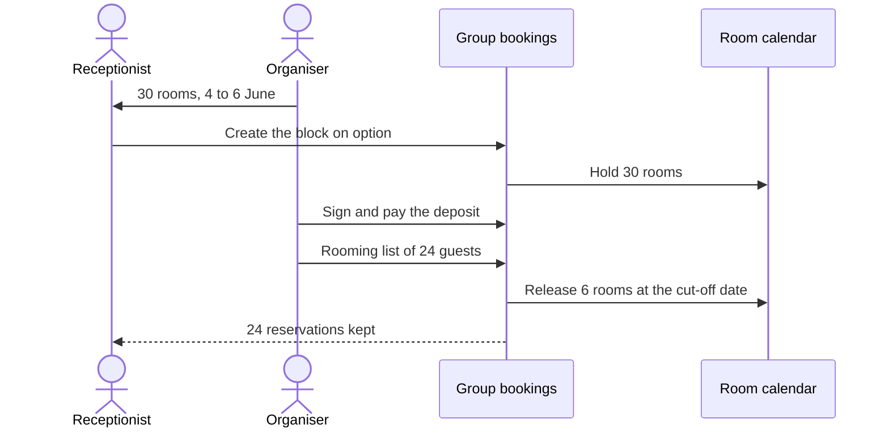

🏠 [Specs](../../../../README.md) › 🏷️ [Sectors](../../../README.md) ›
🍽️ [SC06 Restaurant and hospitality](../../README.md) › 📝 [Use cases](../README.md) ›
📝 [Use cases: FL-SC06-06 Campsites, catering, groups, pricing and licences](README.md) ›
📝 UC-SC06-18 Book groups and seminars

# 📝 UC-SC06-18 Book groups and seminars

**Status:** ✅ specified

## Summary

A hotel sells blocks of rooms to groups and seminars: the receptionist holds an allotment on an option, agrees the rate,
the meeting rooms and the meals with the organiser, receives the rooming list, and releases the rooms the group has not
named at the cut-off date.

## Personas

- [U28 Hotel receptionist](../../../../01-users/personas/u28-hotel-receptionist.md)
- [U09 Customer](../../../../01-users/personas/u09-customer.md)

## Goal

A group has its rooms at the agreed rate, the hotel does not hold unsold rooms past the cut-off date, and every guest of
the rooming list has a reservation.

## Trigger

An organiser asks for a block of rooms, the option date or the cut-off date is reached, or the rooming list arrives.

## Frequency

A few groups a month, several rooms to several dozens each.

## Preconditions

- The room types, rates and calendar exist ([E-SC06-06 Hotel room](../../data/e-sc06-06-hotel-room.md),
  [E-SC06-07 Rate plan](../../data/e-sc06-07-rate-plan.md)).
- The customer or the organiser is a record
  ([E-F6-01](../../../../02-functional/f06-customers-and-sales/data/e-f06-01-customer-record.md)).
- The meeting rooms and meal packages are entered as items.

## Postconditions

- **Succeeded:** the group booking is saved ([E-SC06-15 Group booking](../../data/e-sc06-15-group-booking.md)) with its
  block, rate, dates, deposit and rooming list, and each named guest has a reservation
  ([E-SC06-08 Room reservation](../../data/e-sc06-08-room-reservation.md)).
- **Failed:** the block is released to general sale and no reservation remains held for the group.

## Main flow

1. The receptionist opens the groups screen
   ([S-SC06-18](../../screens/06-campsites-catering-groups-and-pricing/s-sc06-18-groups-and-seminars.md)) and creates
   the group with its dates, the room types, the number of rooms, the rate and the option date.
2. SimpleERP holds the rooms in the calendar and shows the effect on availability.
3. The organiser signs the contract and pays the deposit
   [UC-F6-04](../../../../02-functional/f06-customers-and-sales/use-cases/02-quote-to-order/uc-f06-04-accept-or-sign-a-quote.md)
   and the booking becomes Confirmed.
4. The organiser sends the rooming list on their phone or as a file and the receptionist links each guest to a room
   ([UC-SC06-08](../03-rooms-and-bookings/uc-sc06-08-take-bookings-directly-and-through-channel-managers.md)).
5. At the cut-off date, the rooms with no name are released to general sale
   ([BR-SC06-18](../../business-rules/br-sc06-18-room-blocks-are-released-at-the-cut-off-date.md)).
6. At departure the master bill (rooms, meetings, meals) goes to the organiser and each guest pays their extras on their
   own folio ([UC-SC06-11](../04-stay-and-folio/uc-sc06-11-merge-room-restaurant-and-bar-on-one-folio.md)).

## Alternative flows

- 2a. The organiser asks for more rooms before the cut-off date: SimpleERP adds them if they are free.
- 5a. The contract has an attrition clause: the rooms released below the guaranteed share are still billed.
- 4a. The organiser sends the rooming list late: the receptionist enters it and the release is recomputed.

## Error flows

- 2e. The block asks for more rooms than are free on a night: the receptionist is told the nights that fail and the
  maximum possible.
- 5e. A named guest has no free room left after a release: the receptionist is warned before the release runs.
- 3e. The option date passes with no confirmation: the block lapses and the rooms return to sale.
- Any step: a service does not answer; the call is retried first
  ([BR-F3-32](../../../../02-functional/f03-assistant/business-rules/br-f03-32-retry-before-an-error.md)), then the
  message follows the error pattern ([D122](../../../../06-decisions/ux/d122-error-message-standard.md)) and what the
  user typed stays on the screen.

## Business rules

- [BR-SC06-18](../../business-rules/br-sc06-18-room-blocks-are-released-at-the-cut-off-date.md)
- [BR-SC06-09](../../business-rules/br-sc06-09-no-overbooking-across-channels.md)

## Entities

- [E-SC06-15 Group booking](../../data/e-sc06-15-group-booking.md): created, changed, released
- [E-SC06-08 Room reservation](../../data/e-sc06-08-room-reservation.md): created, one reservation per named guest
- [E-SC06-07 Rate plan](../../data/e-sc06-07-rate-plan.md): read, the group rate
- [E-F6-04 Order](../../../../02-functional/f06-customers-and-sales/data/e-f06-04-order.md): created, the order for the
  group's contract

## Permissions

Receptionist creates and changes group bookings and releases rooms; the organiser sees their own block and enters the
rooming list. The owner reads the groups' revenue.

## Notifications

The organiser, by email: the option ends in three days and the cut-off date is near. The receptionist, in the app: a
rooming list is late.

## Audit events

Each block created, held, changed, confirmed, released or lapsed, with the dates and rooms, who and when.

## AI involvement

No AI step of its own. The AI assistant may open the screen and prefill it from the user's words; the user checks and
confirms
[BR-F3-07](../../../../02-functional/f03-assistant/business-rules/br-f03-07-no-deletes-no-irreversible-acts.md).

## API, MCP and A2A exposure

T5 operations of the capability for the personas above: create, read, update and list. The MCP tool of the
capability may read and propose, never confirm alone. No A2A skill.

## Screens

- [S-SC06-18](../../screens/06-campsites-catering-groups-and-pricing/s-sc06-18-groups-and-seminars.md)

## Flowchart

See
[FL-SC06-06 Campsites, catering, groups, pricing and licences](../../flows/fl-sc06-06-campsites-catering-groups-and-pricing.md#flowchart).

## Sequence diagram

## Acceptance criteria

1. **Given** a block of 30 rooms and a rooming list of 24 names at the cut-off date **when** the date is reached
   **then** 6 rooms are released to general sale and 24 stay held.
2. **Given** an option that ends on 20 May with no confirmation **when** the date passes **then** the block lapses and
   the 30 rooms return to sale.
3. **Given** a block that asks for 12 rooms on a night with 9 free **when** the receptionist saves it **then** the night
   fails and the maximum of 9 is shown.
4. **Given** an attrition clause of 10 percent and 6 rooms released out of 30 **when** the group departs **then** the
   bill includes the rooms below the guaranteed share.

## Non-functional notes

The screen answers within 2 seconds for 10,000 records; every change is audited.

## Regulatory references

A group contract is signed and states the rate, the deposit, the cut-off date, the attrition and the
cancellation terms. The tourist tax is due per guest and night for each named guest. Accommodation carries the reduced
VAT rate and meals and meeting rooms may carry others. The France-pack rule is written later. Related:
[CR-FR-020](../../../../10-country-packs/france/invoicing/cr-fr-020-electronic-acceptance-and-signature.md),
[CR-FR-111](../../../../10-country-packs/france/tax-and-vat/cr-fr-111-tourist-tax.md),
[CR-FR-008 VAT rates](../../../../10-country-packs/france/tax-and-vat/cr-fr-008-vat-rates.md).

## Related use cases

- [UC-SC06-17 Quote and deliver catering](uc-sc06-17-quote-and-deliver-catering.md)
- [UC-SC06-19 Set prices dynamically](uc-sc06-19-set-prices-dynamically.md)
- [UC-SC06-08](../03-rooms-and-bookings/uc-sc06-08-take-bookings-directly-and-through-channel-managers.md)
- [UC-SC06-11](../04-stay-and-folio/uc-sc06-11-merge-room-restaurant-and-bar-on-one-folio.md)
- [UC-F6-29](../../../../02-functional/f06-customers-and-sales/use-cases/10-partners-contracts-and-warranties/uc-f06-29-agree-a-frame-contract-and-call-off-orders.md)

## Open questions

None.

---

⬅️ [UC-SC06-17 Quote and deliver catering](uc-sc06-17-quote-and-deliver-catering.md) · ⬆️ [Up](README.md) ·
➡️ [UC-SC06-19 Set prices dynamically](uc-sc06-19-set-prices-dynamically.md)
