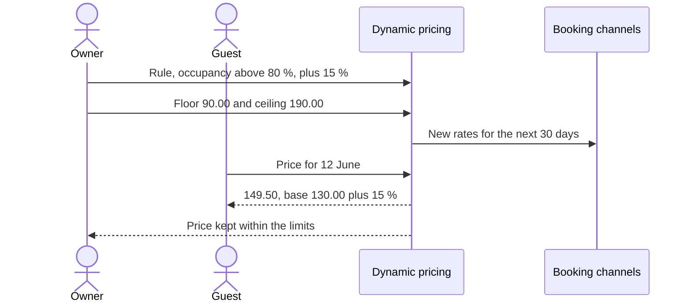

🏠 [Specs](../../../../README.md) › 🏷️ [Sectors](../../../README.md) ›
🍽️ [SC06 Restaurant and hospitality](../../README.md) › 📝 [Use cases](../README.md) ›
📝 [Use cases: FL-SC06-06 Campsites, catering, groups, pricing and licences](README.md) ›
📝 UC-SC06-19 Set prices dynamically

# 📝 UC-SC06-19 Set prices dynamically

**Status:** ✅ specified

## Summary

The owner and the receptionist set rules that move the room rate with demand: occupancy, days before arrival, day of the
week and events in town. Each rule keeps a floor and a ceiling, and the price the guest sees is the one the rules
compute at that time, sent to the booking channels.

## Personas

- [U13 Owner](../../../../01-users/personas/u13-owner.md)
- [U28 Hotel receptionist](../../../../01-users/personas/u28-hotel-receptionist.md)

## Goal

Rates follow demand without ever going under the floor or over the ceiling the owner set, and each price can be
explained.

## Trigger

A rule is created or changed, occupancy crosses a threshold, or a booking asks for a price.

## Frequency

Prices are recomputed every hour and on every booking request.

## Preconditions

- The rooms and the base rate plans exist ([E-SC06-06 Hotel room](../../data/e-sc06-06-hotel-room.md),
  [E-SC06-07 Rate plan](../../data/e-sc06-07-rate-plan.md)).
- The booking channels are connected for rates
  ([UC-SC06-08](../03-rooms-and-bookings/uc-sc06-08-take-bookings-directly-and-through-channel-managers.md)).
- The owner has entered the floor and the ceiling of each room type.

## Postconditions

- **Succeeded:** the rule is saved ([E-SC06-16 Price rule](../../data/e-sc06-16-price-rule.md)) and each price shown
  cites the rule that produced it, within the floor and the ceiling.
- **Failed:** the base rate is kept, no price outside the limits is sent and the broken rule is flagged.

## Main flow

1. The owner opens the dynamic pricing screen
   ([S-SC06-19](../../screens/06-campsites-catering-groups-and-pricing/s-sc06-19-dynamic-pricing.md)) and creates a
   rule: its condition (for example occupancy above 80 percent), its action (plus 15 percent) and the room types.
2. The owner sets the floor and the ceiling of each room type.
3. simple-ERP shows the rule on the next 30 days with the price it would give each night.
4. The owner activates the rule; prices are recomputed and sent to the channels.
5. When a guest asks for a price, simple-ERP applies the active rules in their order of priority and keeps the result
   within the limits ([BR-SC06-19](../../business-rules/br-sc06-19-dynamic-prices-stay-within-floor-and-ceiling.md)).
6. The receptionist sees, beside each price, the rule applied and the base rate.

## Alternative flows

- 3a. Two rules apply to the same night: the rule with the higher priority applies and the other is shown as skipped.
- 5a. An event in town is added to the calendar: the rule for that date raises the rate for the days around it.
- 4a. The owner pauses the rule: prices return to the base rate within the hour.

## Error flows

- 2e. The ceiling is below the floor: the rule cannot be activated.
- 5e. A computed price falls outside the limits: it is cut to the nearest limit and the cut is recorded.
- 4e. A channel refuses the new rate: the rate is retried and the channel is flagged to the receptionist.
- Any step: a service does not answer; the call is retried first
  ([BR-F3-32](../../../../02-functional/f03-assistant/business-rules/br-f03-32-retry-before-an-error.md)), then the
  message follows the error pattern ([D122](../../../../06-decisions/ux/d122-error-message-standard.md)) and what the
  user typed stays on the screen.

## Business rules

- [BR-SC06-19](../../business-rules/br-sc06-19-dynamic-prices-stay-within-floor-and-ceiling.md)
- [BR-SC06-10](../../business-rules/br-sc06-10-rates-by-date-and-room-type.md)

## Entities

- [E-SC06-16 Price rule](../../data/e-sc06-16-price-rule.md): created, changed, activated
- [E-SC06-07 Rate plan](../../data/e-sc06-07-rate-plan.md): read, the base rate of each room type
- [E-SC06-08 Room reservation](../../data/e-sc06-08-room-reservation.md): read, the occupancy that drives the rule
- [E-SC06-06 Hotel room](../../data/e-sc06-06-hotel-room.md): read, the room types

## Permissions

Owner creates, changes and activates rules and limits; receptionist reads the rules and the prices. The
receptionist may pause a rule for one day.

## Notifications

The owner, in the app: a price was cut to its floor or ceiling, or a rule has applied to no night for 30 days.

## Audit events

Each rule created, changed, activated or paused, each price computed with its base, rule and limit applied, and each
cut, with who and when.

## AI involvement

No AI step of its own. The AI assistant may open the screen and prefill it from the user's words; the user checks and
confirms
[BR-F3-07](../../../../02-functional/f03-assistant/business-rules/br-f03-07-no-deletes-no-irreversible-acts.md).

## API, MCP and A2A exposure

T5 operations of the capability for the personas above: create, read, update and list. The MCP tool of the
capability may read and propose, never confirm alone. No A2A skill.

## Screens

- [S-SC06-19](../../screens/06-campsites-catering-groups-and-pricing/s-sc06-19-dynamic-pricing.md)

## Flowchart

See
[FL-SC06-06 Campsites, catering, groups, pricing and licences](../../flows/fl-sc06-06-campsites-catering-groups-and-pricing.md#flowchart).

## Sequence diagram

## Acceptance criteria

1. **Given** a base rate of 130.00 EUR, a rule of plus 15 percent above 80 percent occupancy and occupancy at 85 percent
   **when** a guest asks for the price **then** it is 149.50 EUR.
2. **Given** a rule that would give 210.00 EUR and a ceiling of 190.00 EUR **when** the price is computed **then** it is
   cut to 190.00 EUR and the cut is recorded.
3. **Given** a ceiling below the floor **when** the owner activates the rule **then** it is refused.
4. **Given** a paused rule **when** a guest asks for a price **then** the base rate is shown.

## Non-functional notes

The screen answers within 2 seconds for 10,000 records; every change is audited.

## Regulatory references

The price shown to a consumer includes VAT and the tourist tax is shown apart. A price that changes with
demand is the same for every guest at a given moment. A price personalised for one guest from automated processing of
their data must be announced to them. The France-pack rule is written later. Related:
[CR-FR-034](../../../../10-country-packs/france/consumer/cr-fr-034-prices-shown-including-vat.md),
[CR-FR-111](../../../../10-country-packs/france/tax-and-vat/cr-fr-111-tourist-tax.md),
[CR-FR-050](../../../../10-country-packs/france/data-protection/cr-fr-050-privacy-by-design.md).

## Related use cases

- [UC-SC06-18 Book groups and seminars](uc-sc06-18-book-groups-and-seminars.md)
- [UC-SC06-20 Keep alcohol licences current](uc-sc06-20-keep-alcohol-licences-current.md)
- [UC-SC06-07](../03-rooms-and-bookings/uc-sc06-07-manage-rooms-room-types-and-rates.md)
- [UC-SC06-14](../05-taxes-and-performance/uc-sc06-14-follow-occupancy-revenue-per-room-and-covers.md)
- [UC-F6-12](../../../../02-functional/f06-customers-and-sales/use-cases/01-lead-to-quote/uc-f06-12-manage-price-lists-and-discounts.md)

## Open questions

None.

---

⬅️ [UC-SC06-18 Book groups and seminars](uc-sc06-18-book-groups-and-seminars.md) · ⬆️ [Up](README.md) ·
➡️ [UC-SC06-20 Keep alcohol licences current](uc-sc06-20-keep-alcohol-licences-current.md)
