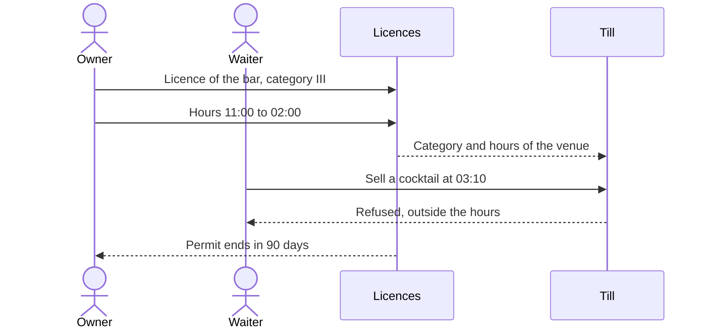

🏠 [Specs](../../../../README.md) › 🏷️ [Sectors](../../../README.md) ›
🍽️ [SC06 Restaurant and hospitality](../../README.md) › 📝 [Use cases](../README.md) ›
📝 [Use cases: FL-SC06-06 Campsites, catering, groups, pricing and licences](README.md) ›
📝 UC-SC06-20 Keep alcohol licences current

# 📝 UC-SC06-20 Keep alcohol licences current

**Status:** 🔄 waiting for the owner

## Summary

The owner keeps the alcohol licences of each venue current: the category, the declaration at the town hall, the
operating permit and its renewal, and the hours when alcohol may be served. The till and the room service read them, so
that a sale outside the category or the hours is refused.

## Personas

- [U13 Owner](../../../../01-users/personas/u13-owner.md)

## Goal

No alcohol is sold under a licence that has expired, outside its category or outside its hours, and the owner knows
months ahead when a licence or permit must be renewed.

## Trigger

A venue opens or changes hands, a licence or permit approaches its end, or the hours change.

## Frequency

A few records per venue, checked daily by the till.

## Preconditions

- The venues are sites of the company
  ([E-F1-02](../../../../02-functional/f01-administration/data/e-f01-02-company-site.md)).
- The licence category of each venue is known: bar or restaurant, with or without meals.
- The person who runs the venue holds the operating permit.

## Postconditions

- **Succeeded:** each venue has its licence saved ([E-SC06-17 Licence](../../data/e-sc06-17-licence.md)) with its
  category, hours and permit, and the till applies them to every sale.
- **Failed:** a venue with no valid licence sells no alcohol and the owner is told which paper is missing.

## Main flow

1. The owner opens the licences screen
   ([S-SC06-20](../../screens/06-campsites-catering-groups-and-pricing/s-sc06-20-alcohol-licences.md)) and creates the
   licence of a venue with its category and the date of its declaration at the town hall.
2. The owner enters the operating permit: its holder, its date and the date of its renewal training.
3. The owner enters the hours when alcohol may be served on each day, from the mayor's or prefect's order.
4. The licence is activated and the till of the venue reads the category and the hours
   [UC-F10-22](../../../../02-functional/f10-point-of-sale/use-cases/08-vouchers-and-age-checks/uc-f10-22-check-age-for-restricted-sales.md).
5. simple-ERP warns the owner ninety days before the end of a permit's validity and before a licence lapses.
6. At the renewal the owner enters the new dates; if the venue changes hands the licence is closed and a new one
   created.

## Alternative flows

- 3a. A temporary bar for an event gets its own short licence
  ([UC-SC08-13](../../../sc08-non-profit/use-cases/05-events/uc-sc08-13-run-a-temporary-bar-at-events.md)) and its own
  hours.
- 4a. The venue is a restaurant with a licence for meals only: the till sells alcohol only with a meal.
- 5a. The permit holder changes: the new holder's training is entered and the old permit closes.

## Error flows

- 4e. A sale of alcohol is tried outside the hours: the till refuses it and records the attempt.
- 5e. A licence has expired: the till blocks alcohol for the venue until it is renewed.
- 1e. The licence category is missing: the licence cannot be activated.
- Any step: a service does not answer; the call is retried first
  ([BR-F3-32](../../../../02-functional/f03-assistant/business-rules/br-f03-32-retry-before-an-error.md)), then the
  message follows the error pattern ([D122](../../../../06-decisions/ux/d122-error-message-standard.md)) and what the
  user typed stays on the screen.

## Business rules

- [BR-SC06-20](../../business-rules/br-sc06-20-alcohol-is-served-within-the-licences-category-and-hours.md)
- [BR-SC06-06](../../business-rules/br-sc06-06-alcohol-sold-within-the-licence.md)

## Entities

- [E-SC06-17 Licence](../../data/e-sc06-17-licence.md): created, changed, expired
- [E-F10-16 Age check](../../../../02-functional/f10-point-of-sale/data/e-f10-16-age-check.md): read, the age check at
  the sale
- [E-F1-02](../../../../02-functional/f01-administration/data/e-f01-02-company-site.md): read, the venue the licence
  belongs to
- [E-SC08-13 Temporary bar](../../../sc08-non-profit/data/e-sc08-13-temporary-bar.md): read, the temporary bars with
  their own licence

## Permissions

Owner creates and changes licences; managers read them. Waiters and cashiers see only whether alcohol can be
served now.

## Notifications

The owner, by email and in the app: a licence or a permit ends within ninety days, or the till refused alcohol outside
the hours.

## Audit events

Each licence created, changed, activated, expired and renewed, each refused sale with its time and reason, who and when.

## AI involvement

No AI step of its own. The AI assistant may open the screen and prefill it from the user's words; the user checks and
confirms
[BR-F3-07](../../../../02-functional/f03-assistant/business-rules/br-f03-07-no-deletes-no-irreversible-acts.md).

## API, MCP and A2A exposure

T5 operations of the capability for the personas above: create, read, update and list. The MCP tool of the
capability may read and propose, never confirm alone. No A2A skill.

## Screens

- [S-SC06-20](../../screens/06-campsites-catering-groups-and-pricing/s-sc06-20-alcohol-licences.md)

## Flowchart

See
[FL-SC06-06 Campsites, catering, groups, pricing and licences](../../flows/fl-sc06-06-campsites-catering-groups-and-pricing.md#flowchart).

## Sequence diagram

## Acceptance criteria

1. **Given** a bar with a category III licence and hours until 02:00 **when** a waiter sells a cocktail at 03:10
   **then** the till refuses it and records the attempt.
2. **Given** a restaurant licence for meals only **when** a waiter sells spirits with no meal on the table **then** the
   till refuses the sale.
3. **Given** a permit valid until 2027-02-10 **when** it is 2026-11-12 **then** the owner is warned that it ends within
   90 days.
4. **Given** an expired licence **when** a waiter sells beer **then** the till blocks alcohol for the venue.

## Non-functional notes

The screen answers within 2 seconds for 10,000 records; every change is audited.

## Regulatory references

A place selling alcohol holds the licence of its category, declared at the town hall before opening, and the
person who runs it holds an operating permit obtained by a training course and renewed by a shorter one. The mayor or
the prefect may set the hours of service and ban sales near certain places. Serving a minor is an offence. Temporary
bars of associations have their own authorisation. Licences are data of the France pack. The France-pack rule is listed
below. Related: [CR-FR-109](../../../../10-country-packs/france/hospitality/cr-fr-109-alcohol-licences.md),
[CR-FR-128](../../../../10-country-packs/france/hospitality/cr-fr-128-temporary-bars.md).

- France-pack rule, (Proposed) until its law is read:
  [CR-FR-235 Alcohol licences and opening hours](../../../../10-country-packs/france/hospitality/cr-fr-235-alcohol-licences.md)

## Related use cases

- [UC-SC06-19 Set prices dynamically](uc-sc06-19-set-prices-dynamically.md)
- [UC-SC06-21 Know the guest](uc-sc06-21-know-the-guest.md)
- [UC-SC06-02](../01-menus-and-food-safety/uc-sc06-02-show-allergens-and-the-home-made-label.md)
- [UC-F10-22](../../../../02-functional/f10-point-of-sale/use-cases/08-vouchers-and-age-checks/uc-f10-22-check-age-for-restricted-sales.md)
- [UC-SC08-13](../../../sc08-non-profit/use-cases/05-events/uc-sc08-13-run-a-temporary-bar-at-events.md)

## Open questions

None.

---

⬅️ [UC-SC06-19 Set prices dynamically](uc-sc06-19-set-prices-dynamically.md) · ⬆️ [Up](README.md) ·
➡️ [UC-SC06-21 Know the guest](uc-sc06-21-know-the-guest.md)
