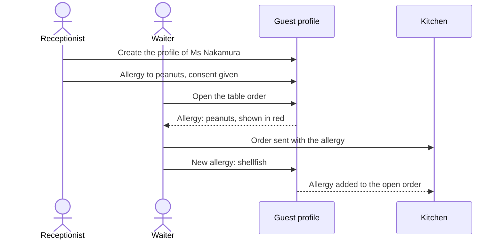

🏠 [Specs](../../../../README.md) › 🏷️ [Sectors](../../../README.md) ›
🍽️ [SC06 Restaurant and hospitality](../../README.md) › 📝 [Use cases](../README.md) ›
📝 [Use cases: FL-SC06-06 Campsites, catering, groups, pricing and licences](README.md) › 📝 UC-SC06-21 Know the guest

# 📝 UC-SC06-21 Know the guest

**Status:** ✅ specified

## Summary

The receptionist and the waiters keep what they know of a guest: allergies, diets, preferred room, usual table, special
dates and past stays. The profile follows the guest from the room to the restaurant and the bar, and the allergies
appear on every order so that no dish is served that the guest cannot eat.

## Personas

- [U28 Hotel receptionist](../../../../01-users/personas/u28-hotel-receptionist.md)
- [U18 Waiter](../../../../01-users/personas/u18-waiter.md)

## Goal

A returning guest is welcomed with what they like, and the allergies they declared are in front of everyone who takes an
order for them.

## Trigger

A guest books, arrives, orders, or tells a member of staff about an allergy or a preference.

## Frequency

One profile per guest, read at every booking and every order.

## Preconditions

- The guest is a customer record
  ([E-F6-01](../../../../02-functional/f06-customers-and-sales/data/e-f06-01-customer-record.md)) with a booking or a
  first visit.
- The guest agreed to the keeping of their preferences, or the profile holds only what the stay needs.
- The restaurant's orders pass through the till or the waiter's phone
  ([E-F10-03](../../../../02-functional/f10-point-of-sale/data/e-f10-03-point-of-sale-order.md)).

## Postconditions

- **Succeeded:** the profile is saved ([E-SC06-18 Guest profile](../../data/e-sc06-18-guest-profile.md)) with its
  allergies, preferences and consent, and every order for the guest shows the allergies.
- **Failed:** no preference is kept without consent, and an allergy typed is never lost.

## Main flow

1. At the first booking the receptionist creates the profile
   ([S-SC06-21](../../screens/06-campsites-catering-groups-and-pricing/s-sc06-21-guest-profiles.md)) and asks about
   allergies, diets and preferences.
2. The receptionist records the guest's consent to keep the preferences for later stays.
3. At each stay the profile shows the preferred room, the pillow, the arrival time and the special dates.
4. When the guest orders in the restaurant or the bar, the waiter's phone shows the allergies in red at the top of the
   order ([BR-SC06-21](../../business-rules/br-sc06-21-allergies-are-shown-at-every-order.md)).
5. A waiter who learns of a new allergy adds it from the phone and it is shown at once to the kitchen.
6. After the retention period or on request the profile is anonymised
   [UC-F1-25](../../../../02-functional/f01-administration/use-cases/15-security-and-group-data/uc-f01-25-set-retention-and-purge-personal-data.md).

## Alternative flows

- 2a. The guest refuses to be kept: only the allergies and the stay's needs are held until departure.
- 4a. The guest orders for a table of several people: each seat shows the allergies of its guest when profiles are
  linked.
- 3a. The guest is part of a group: the organiser's list shows the dietary needs before arrival.

## Error flows

- 4e. An allergen of the guest is in a dish ordered: the waiter's phone warns before the order is sent to the kitchen.
- 2e. The consent is missing for a preference: it is not saved and the receptionist is told.
- 6e. An erasure request arrives for a profile with an open stay: the request waits for the departure and then runs.
- Any step: a service does not answer; the call is retried first
  ([BR-F3-32](../../../../02-functional/f03-assistant/business-rules/br-f03-32-retry-before-an-error.md)), then the
  message follows the error pattern ([D122](../../../../06-decisions/ux/d122-error-message-standard.md)) and what the
  user typed stays on the screen.

## Business rules

- [BR-SC06-21](../../business-rules/br-sc06-21-allergies-are-shown-at-every-order.md)
- [BR-SC06-15](../../business-rules/br-sc06-15-guest-data-kept-no-longer-than-needed.md)

## Entities

- [E-SC06-18 Guest profile](../../data/e-sc06-18-guest-profile.md): created, changed, anonymised
- [E-F6-01](../../../../02-functional/f06-customers-and-sales/data/e-f06-01-customer-record.md): read and changed, the
  customer's identity
- [E-SC06-02 Menu dish](../../data/e-sc06-02-menu-dish.md): read, the allergens of each dish
- [E-F10-03](../../../../02-functional/f10-point-of-sale/data/e-f10-03-point-of-sale-order.md): read, the order that
  shows the allergies

## Permissions

Receptionist creates and changes profiles; waiters read allergies and add a new one; the owner reads the preferences.
Other staff see only the allergies relevant to their task.

## Notifications

The kitchen, in the app: a new allergy was added to a guest with an open order.

## Audit events

Each profile created, each allergy or preference added, changed or removed, each consent, each reading of the sensitive
part and each anonymisation, with who and when.

## AI involvement

No AI step of its own. The AI assistant may open the screen and prefill it from the user's words; the user checks and
confirms
[BR-F3-07](../../../../02-functional/f03-assistant/business-rules/br-f03-07-no-deletes-no-irreversible-acts.md).

## API, MCP and A2A exposure

T5 operations of the capability for the personas above: create, read, update and list. The MCP tool of the
capability may read and propose, never confirm alone. No A2A skill.

## Screens

- [S-SC06-21](../../screens/06-campsites-catering-groups-and-pricing/s-sc06-21-guest-profiles.md)

## Flowchart

See
[FL-SC06-06 Campsites, catering, groups, pricing and licences](../../flows/fl-sc06-06-campsites-catering-groups-and-pricing.md#flowchart).

## Sequence diagram

## Acceptance criteria

1. **Given** a guest with a peanut allergy in their profile **when** a waiter opens an order for them **then** the
   allergy is shown in red at the top of the order.
2. **Given** a dish that contains an allergen of the guest **when** the waiter adds it to the order **then** a warning
   appears before the order is sent.
3. **Given** a guest who refuses to be kept **when** the receptionist saves the profile **then** only the allergies and
   the stay's needs are kept until departure.
4. **Given** a profile with no stay for the retention period **when** the period ends **then** the profile is
   anonymised.

## Non-functional notes

The screen answers within 2 seconds for 10,000 records; every change is audited.

## Regulatory references

Allergies and diets that reveal a health condition are sensitive personal data: they are kept only with the
guest's consent or for the stay's needs, read only by the staff who need them, and erased on request or after the
retention period. The venue must be able to give the allergens of every dish. The France-pack rule is written later.
Related: [CR-FR-051](../../../../10-country-packs/france/data-protection/cr-fr-051-access-and-erasure.md),
[CR-FR-052](../../../../10-country-packs/france/data-protection/cr-fr-052-storage-limitation.md),
[CR-FR-107](../../../../10-country-packs/france/consumer/cr-fr-107-allergen-information.md).

## Related use cases

- [UC-SC06-20 Keep alcohol licences current](uc-sc06-20-keep-alcohol-licences-current.md)
- [UC-SC06-02](../01-menus-and-food-safety/uc-sc06-02-show-allergens-and-the-home-made-label.md)
- [UC-SC06-15](../03-rooms-and-bookings/uc-sc06-15-ask-the-assistant-about-the-hotel-or-restaurant.md)
- [UC-F10-25](../../../../02-functional/f10-point-of-sale/use-cases/10-clienteling-transfers-and-tax-free/uc-f10-25-serve-a-customer-with-their-profile.md)

## Open questions

None.

---

⬅️ [UC-SC06-20 Keep alcohol licences current](uc-sc06-20-keep-alcohol-licences-current.md) · ⬆️ [Up](README.md)
