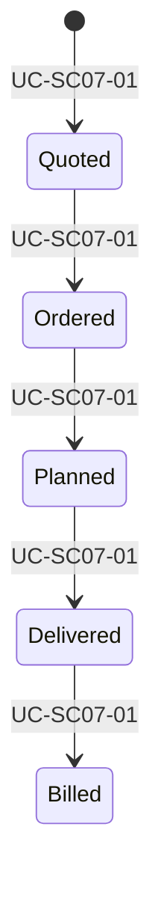

🏠 [Specs](../../../README.md) › 🏷️ [Sectors](../../README.md) › 🚛 [SC07 Transport and logistics](../README.md) ›
🗃️ [Data](README.md) › 🗃️ E-SC07-01 Transport order

# 🗃️ E-SC07-01 Transport order

**Status:** ✅ specified

## Purpose

A load to move.

## Fields

| Name | Type | Required | Validation | Default | Example | Personal data | Custom fields |
|---|---|---|---|---|---|---|---|
| client, lane | records | yes | - | - | Acme, Lyon to Lille | no | no |
| goods, weight, pallets | text, kg, number | yes | > 0 | - | 12 t, 26 | no | no |
| state | quoted, ordered, planned, delivered, billed | yes | - | quoted | delivered | no | no |

## Relations

As its use cases.

## Lifecycle

## Indexes and search

By number, date, partner.

## Retention

Kept for the period of its kind of record in the country pack (D293), or else its kind's default in the
[retention schedule](../../../05-non-functional/data-retention.md).

## Audit

Every change.

## Import and export

CSV, FEC where relevant.

## Used by

- [UC-SC07-01](../use-cases/01-orders-and-planning/uc-sc07-01-quote-and-take-transport-orders.md)

## Open questions

None.

---

⬆️ [Up](README.md) · ➡️ [E-SC07-02 Trip](e-sc07-02-trip.md)
