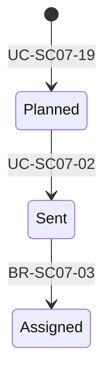

🏠 [Specs](../../../README.md) › 🏷️ [Sectors](../../README.md) › 🚛 [SC07 Transport and logistics](../README.md) ›
🗃️ [Data](README.md) › 🗃️ E-SC07-02 Trip

# 🗃️ E-SC07-02 Trip

**Status:** ✅ specified

## Purpose

A vehicle's journey with stops.

## Fields

| Name | Type | Required | Validation | Default | Example | Personal data | Custom fields |
|---|---|---|---|---|---|---|---|
| vehicle, driver, date | records | yes | BR-SC07-02, BR-SC07-03 | - | 19 t AB-123, M. D., 12 Nov | yes | no |
| stops | list | yes | - | - | 4 | no | no |
| distance, empty km | km | no | - | - | 610, 80 | no | no |

## Relations

As its use cases.

## Lifecycle

## Indexes and search

By number, date, partner.

## Retention

Kept for the period of its kind of record in the country pack (D293), or else its kind's default in the
[retention schedule](../../../05-non-functional/data-retention.md).

## Audit

Every change.

## Import and export

CSV, FEC where relevant.

## Used by

- [UC-SC07-02](../use-cases/01-orders-and-planning/uc-sc07-02-plan-trips-and-optimise-routes.md)
- [UC-SC07-18](../use-cases/05-billing-and-performance/uc-sc07-18-follow-cost-and-margin.md)
- [UC-SC07-19](../use-cases/04-compliance/uc-sc07-19-follow-cabotage-and-international-trips.md)
- [UC-SC07-20](../use-cases/01-orders-and-planning/uc-sc07-20-ask-the-assistant-about-the-fleet.md)

## Open questions

None.

---

⬅️ [E-SC07-01 Transport order](e-sc07-01-transport-order.md) · ⬆️ [Up](README.md) ·
➡️ [E-SC07-03 Fleet vehicle](e-sc07-03-fleet-vehicle.md)
