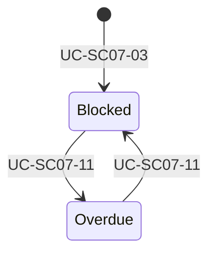

🏠 [Specs](../../../README.md) › 🏷️ [Sectors](../../README.md) › 🚛 [SC07 Transport and logistics](../README.md) ›
🗃️ [Data](README.md) › 🗃️ E-SC07-03 Fleet vehicle

# 🗃️ E-SC07-03 Fleet vehicle

**Status:** ✅ specified

## Purpose

A truck, van or trailer.

## Fields

| Name | Type | Required | Validation | Default | Example | Personal data | Custom fields |
|---|---|---|---|---|---|---|---|
| plate, kind | text | yes | unique | - | AB-123, 19 t | no | no |
| licence copy | number, validity | no | BR-SC07-02 | - | copy 14 | no | no |
| inspection, maintenance | dates | no | BR-SC07-10 | - | 2027-03 | no | no |

## Relations

As its use cases.

## Lifecycle

## Indexes and search

By number, date, partner.

## Retention

Kept for the period of its kind of record in the country pack (D293), or else its kind's default in the
[retention schedule](../../../05-non-functional/data-retention.md).

## Audit

Every change.

## Import and export

CSV, FEC where relevant.

## Used by

- [UC-SC07-03](../use-cases/02-fleet-and-drivers/uc-sc07-03-manage-the-fleet-and-trailers.md)
- [UC-SC07-11](../use-cases/02-fleet-and-drivers/uc-sc07-11-maintain-vehicles-and-their-inspections.md)

## Open questions

None.

---

⬅️ [E-SC07-02 Trip](e-sc07-02-trip.md) · ⬆️ [Up](README.md) ·
➡️ [E-SC07-04 Driver document](e-sc07-04-driver-document.md)
