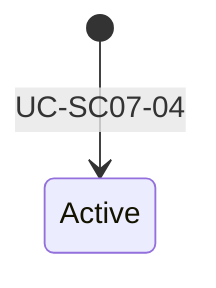

🏠 [Specs](../../../README.md) › 🏷️ [Sectors](../../README.md) › 🚛 [SC07 Transport and logistics](../README.md) ›
🗃️ [Data](README.md) › 🗃️ E-SC07-04 Driver document

# 🗃️ E-SC07-04 Driver document

**Status:** ✅ specified

## Purpose

A licence, card or training of a driver.

## Fields

| Name | Type | Required | Validation | Default | Example | Personal data | Custom fields |
|---|---|---|---|---|---|---|---|
| driver, kind | records | yes | BR-SC07-05 | - | M. D., driver card | yes | no |
| valid to | date | yes | - | - | 2028-04 | no | no |

## Relations

As its use cases.

## Lifecycle

## Indexes and search

By number, date, partner.

## Retention

Kept for the period of its kind of record in the country pack (D293), or else its kind's default in the
[retention schedule](../../../05-non-functional/data-retention.md).

## Audit

Every change.

## Import and export

CSV, FEC where relevant.

## Used by

- [UC-SC07-04](../use-cases/02-fleet-and-drivers/uc-sc07-04-manage-drivers-and-their-documents.md)

## Open questions

None.

---

⬅️ [E-SC07-03 Fleet vehicle](e-sc07-03-fleet-vehicle.md) · ⬆️ [Up](README.md) ·
➡️ [E-SC07-05 Consignment note](e-sc07-05-consignment-note.md)
