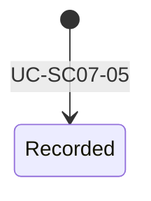

🏠 [Specs](../../../README.md) › 🏷️ [Sectors](../../README.md) › 🚛 [SC07 Transport and logistics](../README.md) ›
🗃️ [Data](README.md) › 🗃️ E-SC07-05 Consignment note

# 🗃️ E-SC07-05 Consignment note

**Status:** 🔄 waiting for the owner

## Purpose

The note of a shipment.

## Fields

| Name | Type | Required | Validation | Default | Example | Personal data | Custom fields |
|---|---|---|---|---|---|---|---|
| order, number | records | yes | unique | auto | CN-4471 | no | no |
| form | paper, electronic | yes | BR-SC07-04 | paper | electronic | no | no |
| signatures | loading, delivery | no | - | - | both | yes | no |

## Relations

(Proposed) As its use cases.

## Lifecycle

## Indexes and search

(Proposed) By number, date, partner.

## Retention

At least 2 years:
[CR-FR-118 Documents on board and the consignment note](../../../10-country-packs/france/transport/cr-fr-118-documents-on-board.md).

## Audit

Every change.

## Import and export

(Proposed) CSV, FEC where relevant.

## Used by

- [UC-SC07-05](../use-cases/03-on-the-road/uc-sc07-05-issue-consignment-notes-paper-or-e-cmr.md)
- [UC-SC07-16](../use-cases/06-logistics-for-clients/uc-sc07-16-give-clients-tracking-and-documents-in-the-portal.md)

## Open questions

None.

---

⬅️ [E-SC07-04 Driver document](e-sc07-04-driver-document.md) · ⬆️ [Up](README.md) ·
➡️ [E-SC07-06 Stop](e-sc07-06-stop.md)
