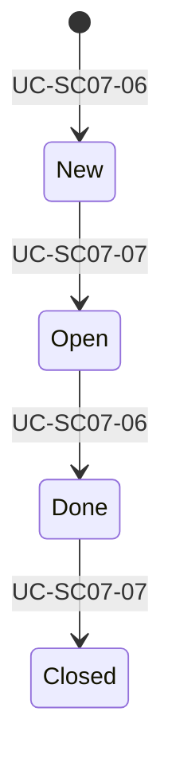

🏠 [Specs](../../../README.md) › 🏷️ [Sectors](../../README.md) › 🚛 [SC07 Transport and logistics](../README.md) ›
🗃️ [Data](README.md) › 🗃️ E-SC07-06 Stop

# 🗃️ E-SC07-06 Stop

**Status:** ✅ specified

## Purpose

A loading or delivery stop.

## Fields

| Name | Type | Required | Validation | Default | Example | Personal data | Custom fields |
|---|---|---|---|---|---|---|---|
| trip, address | records | yes | - | - | T-881, Lille | no | no |
| check-in, check-out | times | no | BR-SC07-07 | - | 10:00, 12:05 | no | no |
| proof | signature, photo, code | no | BR-SC07-06 | - | signature | yes | no |

## Relations

As its use cases.

## Lifecycle

## Indexes and search

By number, date, partner.

## Retention

Kept for the period of its kind of record in the country pack (D293), or else its kind's default in the
[retention schedule](../../../05-non-functional/data-retention.md).

## Audit

Every change.

## Import and export

CSV, FEC where relevant.

## Used by

- [UC-SC07-06](../use-cases/03-on-the-road/uc-sc07-06-drive-with-the-phone.md)
- [UC-SC07-07](../use-cases/03-on-the-road/uc-sc07-07-collect-proofs-of-delivery-and-report-incidents.md)
- [UC-SC07-16](../use-cases/06-logistics-for-clients/uc-sc07-16-give-clients-tracking-and-documents-in-the-portal.md)
- [UC-SC07-20](../use-cases/01-orders-and-planning/uc-sc07-20-ask-the-assistant-about-the-fleet.md)

## Open questions

None.

---

⬅️ [E-SC07-05 Consignment note](e-sc07-05-consignment-note.md) · ⬆️ [Up](README.md) ·
➡️ [E-SC07-07 Transport incident](e-sc07-07-transport-incident.md)
