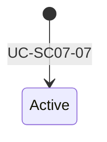

🏠 [Specs](../../../README.md) › 🏷️ [Sectors](../../README.md) › 🚛 [SC07 Transport and logistics](../README.md) ›
🗃️ [Data](README.md) › 🗃️ E-SC07-07 Transport incident

# 🗃️ E-SC07-07 Transport incident

**Status:** ✅ specified

## Purpose

Damage, delay or refusal.

## Fields

| Name | Type | Required | Validation | Default | Example | Personal data | Custom fields |
|---|---|---|---|---|---|---|---|
| stop, kind | records | yes | - | - | Lille, damage | no | no |
| reservation, photos | text, files | no | - | - | box damaged | no | no |

## Relations

As its use cases.

## Lifecycle

## Indexes and search

By number, date, partner.

## Retention

Kept for the period of its kind of record in the country pack (D293), or else its kind's default in the
[retention schedule](../../../05-non-functional/data-retention.md).

## Audit

Every change.

## Import and export

CSV, FEC where relevant.

## Used by

- [UC-SC07-07](../use-cases/03-on-the-road/uc-sc07-07-collect-proofs-of-delivery-and-report-incidents.md)

## Open questions

None.

---

⬅️ [E-SC07-06 Stop](e-sc07-06-stop.md) · ⬆️ [Up](README.md) ·
➡️ [E-SC07-08 Tachograph file](e-sc07-08-tachograph-file.md)
