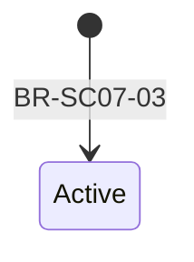

🏠 [Specs](../../../README.md) › 🏷️ [Sectors](../../README.md) › 🚛 [SC07 Transport and logistics](../README.md) ›
🗃️ [Data](README.md) › 🗃️ E-SC07-08 Tachograph file

# 🗃️ E-SC07-08 Tachograph file

**Status:** ✅ specified

## Purpose

Downloaded tachograph data.

## Fields

| Name | Type | Required | Validation | Default | Example | Personal data | Custom fields |
|---|---|---|---|---|---|---|---|
| vehicle or driver, date | records | yes | - | - | M. D., 1 Nov | yes | no |
| infringements | list | no | BR-SC07-03 | - | 1 rest short | yes | no |

## Relations

As its use cases.

## Lifecycle

## Indexes and search

By number, date, partner.

## Retention

Kept for the period of its kind of record in the country pack (D293), or else its kind's default in the
[retention schedule](../../../05-non-functional/data-retention.md).

## Audit

Every change.

## Import and export

CSV, FEC where relevant.

## Used by

- [UC-SC07-08](../use-cases/04-compliance/uc-sc07-08-import-tachograph-data-and-check-driving-times.md)

## Open questions

None.

---

⬅️ [E-SC07-07 Transport incident](e-sc07-07-transport-incident.md) · ⬆️ [Up](README.md) ·
➡️ [E-SC07-09 Dangerous goods declaration](e-sc07-09-dangerous-goods-declaration.md)
