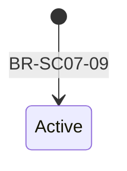

🏠 [Specs](../../../README.md) › 🏷️ [Sectors](../../README.md) › 🚛 [SC07 Transport and logistics](../README.md) ›
🗃️ [Data](README.md) › 🗃️ E-SC07-09 Dangerous goods declaration

# 🗃️ E-SC07-09 Dangerous goods declaration

**Status:** 🔄 waiting for the owner

## Purpose

Dangerous goods in a load.

## Fields

| Name | Type | Required | Validation | Default | Example | Personal data | Custom fields |
|---|---|---|---|---|---|---|---|
| order, class, quantity | records | yes | BR-SC07-09 | - | CN-4471, class 3, 800 l | no | no |

## Relations

(Proposed) As its use cases.

## Lifecycle

## Indexes and search

(Proposed) By number, date, partner.

## Retention

Kept for the period of its kind of record in the country pack (D293), or else its kind's default in the
[retention schedule](../../../05-non-functional/data-retention.md).

## Audit

Every change.

## Import and export

(Proposed) CSV, FEC where relevant.

## Used by

- [UC-SC07-09](../use-cases/04-compliance/uc-sc07-09-handle-dangerous-goods.md)

## Open questions

None.

---

⬅️ [E-SC07-08 Tachograph file](e-sc07-08-tachograph-file.md) · ⬆️ [Up](README.md) ·
➡️ [E-SC07-10 Fuel and toll line](e-sc07-10-fuel-and-toll-line.md)
