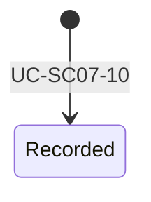

🏠 [Specs](../../../README.md) › 🏷️ [Sectors](../../README.md) › 🚛 [SC07 Transport and logistics](../README.md) ›
🗃️ [Data](README.md) › 🗃️ E-SC07-10 Fuel and toll line

# 🗃️ E-SC07-10 Fuel and toll line

**Status:** 🔄 waiting for the owner

## Purpose

A card or toll transaction.

## Fields

| Name | Type | Required | Validation | Default | Example | Personal data | Custom fields |
|---|---|---|---|---|---|---|---|
| vehicle, date, amount | records | yes | - | - | AB-123, 12 Nov, 312.40 | no | no |
| trip | trip | no | - | - | T-881 | no | no |

## Relations

(Proposed) As its use cases.

## Lifecycle

## Indexes and search

(Proposed) By number, date, partner.

## Retention

As an accounting record:
[CR-FR-002 Accounting records kept 10 years](../../../10-country-packs/france/accounting/cr-fr-002-accounting-records-kept-ten-years.md).

## Audit

Every change.

## Import and export

(Proposed) CSV, FEC where relevant.

## Used by

- [UC-SC07-10](../use-cases/05-billing-and-performance/uc-sc07-10-manage-fuel-cards-and-tolls.md)

## Open questions

None.

---

⬅️ [E-SC07-09 Dangerous goods declaration](e-sc07-09-dangerous-goods-declaration.md) · ⬆️ [Up](README.md) ·
➡️ [E-SC07-11 Vehicle repair](e-sc07-11-vehicle-repair.md)
