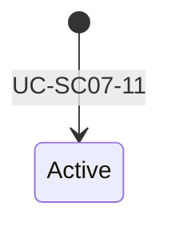

🏠 [Specs](../../../README.md) › 🏷️ [Sectors](../../README.md) › 🚛 [SC07 Transport and logistics](../README.md) ›
🗃️ [Data](README.md) › 🗃️ E-SC07-11 Vehicle repair

# 🗃️ E-SC07-11 Vehicle repair

**Status:** 🔄 waiting for the owner

## Purpose

A maintenance or repair job.

## Fields

| Name | Type | Required | Validation | Default | Example | Personal data | Custom fields |
|---|---|---|---|---|---|---|---|
| vehicle, kind | records | yes | - | - | AB-123, brakes | no | no |
| date, cost | date, amount | yes | - | - | 3 Nov, 840 | no | no |

## Relations

(Proposed) As its use cases.

## Lifecycle

## Indexes and search

(Proposed) By number, date, partner.

## Retention

Kept for the period of its kind of record in the country pack (D293), or else its kind's default in the
[retention schedule](../../../05-non-functional/data-retention.md).

## Audit

Every change.

## Import and export

(Proposed) CSV, FEC where relevant.

## Used by

- [UC-SC07-11](../use-cases/02-fleet-and-drivers/uc-sc07-11-maintain-vehicles-and-their-inspections.md)

## Open questions

None.

---

⬅️ [E-SC07-10 Fuel and toll line](e-sc07-10-fuel-and-toll-line.md) · ⬆️ [Up](README.md) ·
➡️ [E-SC07-12 Charter](e-sc07-12-charter.md)
