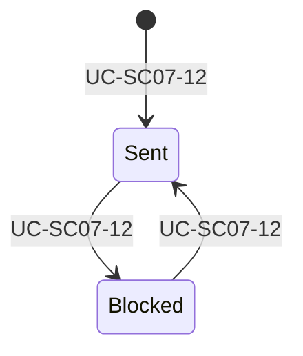

🏠 [Specs](../../../README.md) › 🏷️ [Sectors](../../README.md) › 🚛 [SC07 Transport and logistics](../README.md) ›
🗃️ [Data](README.md) › 🗃️ E-SC07-12 Charter

# 🗃️ E-SC07-12 Charter

**Status:** ✅ specified

## Purpose

A load given to another carrier.

## Fields

| Name | Type | Required | Validation | Default | Example | Personal data | Custom fields |
|---|---|---|---|---|---|---|---|
| order, carrier | records | yes | BR-SC07-11 | - | Acme order, Carrier B | no | no |
| price | amount | yes | - | - | 780 | no | no |

## Relations

As its use cases.

## Lifecycle

## Indexes and search

By number, date, partner.

## Retention

As an accounting record:
[CR-FR-002 Accounting records kept 10 years](../../../10-country-packs/france/accounting/cr-fr-002-accounting-records-kept-ten-years.md).

## Audit

Every change.

## Import and export

CSV, FEC where relevant.

## Used by

- [UC-SC07-12](../use-cases/01-orders-and-planning/uc-sc07-12-subcontract-to-other-carriers.md)

## Open questions

None.

---

⬅️ [E-SC07-11 Vehicle repair](e-sc07-11-vehicle-repair.md) · ⬆️ [Up](README.md) ·
➡️ [E-SC07-13 Transport invoice line](e-sc07-13-transport-invoice-line.md)
