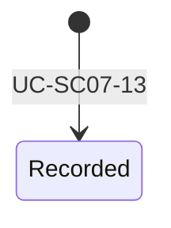

🏠 [Specs](../../../README.md) › 🏷️ [Sectors](../../README.md) › 🚛 [SC07 Transport and logistics](../README.md) ›
🗃️ [Data](README.md) › 🗃️ E-SC07-13 Transport invoice line

# 🗃️ E-SC07-13 Transport invoice line

**Status:** ✅ specified

## Purpose

A billed item.

## Fields

| Name | Type | Required | Validation | Default | Example | Personal data | Custom fields |
|---|---|---|---|---|---|---|---|
| order, kind | records | yes | - | - | CN-4471, fuel surcharge | no | no |
| amount, CO2 | amount, kg | yes | BR-SC07-12, BR-SC07-14 | - | 38.20, 412 | no | no |

## Relations

As its use cases.

## Lifecycle

## Indexes and search

By number, date, partner.

## Retention

As an accounting record:
[CR-FR-002 Accounting records kept 10 years](../../../10-country-packs/france/accounting/cr-fr-002-accounting-records-kept-ten-years.md).

## Audit

Every change.

## Import and export

CSV, FEC where relevant.

## Used by

- [UC-SC07-13](../use-cases/05-billing-and-performance/uc-sc07-13-bill-transport-with-surcharges.md)
- [UC-SC07-15](../use-cases/06-logistics-for-clients/uc-sc07-15-bill-storage-and-handling.md)
- [UC-SC07-17](../use-cases/05-billing-and-performance/uc-sc07-17-inform-clients-of-co2-per-transport.md)
- [UC-SC07-18](../use-cases/05-billing-and-performance/uc-sc07-18-follow-cost-and-margin.md)

## Open questions

None.

---

⬅️ [E-SC07-12 Charter](e-sc07-12-charter.md) · ⬆️ [Up](README.md) ·
➡️ [E-SC07-14 Client stock](e-sc07-14-client-stock.md)
