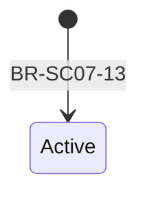

🏠 [Specs](../../../README.md) › 🏷️ [Sectors](../../README.md) › 🚛 [SC07 Transport and logistics](../README.md) ›
🗃️ [Data](README.md) › 🗃️ E-SC07-14 Client stock

# 🗃️ E-SC07-14 Client stock

**Status:** 🔄 waiting for the owner

## Purpose

Goods stored for a client.

## Fields

| Name | Type | Required | Validation | Default | Example | Personal data | Custom fields |
|---|---|---|---|---|---|---|---|
| client, product, location | records | yes | - | - | Acme, box B2, A-12 | no | no |
| pallets, since | number, date | yes | BR-SC07-13 | - | 40, 1 Nov | no | no |

## Relations

(Proposed) As its use cases.

## Lifecycle

## Indexes and search

(Proposed) By number, date, partner.

## Retention

Kept for the period of its kind of record in the country pack (D293), or else its kind's default in the
[retention schedule](../../../05-non-functional/data-retention.md).

## Audit

Every change.

## Import and export

(Proposed) CSV, FEC where relevant.

## Used by

- [UC-SC07-14](../use-cases/06-logistics-for-clients/uc-sc07-14-run-warehouse-logistics-for-clients.md)
- [UC-SC07-15](../use-cases/06-logistics-for-clients/uc-sc07-15-bill-storage-and-handling.md)

## Open questions

None.

---

⬅️ [E-SC07-13 Transport invoice line](e-sc07-13-transport-invoice-line.md) · ⬆️ [Up](README.md) ·
➡️ [E-SC07-15 Cabotage operation](e-sc07-15-cabotage-operation.md)
