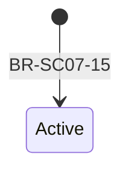

🏠 [Specs](../../../README.md) › 🏷️ [Sectors](../../README.md) › 🚛 [SC07 Transport and logistics](../README.md) ›
🗃️ [Data](README.md) › 🗃️ E-SC07-15 Cabotage operation

# 🗃️ E-SC07-15 Cabotage operation

**Status:** 🔄 waiting for the owner

## Purpose

A domestic job abroad after an international trip.

## Fields

| Name | Type | Required | Validation | Default | Example | Personal data | Custom fields |
|---|---|---|---|---|---|---|---|
| country, trip, date | records | yes | BR-SC07-15 | - | Germany, T-882, 14 Nov | no | no |
| posting declaration | reference | no | - | - | DE-77 | no | no |

## Relations

(Proposed) As its use cases.

## Lifecycle

## Indexes and search

(Proposed) By number, date, partner.

## Retention

Kept for the period of its kind of record in the country pack (D293), or else its kind's default in the
[retention schedule](../../../05-non-functional/data-retention.md).

## Audit

Every change.

## Import and export

(Proposed) CSV, FEC where relevant.

## Used by

- [UC-SC07-19](../use-cases/04-compliance/uc-sc07-19-follow-cabotage-and-international-trips.md)

## Open questions

None.

---

⬅️ [E-SC07-14 Client stock](e-sc07-14-client-stock.md) · ⬆️ [Up](README.md) ·
➡️ [E-SC07-16 Proof of delivery](e-sc07-16-proof-of-delivery.md)
