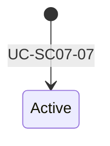

🏠 [Specs](../../../README.md) › 🏷️ [Sectors](../../README.md) › 🚛 [SC07 Transport and logistics](../README.md) ›
🗃️ [Data](README.md) › 🗃️ E-SC07-16 Proof of delivery

# 🗃️ E-SC07-16 Proof of delivery

**Status:** 🔄 waiting for the owner

## Purpose

(Proposed) The proof of delivery the flow charts name with the words "Proof of delivery"
([FL-SC07-03](../flows/fl-sc07-03-on-the-road.md)). The owner decided to create it
([D516](../../../06-decisions/foundations/d516-naming-rules-and-the-seven-classes-of-names.md)); what it holds waits for
the owner's confirmation.

## Fields

(Proposed) To define with the owner: the flow charts name the record, not its fields.

## Relations

(Proposed) To define with the owner, from the use cases below.

## Lifecycle

## Indexes and search

(Proposed) To define with the owner.

## Retention

(Proposed) As the other records of its capability, to confirm with the owner.

## Audit

(Proposed) Every change, as the other records of its capability.

## Import and export

(Proposed) To define with the owner.

## Used by

- [UC-SC07-07 Collect proofs of delivery and report incidents](../use-cases/03-on-the-road/uc-sc07-07-collect-proofs-of-delivery-and-report-incidents.md)

## Open questions

(Proposed) Its fields, relations and states wait for the owner (waiting list, step 36e).

---

⬅️ [E-SC07-15 Cabotage operation](e-sc07-15-cabotage-operation.md) · ⬆️ [Up](README.md) ·
➡️ [E-SC07-17 Transport CO2 statement](e-sc07-17-transport-co2-statement.md)
