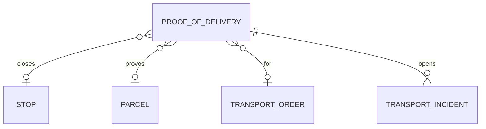
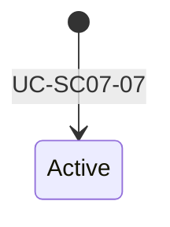

🏠 [Specs](../../../README.md) › 🏷️ [Sectors](../../README.md) › 🚛 [SC07 Transport and logistics](../README.md) ›
🗃️ [Data](README.md) › 🗃️ E-SC07-16 Proof of delivery

# 🗃️ E-SC07-16 Proof of delivery

**Status:** ✅ specified

## Purpose

The proof of delivery the flow charts name with the words "Proof of delivery"
([FL-SC07-03](../flows/fl-sc07-03-on-the-road.md)). The owner decided to create it
([D516](../../../06-decisions/foundations/d516-naming-rules-and-the-seven-classes-of-names.md)); its fields are derived
from the specifications and confirmed by the owner (D572).

## Fields

| Name | Type | Required | Validation | Default | Example | Personal data | Custom fields |
|---|---|---|---|---|---|---|---|
| title | text | yes | not empty | - | POD, order TO-2026-318 | no | no |
| order | transport order (E-SC07-01) | no | the stop's order | the stop's order | TO-2026-318 | no | no |
| stop | stop (E-SC07-06) | no | a stop or a parcel is set | - | Lille | no | no |
| parcel | parcel (E-SC07-20) | no | a stop or a parcel is set | - | 98122 | no | no |
| kind | signature, photo, code, neighbour's name | yes | at least one, BR-SC07-06 | - | signature | no | no |
| signed by | text | no | the consignee's or the neighbour's name | - | Nord Distri, J. Caron | yes | no |
| signature | image | no | required for the kind signature | - | signed on the phone | yes | no |
| code | text | no | required for the kind code | - | 4471 | no | no |
| photos | files | no | - | - | drop place, damaged box | no | no |
| reservations | text | no | - | - | 1 box damaged | no | no |
| goods scanned | number | no | 0 or more | - | 26 pallets | no | no |
| identity checked | yes or no | no | for a delivery in person | no | yes | no | no |
| collected at | date and time | yes | set when the proof is collected | - | 2026-11-12 12:05 | no | no |
| state | Active | yes | the lifecycle below | Active | Active | no | no |

At delivery the driver collects a signature, a photo or a code and notes the consignee's reservations; an absent
consignee gives a photo of the drop place and a code, and a stop without proof cannot close
([UC-SC07-07](../use-cases/03-on-the-road/uc-sc07-07-collect-proofs-of-delivery-and-report-incidents.md) steps 1 to 3,
1a and 1e, [BR-SC07-06](../business-rules/br-sc07-06-proof-of-delivery-closes-the-stop.md)). A parcel ends with a proof,
a neighbour's name when a neighbour accepts it and a scanned document for a delivery in person
([UC-SC07-23](../use-cases/07-passengers-removals-courier-and-freight/uc-sc07-23-run-last-mile-rounds.md) step 4, 2a and
5a, [BR-SC07-18](../business-rules/br-sc07-18-a-failed-delivery-gets-a-new-slot-or-a-relay-point.md)). The title and the
state are the columns of [S-SC07-L16 Proof of deliveries](../screens/00-lists/s-sc07-l16-proof-of-deliveries.md), whose
example rows read "POD, order TO-2026-318"; the goods scanned and the reservation are those of the
[S-SC07-07 Proof of delivery](../screens/03-on-the-road/s-sc07-07-proof-of-delivery.md) mock-up, "26 pallets scanned,
Reservation: 1 box damaged (photo)".

## Relations

- [E-SC07-06 Stop](e-sc07-06-stop.md): the stop the proof closes, with its check-in and check-out
- [E-SC07-20 Parcel](e-sc07-20-parcel.md): the parcel delivered on a last-mile round
- [E-SC07-01 Transport order](e-sc07-01-transport-order.md)
- [E-SC07-07 Transport incident](e-sc07-07-transport-incident.md): opened by a reservation or a damage
- [E-SC07-13 Transport invoice line](e-sc07-13-transport-invoice-line.md): a trip with a stop without proof cannot be
  billed yet, as the billing mock-up shows
- [UC-SC07-16 Give clients tracking and documents in the portal](../use-cases/06-logistics-for-clients/uc-sc07-16-give-clients-tracking-and-documents-in-the-portal.md):
  where the client downloads the proof

## Lifecycle

## Indexes and search

By title and state, the sort and facet of
[S-SC07-L16 Proof of deliveries](../screens/00-lists/s-sc07-l16-proof-of-deliveries.md); searched by title, order,
stop and parcel.

## Retention

As the other records of its capability.

## Audit

Every change, as the other records of its capability.

## Import and export

CSV or XLSX export of the rows and columns the user may see, from
[S-SC07-L16 Proof of deliveries](../screens/00-lists/s-sc07-l16-proof-of-deliveries.md), audited (T3); the client
downloads each proof from the portal
([UC-SC07-16](../use-cases/06-logistics-for-clients/uc-sc07-16-give-clients-tracking-and-documents-in-the-portal.md)
step 3); no import.

## Used by

- [UC-SC07-07 Collect proofs of delivery and report incidents](../use-cases/03-on-the-road/uc-sc07-07-collect-proofs-of-delivery-and-report-incidents.md)

## Open questions

None.

---

⬅️ [E-SC07-15 Cabotage operation](e-sc07-15-cabotage-operation.md) · ⬆️ [Up](README.md) ·
➡️ [E-SC07-17 Transport CO2 statement](e-sc07-17-transport-co2-statement.md)
