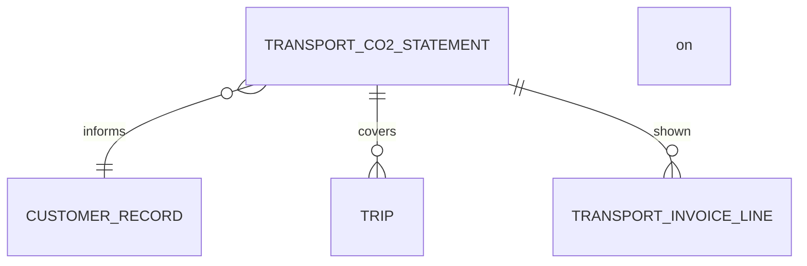
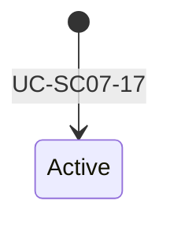

🏠 [Specs](../../../README.md) › 🏷️ [Sectors](../../README.md) › 🚛 [SC07 Transport and logistics](../README.md) ›
🗃️ [Data](README.md) › 🗃️ E-SC07-17 Transport CO2 statement

# 🗃️ E-SC07-17 Transport CO2 statement

**Status:** ✅ specified

## Purpose

The transport co2 statement the flow charts name with the words "CO2"
([FL-SC07-05](../flows/fl-sc07-05-billing-and-performance.md)). The owner decided to create it
([D516](../../../06-decisions/foundations/d516-naming-rules-and-the-seven-classes-of-names.md)); its fields are derived
from the specifications and confirmed by the owner (D572).

## Fields

| Name | Type | Required | Validation | Default | Example | Personal data | Custom fields |
|---|---|---|---|---|---|---|---|
| title | text | yes | not empty | - | CO2 statement, November 2026 | no | no |
| client | customer (E-F6-01) | yes | a customer of the company | - | Acme | no | no |
| period | month or year | yes | a month for the invoices, a year for the yearly report | - | November 2026 | no | no |
| transports | lines with transport, distance, load and CO2, computed | yes | from fuel and distance, BR-SC07-14 | computed | T-881, 690 km, 12 t, 412 kg | no | no |
| total CO2 | kg, computed | yes | the sum of the lines | computed | 600 kg | no | no |
| method | text | yes | the method [CR-FR-120](../../../10-country-packs/france/transport/cr-fr-120-co2-information.md) names, or the client's own, named | the country pack's | the client's own, named | no | no |
| default values used | yes or no | yes | set when data is missing | no | yes | no | no |
| held | yes or no | yes | set while the client has no address | no | no | no | no |
| state | Active | yes | the lifecycle below | Active | Active | no | no |

SimpleERP computes each transport's emissions from fuel and distance, puts the figure on the invoice and makes the
yearly report per client; the client's own method is used and named, missing data is replaced by default values and
flagged, and the report of a client without address is held
([UC-SC07-17](../use-cases/05-billing-and-performance/uc-sc07-17-inform-clients-of-co2-per-transport.md) steps 1 to
3, 1a, 1e and 3e, [BR-SC07-14](../business-rules/br-sc07-14-co2-shown-per-transport.md)). The title and the state are
the columns of [S-SC07-L17 Transport CO2 statements](../screens/00-lists/s-sc07-l17-transport-co2-statements.md), whose
example rows read "CO2 statement, October 2026"; the client, the month and the lines are those of the
[S-SC07-17 CO2 information](../screens/05-billing-and-performance/s-sc07-17-co2-information.md) mock-up, "Acme ·
November", T-881 and T-889.

## Relations

- [E-F6-01 Customer record](../../../02-functional/f06-customers-and-sales/data/e-f06-01-customer-record.md)
- [E-SC07-02 Trip](e-sc07-02-trip.md): the transports and their distance
- [E-SC07-10 Fuel and toll line](e-sc07-10-fuel-and-toll-line.md): the fuel the emissions are computed from
- [E-SC07-13 Transport invoice line](e-sc07-13-transport-invoice-line.md): the CO2 shown on the invoice
- [UC-F8-28 Prepare the sustainability report](../../../02-functional/f08-accounting/use-cases/09-pay-analyse-and-report/uc-f08-28-prepare-the-sustainability-report.md):
  where the figures go

## Lifecycle

## Indexes and search

By title and state, the sort and facet of
[S-SC07-L17 Transport CO2 statements](../screens/00-lists/s-sc07-l17-transport-co2-statements.md); searched by title,
client and period.

## Retention

As the other records of its capability.

## Audit

Every change, as the other records of its capability.

## Import and export

CSV or XLSX export of the rows and columns the user may see, from
[S-SC07-L17 Transport CO2 statements](../screens/00-lists/s-sc07-l17-transport-co2-statements.md), audited (T3); the
figures go to the sustainability report
([UC-F8-28](../../../02-functional/f08-accounting/use-cases/09-pay-analyse-and-report/uc-f08-28-prepare-the-sustainability-report.md));
no import.

## Used by

- [UC-SC07-17 Inform clients of CO2 per transport](../use-cases/05-billing-and-performance/uc-sc07-17-inform-clients-of-co2-per-transport.md)

## Open questions

None.

---

⬅️ [E-SC07-16 Proof of delivery](e-sc07-16-proof-of-delivery.md) · ⬆️ [Up](README.md) ·
➡️ [E-SC07-18 Passenger trip](e-sc07-18-passenger-trip.md)
