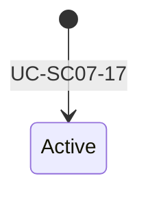

🏠 [Specs](../../../README.md) › 🏷️ [Sectors](../../README.md) › 🚛 [SC07 Transport and logistics](../README.md) ›
🗃️ [Data](README.md) › 🗃️ E-SC07-17 Transport CO2 statement

# 🗃️ E-SC07-17 Transport CO2 statement

**Status:** 🔄 waiting for the owner

## Purpose

(Proposed) The transport co2 statement the flow charts name with the words "CO2"
([FL-SC07-05](../flows/fl-sc07-05-billing-and-performance.md)). The owner decided to create it
([D516](../../../06-decisions/foundations/d516-naming-rules-and-the-seven-classes-of-names.md)); what it holds waits for
the owner's confirmation.

## Fields

(Proposed) To define with the owner: the flow charts name the record, not its fields.

## Relations

(Proposed) To define with the owner, from the use cases below.

## Lifecycle

## Indexes and search

(Proposed) To define with the owner.

## Retention

(Proposed) As the other records of its capability, to confirm with the owner.

## Audit

(Proposed) Every change, as the other records of its capability.

## Import and export

(Proposed) To define with the owner.

## Used by

- [UC-SC07-17 Inform clients of CO2 per transport](../use-cases/05-billing-and-performance/uc-sc07-17-inform-clients-of-co2-per-transport.md)

## Open questions

(Proposed) Its fields, relations and states wait for the owner (waiting list, step 36e).

---

⬅️ [E-SC07-16 Proof of delivery](e-sc07-16-proof-of-delivery.md) · ⬆️ [Up](README.md) ·
➡️ [E-SC07-18 Passenger trip](e-sc07-18-passenger-trip.md)
