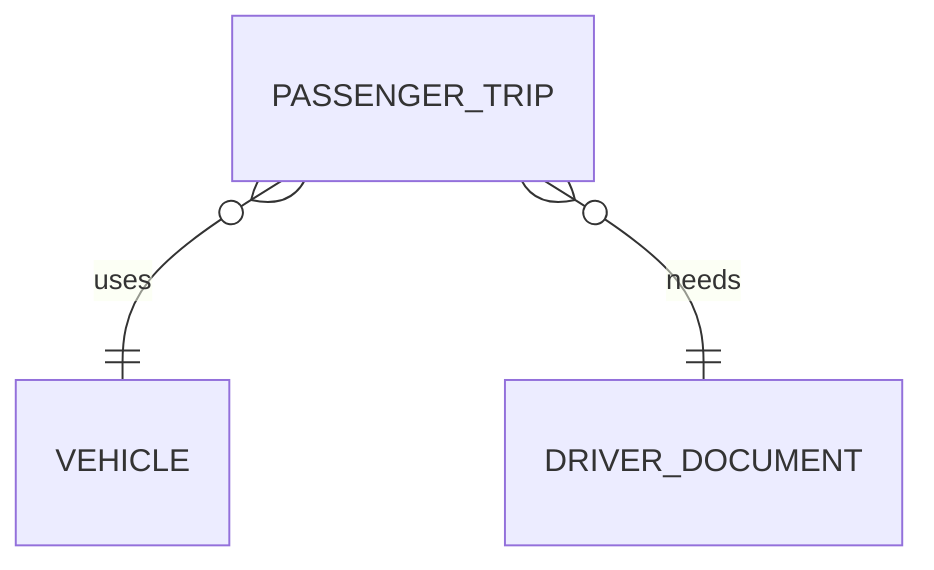
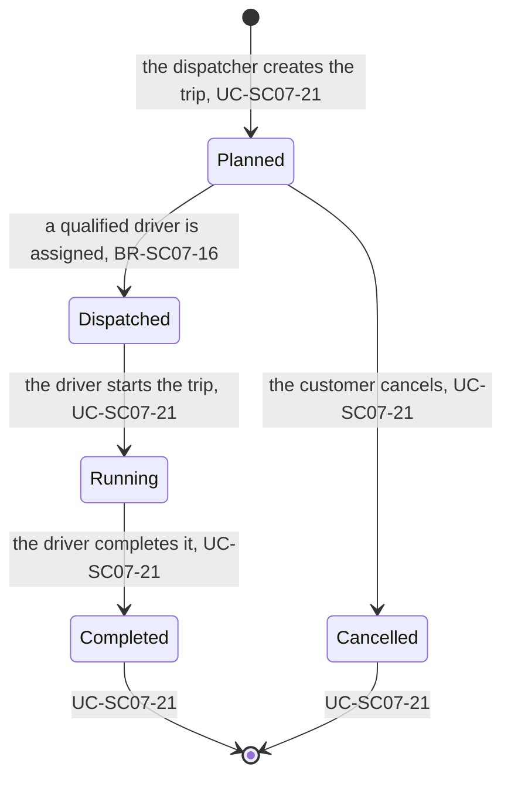

🏠 [Specs](../../../README.md) › 🏷️ [Sectors](../../README.md) › 🚛 [SC07 Transport and logistics](../README.md) ›
🗃️ [Data](README.md) › 🗃️ E-SC07-18 Passenger trip

# 🗃️ E-SC07-18 Passenger trip

**Status:** ✅ specified

## Purpose

One trip carrying people: its vehicle, driver, passengers, stops and quote
([D551](../../../06-decisions/sectors/d551-benchmark-gaps-sc07-transport.md)). It is related to the goods trip
([E-SC07-02 Trip](e-sc07-02-trip.md)) but differs: it counts passengers and seats, checks the licence for the bus class
and keeps the passenger list.

## Fields

| Name | Type | Required | Validation | Default | Example | Personal data | Custom fields |
|---|---|---|---|---|---|---|---|
| start | date and time | yes | not in the past | - | 2026-11-22 07:30 | no | no |
| pick-up | place | yes | an address | - | Lyon station | no | no |
| drop-off | place | yes | an address | - | Annecy lake | no | no |
| passengers | number | yes | 1 up to the seats | - | 48 | no | no |
| vehicle | vehicle (E-SC07-03) | no | a vehicle with the seats | - | Coach 41 | no | no |
| driver | user | no | licence covers the class | - | Moreau | no | no |
| quote | quote (E-F6-03) | no | an accepted quote | - | Q-1042 | no | no |
| passenger list | names and needs | no | personal data | - | 48 names | yes | no |
| price | amount in EUR | no | 0 or more | from the quote | 960.00 | no | no |
| state | Planned, Dispatched, Running, Completed, Cancelled | yes | the lifecycle below | Planned | Dispatched | no | no |
| owner | user | yes | a user of the company | the creator | Claire P. | yes | no |

## Relations

- [E-SC07-03 Fleet vehicle](e-sc07-03-fleet-vehicle.md)
- [E-SC07-04 Driver document](e-sc07-04-driver-document.md)
- [E-SC07-02 Trip](e-sc07-02-trip.md)
- [E-SC07-13 Transport invoice line](e-sc07-13-transport-invoice-line.md)

## Lifecycle

## Indexes and search

By date, vehicle, driver, customer and state.

## Retention

Kept five years, as transport records, and the passenger list erased after the period set in the settings.

## Audit

Every assignment, licence check, change, start, stop and completion, with who and when.

## Import and export

CSV import of a group's passenger list and export of the trips of a month.

## Used by

- [UC-SC07-21](../use-cases/07-passengers-removals-courier-and-freight/uc-sc07-21-run-passenger-transport.md)
- [UC-SC07-02](../use-cases/01-orders-and-planning/uc-sc07-02-plan-trips-and-optimise-routes.md)

## Open questions

None.

---

⬅️ [E-SC07-17 Transport CO2 statement](e-sc07-17-transport-co2-statement.md) · ⬆️ [Up](README.md) ·
➡️ [E-SC07-19 Removal](e-sc07-19-removal.md)
