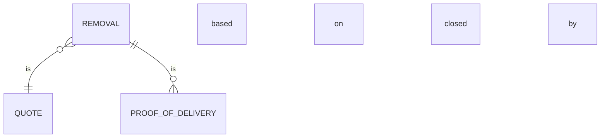
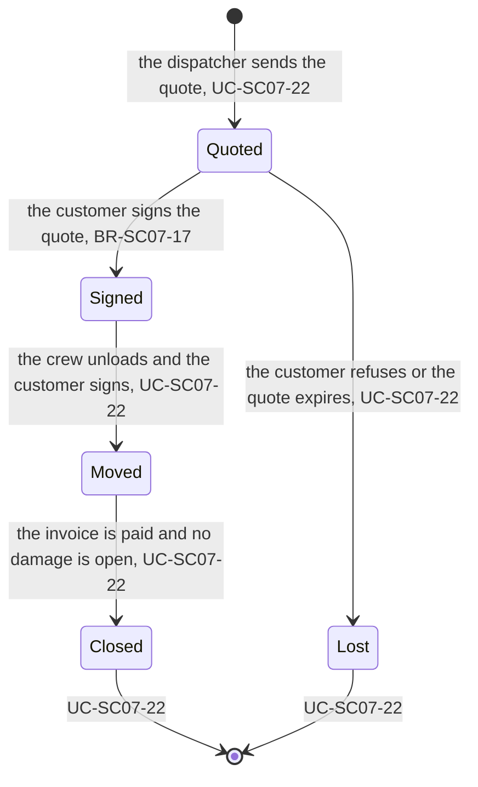

🏠 [Specs](../../../README.md) › 🏷️ [Sectors](../../README.md) › 🚛 [SC07 Transport and logistics](../README.md) ›
🗃️ [Data](README.md) › 🗃️ E-SC07-19 Removal

# 🗃️ E-SC07-19 Removal

**Status:** ✅ specified

## Purpose

One house or office move: addresses, volume, crew, quote, listed items with their condition, and damage notes
([D551](../../../06-decisions/sectors/d551-benchmark-gaps-sc07-transport.md)). The quote itself is a customer quote
([E-F6-03 Quote](../../../02-functional/f06-customers-and-sales/data/e-f06-03-quote.md)): the removal holds what is
specific to a move.

## Fields

| Name | Type | Required | Validation | Default | Example | Personal data | Custom fields |
|---|---|---|---|---|---|---|---|
| customer | customer (E-F6-01) | yes | a customer of the company | - | M. Dupont | no | no |
| from | address with floor | yes | an address | - | Lyon 3e, 4th floor | no | no |
| to | address with floor | yes | an address | - | Villeurbanne, 2nd floor | no | no |
| move date | date | yes | not in the past | - | 2026-12-12 | no | no |
| volume | number in m3 | yes | above 0 | - | 28 | no | no |
| crew | number | yes | 1 or more | - | 3 | no | no |
| quote | quote (E-F6-03) | yes | signed before the move | - | Q-1130 | no | no |
| declared value | amount in EUR | no | 0 or more | - | 12,000.00 | no | no |
| items | list with condition and photo | no | filled on the day | - | 34 items | no | no |
| damages | number | yes | 0 or more | 0 | 1 | no | no |
| state | Quoted, Signed, Moved, Closed, Lost | yes | the lifecycle below | Quoted | Signed | no | no |
| owner | user | yes | a user of the company | the creator | Claire P. | yes | no |

## Relations

- [E-F6-01](../../../02-functional/f06-customers-and-sales/data/e-f06-01-customer-record.md)
- [E-F6-03 Quote](../../../02-functional/f06-customers-and-sales/data/e-f06-03-quote.md)
- [E-SC07-03 Fleet vehicle](e-sc07-03-fleet-vehicle.md)
- [E-SC07-16 Proof of delivery](e-sc07-16-proof-of-delivery.md)

## Lifecycle

## Indexes and search

By customer, move date, state and city.

## Retention

Kept five years after the move, with the photos and signed lists, to settle a claim.

## Audit

Every quote version, signature, item, photo and damage note, with who, when and the device.

## Import and export

Export of the signed list and the photos of a removal as a PDF for the insurer.

## Used by

- [UC-SC07-22](../use-cases/07-passengers-removals-courier-and-freight/uc-sc07-22-quote-and-run-house-removals.md)
- [UC-SC07-01](../use-cases/01-orders-and-planning/uc-sc07-01-quote-and-take-transport-orders.md)

## Open questions

None.

---

⬅️ [E-SC07-18 Passenger trip](e-sc07-18-passenger-trip.md) · ⬆️ [Up](README.md) ·
➡️ [E-SC07-20 Parcel](e-sc07-20-parcel.md)
