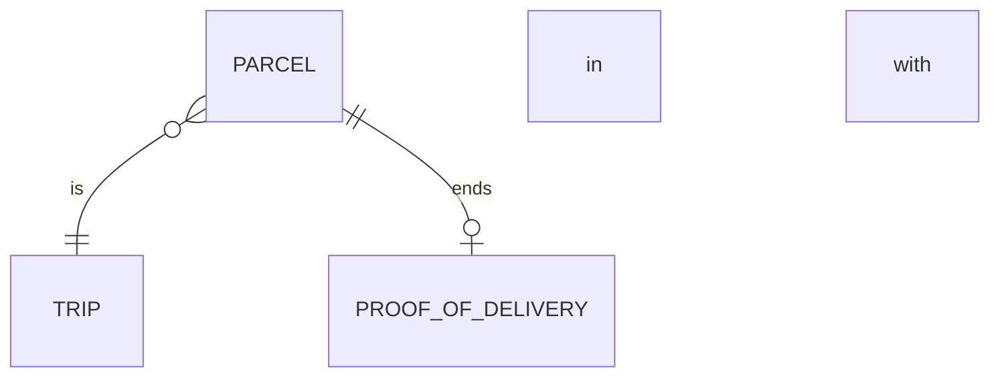
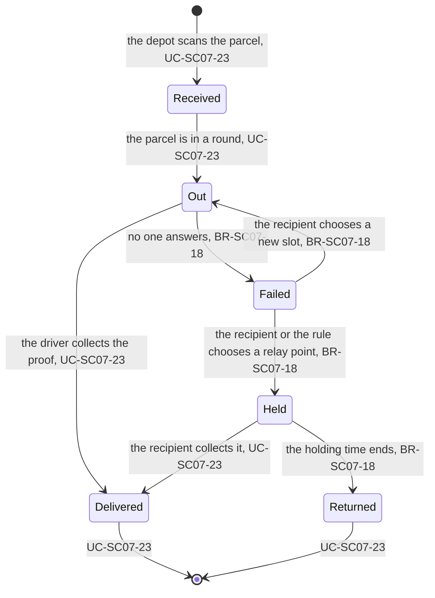

🏠 [Specs](../../../README.md) › 🏷️ [Sectors](../../README.md) › 🚛 [SC07 Transport and logistics](../README.md) ›
🗃️ [Data](README.md) › 🗃️ E-SC07-20 Parcel

# 🗃️ E-SC07-20 Parcel

**Status:** ✅ specified

## Purpose

One parcel followed from the depot to the recipient or the relay point: slot, round, attempts and proof
([D551](../../../06-decisions/sectors/d551-benchmark-gaps-sc07-transport.md)). It is the unit of the round; its proof is
the proof of delivery ([E-SC07-16 Proof of delivery](e-sc07-16-proof-of-delivery.md)) and its stop is a stop of a trip
([E-SC07-06 Stop](e-sc07-06-stop.md)).

## Fields

| Name | Type | Required | Validation | Default | Example | Personal data | Custom fields |
|---|---|---|---|---|---|---|---|
| reference | text | yes | unique in the depot | - | 98122 | no | no |
| recipient | name and address | yes | an address | - | Mme Laurent, 12 rue Garibaldi | yes | no |
| sender | customer (E-F6-01) | yes | a customer of the company | - | Shop Mode | no | no |
| slot | date and time window | no | after reception | - | 14:00-16:00 | no | no |
| round | trip (E-SC07-02) | no | a round of the day | - | R-01 | no | no |
| attempts | number | yes | 0 to 3 | 0 | 1 | no | no |
| relay point | place | no | a relay point of the settings | - | Tabac Victor Hugo | no | no |
| holding until | date | no | after the relay arrival | - | 2026-12-03 | no | no |
| proof | signature, photo or code | no | required to be Delivered | - | signature | no | no |
| state | Received, Out, Delivered, Failed, Held, Returned | yes | the lifecycle below | Received | Out | no | no |
| owner | user | yes | a user of the company | the creator | Claire P. | yes | no |

## Relations

- [E-SC07-16 Proof of delivery](e-sc07-16-proof-of-delivery.md)
- [E-SC07-06 Stop](e-sc07-06-stop.md)
- [E-SC07-02 Trip](e-sc07-02-trip.md)
- [E-F6-01](../../../02-functional/f06-customers-and-sales/data/e-f06-01-customer-record.md)

## Lifecycle

## Indexes and search

By reference, recipient, round, state and slot.

## Retention

Kept six months after delivery for claims, then the recipient's personal data erased.

## Audit

Every scan, attempt, proof, choice and return, with who, when and the place.

## Import and export

CSV import of the sender's manifest and export of the day's results to the sender.

## Used by

- [UC-SC07-23](../use-cases/07-passengers-removals-courier-and-freight/uc-sc07-23-run-last-mile-rounds.md)
- [UC-SC07-02](../use-cases/01-orders-and-planning/uc-sc07-02-plan-trips-and-optimise-routes.md)

## Open questions

None.

---

⬅️ [E-SC07-19 Removal](e-sc07-19-removal.md) · ⬆️ [Up](README.md) ·
➡️ [E-SC07-21 Shipment file](e-sc07-21-shipment-file.md)
