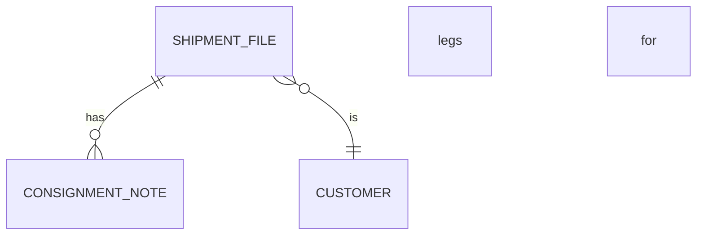
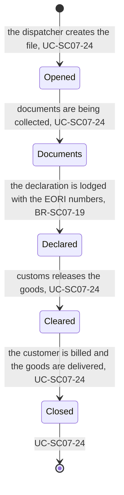

🏠 [Specs](../../../README.md) › 🏷️ [Sectors](../../README.md) › 🚛 [SC07 Transport and logistics](../README.md) ›
🗃️ [Data](README.md) › 🗃️ E-SC07-21 Shipment file

# 🗃️ E-SC07-21 Shipment file

**Status:** ✅ specified

## Purpose

The file of one international shipment handled by the forwarder: parties, goods, documents, declaration, duties and
carrier legs ([D551](../../../06-decisions/sectors/d551-benchmark-gaps-sc07-transport.md)). It is related to the
transport order ([E-SC07-01 Transport order](e-sc07-01-transport-order.md)) but differs: it holds the customs side that
a domestic order does not have.

## Fields

| Name | Type | Required | Validation | Default | Example | Personal data | Custom fields |
|---|---|---|---|---|---|---|---|
| customer | customer (E-F6-01) | yes | a customer of the company | - | Atelier Roche | no | no |
| direction | import, export, transit | yes | one of the three | - | import | no | no |
| incoterm | code | yes | a valid incoterm | - | FOB | no | no |
| goods | lines with tariff code, value, weight | yes | at least one line | - | 4 pallets | no | no |
| eori numbers | text per party | no | valid format | - | FR12345678901234 | no | no |
| documents | list with status | yes | the required documents | computed | 3 of 4 | no | no |
| duties | amount in EUR | no | 0 or more | computed | 1,240.00 | no | no |
| vat | amount in EUR | no | 0 or more | computed | 7,870.00 | no | no |
| customs reference | text | no | given by customs | - | 25FR1234567 | no | no |
| fee | amount in EUR | no | 0 or more | from the price list | 180.00 | no | no |
| state | Opened, Documents, Declared, Cleared, Closed | yes | the lifecycle below | Opened | Documents | no | no |
| owner | user | yes | a user of the company | the creator | Claire P. | yes | no |

## Relations

- [E-F6-01](../../../02-functional/f06-customers-and-sales/data/e-f06-01-customer-record.md)
- [E-SC07-01 Transport order](e-sc07-01-transport-order.md)
- [E-SC07-05 Consignment note](e-sc07-05-consignment-note.md)
- [E-SC07-12 Charter](e-sc07-12-charter.md)

## Lifecycle

## Indexes and search

By customer, direction, state, incoterm and customs reference.

## Retention

Kept ten years with the customs documents and the accounting records
([CR-FR-002](../../../10-country-packs/france/accounting/cr-fr-002-accounting-records-kept-ten-years.md)).

## Audit

Every document, code, declaration and release, with who, when and the customs reference.

## Import and export

Import of the lines of a commercial invoice as CSV, and export of the file for the customs portal.

## Used by

- [UC-SC07-24](../use-cases/07-passengers-removals-courier-and-freight/uc-sc07-24-forward-freight-and-clear-customs.md)
- [UC-SC07-12](../use-cases/01-orders-and-planning/uc-sc07-12-subcontract-to-other-carriers.md)

## Open questions

None.

---

⬅️ [E-SC07-20 Parcel](e-sc07-20-parcel.md) · ⬆️ [Up](README.md)
