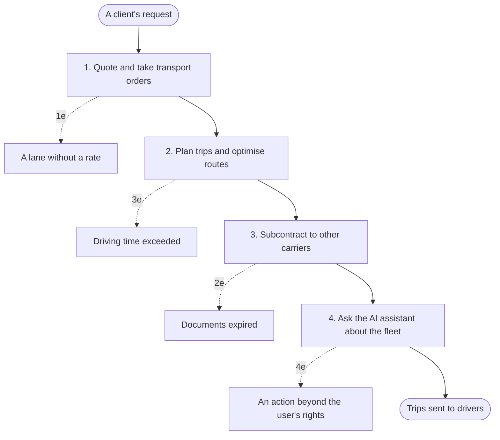

🏠 [Specs](../../../README.md) › 🏷️ [Sectors](../../README.md) › 🚛 [SC07 Transport and logistics](../README.md) ›
🔀 [Flows](README.md) › 🔀 FL-SC07-01 Orders and planning

# 🔀 FL-SC07-01 Orders and planning

**Status:** ✅ specified

## Summary

Orders, trips from the shared optimiser, chartering and the AI assistant. It covers
[UC-SC07-01 Quote and take transport orders](../use-cases/01-orders-and-planning/uc-sc07-01-quote-and-take-transport-orders.md),
[UC-SC07-02 Plan trips and optimise routes](../use-cases/01-orders-and-planning/uc-sc07-02-plan-trips-and-optimise-routes.md),
[UC-SC07-12 Subcontract to other carriers](../use-cases/01-orders-and-planning/uc-sc07-12-subcontract-to-other-carriers.md),
[UC-SC07-20 Ask the AI assistant about the fleet](../use-cases/01-orders-and-planning/uc-sc07-20-ask-the-assistant-about-the-fleet.md).

## Personas

- [U03 Sales](../../../01-users/personas/u03-sales.md)
- [U04 Purchasing and stock](../../../01-users/personas/u04-purchasing.md)
- [U09 Customer](../../../01-users/personas/u09-customer.md)
- [U29 Dispatcher](../../../01-users/personas/u29-dispatcher.md)
- [U30 Driver](../../../01-users/personas/u30-driver.md)

## Flowchart

## Sequence diagram

See each use case.

## Steps

| Step | Persona | Screen | Use case | What happens |
|---|---|---|---|---|
| 1 | U03, U29, U09 | [S-SC07-01](../screens/01-orders-and-planning/s-sc07-01-transport-orders.md), [S-SC07-02](../screens/01-orders-and-planning/s-sc07-02-trip-planning.md) | [UC-SC07-01](../use-cases/01-orders-and-planning/uc-sc07-01-quote-and-take-transport-orders.md) | Sales quotes a transport by lane, weight and pallets, once the client accepts, the order goes to the dispatcher for planning |
| 2 | U29 | [S-SC07-02](../screens/01-orders-and-planning/s-sc07-02-trip-planning.md) | [UC-SC07-02](../use-cases/01-orders-and-planning/uc-sc07-02-plan-trips-and-optimise-routes.md) | The dispatcher groups orders into trips with the shared rounds optimiser, checks driving times and licences, and assigns a vehicle and driver |
| 3 | U29, U04 | [S-SC07-12](../screens/01-orders-and-planning/s-sc07-12-chartering.md) | [UC-SC07-12](../use-cases/01-orders-and-planning/uc-sc07-12-subcontract-to-other-carriers.md) | The dispatcher and purchasing charter an order to another carrier, checking its licence and vigilance documents first |
| 4 | U29, U30 | [S-SC07-20](../screens/01-orders-and-planning/s-sc07-20-fleet-assistant.md) | [UC-SC07-20](../use-cases/01-orders-and-planning/uc-sc07-20-ask-the-assistant-about-the-fleet.md) | The dispatcher or a driver asks the AI assistant where a truck is, who can take a load or a driver's remaining time, within their role's rights |

### Entities and screens

| Entity | States in this flow | Shown at step and screen | Aggregated view |
|---|---|---|---|
| [E-F16-01 Customer request](../../../02-functional/f16-customer-support-agents/data/e-f16-01-customer-request.md) | New, In progress, Resolved, Waiting, Escalated | Shown elsewhere: [S-F16-11 My requests](../../../02-functional/f16-customer-support-agents/screens/05-customer-side/s-f16-11-my-requests.md) | Customer requests |
| [E-F6-03 Quote](../../../02-functional/f06-customers-and-sales/data/e-f06-03-quote.md) | Refused, Sent, Expired | Shown elsewhere: [S-F6-03 Quote editor](../../../02-functional/f06-customers-and-sales/screens/01-lead-to-quote/s-f06-03-quote-editor.md) | Quotes |
| [E-SC07-01 Transport order](../data/e-sc07-01-transport-order.md) | Quoted, Ordered, Planned, Delivered, Billed | 1 [S-SC07-01](../screens/01-orders-and-planning/s-sc07-01-transport-orders.md); 1, 2 [S-SC07-02](../screens/01-orders-and-planning/s-sc07-02-trip-planning.md) | Transport orders |
| [E-SC07-02 Trip](../data/e-sc07-02-trip.md) | Planned, Sent | 1, 2 [S-SC07-02](../screens/01-orders-and-planning/s-sc07-02-trip-planning.md); 4 [S-SC07-20](../screens/01-orders-and-planning/s-sc07-20-fleet-assistant.md) | Trips |
| [E-F7-08 Route](../../../02-functional/f07-purchasing-and-stock/data/e-f07-08-route.md) | Active | Shown elsewhere: [S-F7-13 Warehouse setup](../../../02-functional/f07-purchasing-and-stock/screens/03-replenish/s-f07-13-warehouse-setup.md) | Routes |
| [E-SC07-12 Charter](../data/e-sc07-12-charter.md) | Sent, Blocked | 3 [S-SC07-12](../screens/01-orders-and-planning/s-sc07-12-chartering.md) | Charters |
| [E-F2-13 Document](../../../02-functional/f02-no-code-configuration/data/e-f02-13-document.md) | To sort, To validate, Done | Shown elsewhere: [S-F2-13 Documents workspace](../../../02-functional/f02-no-code-configuration/screens/07-benchmark-additions/s-f02-13-documents-workspace.md) | Documents |
| [E-SC07-03 Fleet vehicle](../data/e-sc07-03-fleet-vehicle.md) | Blocked | Shown elsewhere: [S-SC07-03 Fleet](../screens/02-fleet-and-drivers/s-sc07-03-fleet.md) | Fleet vehicles |
| [E-F3-04 Assistant change batch](../../../02-functional/f03-assistant/data/e-f03-04-assistant-change-batch.md) | Proposed | Shown elsewhere: [S-F3-01 Assistant panel](../../../02-functional/f03-assistant/screens/01-ask-the-assistant/s-f03-01-assistant-panel.md) | Assistant change batches |
| [E-F1-03 User](../../../02-functional/f01-administration/data/e-f01-03-user.md) | Invited, Active, Deactivated | Shown elsewhere: [S-F1-03 Users](../../../02-functional/f01-administration/screens/03-user-lifecycle/s-f01-03-users.md) | Users |
| [E-F1-06 Role](../../../02-functional/f01-administration/data/e-f01-06-role.md) | Active | Shown elsewhere: [S-F1-06 Role editor](../../../02-functional/f01-administration/screens/04-edit-a-role/s-f01-06-role-editor.md) | Roles |

## Errors

- [UC-SC07-01](../use-cases/01-orders-and-planning/uc-sc07-01-quote-and-take-transport-orders.md) 1e. A lane without a
  rate: sales is asked to set one.
- [UC-SC07-01](../use-cases/01-orders-and-planning/uc-sc07-01-quote-and-take-transport-orders.md) 4e. The delivery
  window impossible for the distance: the dispatcher is warned.
- [UC-SC07-02](../use-cases/01-orders-and-planning/uc-sc07-02-plan-trips-and-optimise-routes.md) 3e. Driving time
  exceeded: the assignment is refused with the remaining time.
- [UC-SC07-02](../use-cases/01-orders-and-planning/uc-sc07-02-plan-trips-and-optimise-routes.md) 3f. A vehicle without a
  valid licence copy: it is not assignable.
- [UC-SC07-12](../use-cases/01-orders-and-planning/uc-sc07-12-subcontract-to-other-carriers.md) 2e. Documents expired:
  the charter is blocked.
- [UC-SC07-12](../use-cases/01-orders-and-planning/uc-sc07-12-subcontract-to-other-carriers.md) 3e. The carrier refuses:
  the next carrier is proposed.
- [UC-SC07-20](../use-cases/01-orders-and-planning/uc-sc07-20-ask-the-assistant-about-the-fleet.md) 4e. An action beyond
  the user's rights: the AI assistant refuses and says which role can do it.
- [UC-SC07-20](../use-cases/01-orders-and-planning/uc-sc07-20-ask-the-assistant-about-the-fleet.md) 2e. No position
  shared: the AI assistant says the last known position and its time.

## Images

Every step and error, for each persona taking part, in light and dark mode (D120). Steps are numbered as in the Steps
table; E rows are the error cases.

| Step | Persona | Device | Light | Dark |
|---|---|---|---|---|
| 1 | U03 | desktop | [light](../images/01-orders-and-planning/u03-sales/1-order-desktop-light.png) | [dark](../images/01-orders-and-planning/u03-sales/1-order-desktop-dark.png) |
| 1 | U03 | phone | [light](../images/01-orders-and-planning/u03-sales/1-order-phone-light.png) | [dark](../images/01-orders-and-planning/u03-sales/1-order-phone-dark.png) |
| 1 | U03 | tablet | [light](../images/01-orders-and-planning/u03-sales/1-order-tablet-light.png) | [dark](../images/01-orders-and-planning/u03-sales/1-order-tablet-dark.png) |
| 1 | U09 | phone | [light](../images/01-orders-and-planning/u09-customer/1-order-phone-light.png) | [dark](../images/01-orders-and-planning/u09-customer/1-order-phone-dark.png) |
| 1 | U29 | desktop | [light](../images/01-orders-and-planning/u29-dispatcher/1-order-desktop-light.png) | [dark](../images/01-orders-and-planning/u29-dispatcher/1-order-desktop-dark.png) |
| 1 | U29 | phone | [light](../images/01-orders-and-planning/u29-dispatcher/1-order-phone-light.png) | [dark](../images/01-orders-and-planning/u29-dispatcher/1-order-phone-dark.png) |
| 2 | U29 | desktop | [light](../images/01-orders-and-planning/u29-dispatcher/2-plan-trips-desktop-light.png) | [dark](../images/01-orders-and-planning/u29-dispatcher/2-plan-trips-desktop-dark.png) |
| 2 | U29 | phone | [light](../images/01-orders-and-planning/u29-dispatcher/2-plan-trips-phone-light.png) | [dark](../images/01-orders-and-planning/u29-dispatcher/2-plan-trips-phone-dark.png) |
| 3 | U29 | desktop | [light](../images/01-orders-and-planning/u29-dispatcher/3-charter-desktop-light.png) | [dark](../images/01-orders-and-planning/u29-dispatcher/3-charter-desktop-dark.png) |
| 3 | U29 | phone | [light](../images/01-orders-and-planning/u29-dispatcher/3-charter-phone-light.png) | [dark](../images/01-orders-and-planning/u29-dispatcher/3-charter-phone-dark.png) |
| 3 | U04 | desktop | [light](../images/01-orders-and-planning/u04-purchasing/3-charter-desktop-light.png) | [dark](../images/01-orders-and-planning/u04-purchasing/3-charter-desktop-dark.png) |
| 4 | U29 | desktop | [light](../images/01-orders-and-planning/u29-dispatcher/4-assistant-desktop-light.png) | [dark](../images/01-orders-and-planning/u29-dispatcher/4-assistant-desktop-dark.png) |
| 4 | U29 | phone | [light](../images/01-orders-and-planning/u29-dispatcher/4-assistant-phone-light.png) | [dark](../images/01-orders-and-planning/u29-dispatcher/4-assistant-phone-dark.png) |
| 4 | U30 | phone | [light](../images/01-orders-and-planning/u30-driver/4-assistant-phone-light.png) | [dark](../images/01-orders-and-planning/u30-driver/4-assistant-phone-dark.png) |
| E1 | U29 | desktop | [light](../images/01-orders-and-planning/u29-dispatcher/e1-driving-time-desktop-light.png) | [dark](../images/01-orders-and-planning/u29-dispatcher/e1-driving-time-desktop-dark.png) |
| E1 | U29 | phone | [light](../images/01-orders-and-planning/u29-dispatcher/e1-driving-time-phone-light.png) | [dark](../images/01-orders-and-planning/u29-dispatcher/e1-driving-time-phone-dark.png) |

## Open questions

None.

---

⬆️ [Up](README.md) · ➡️ [FL-SC07-02 Fleet and drivers](fl-sc07-02-fleet-and-drivers.md)
