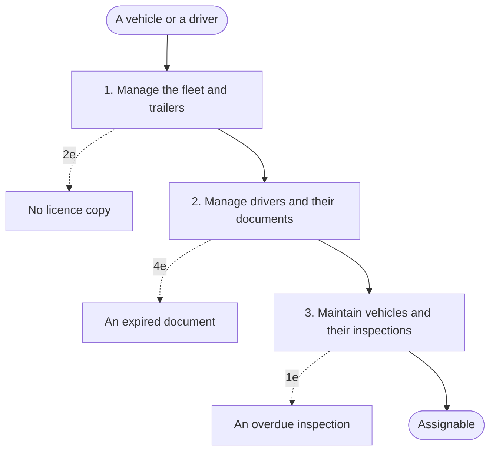

🏠 [Specs](../../../README.md) › 🏷️ [Sectors](../../README.md) › 🚛 [SC07 Transport and logistics](../README.md) ›
🔀 [Flows](README.md) › 🔀 FL-SC07-02 Fleet and drivers

# 🔀 FL-SC07-02 Fleet and drivers

**Status:** ✅ specified

## Summary

The fleet, the drivers' documents and maintenance. It covers
[UC-SC07-03 Manage the fleet and trailers](../use-cases/02-fleet-and-drivers/uc-sc07-03-manage-the-fleet-and-trailers.md),
[UC-SC07-04 Manage drivers and their documents](../use-cases/02-fleet-and-drivers/uc-sc07-04-manage-drivers-and-their-documents.md),
[UC-SC07-11 Maintain vehicles and their inspections](../use-cases/02-fleet-and-drivers/uc-sc07-11-maintain-vehicles-and-their-inspections.md).

## Personas

- [U06 Human resources](../../../01-users/personas/u06-hr.md)
- [U29 Dispatcher](../../../01-users/personas/u29-dispatcher.md)

## Flowchart

## Sequence diagram

See each use case.

## Steps

| Step | Persona | Screen | Use case | What happens |
|---|---|---|---|---|
| 1 | U29 | [S-SC07-03](../screens/02-fleet-and-drivers/s-sc07-03-fleet.md) | [UC-SC07-03](../use-cases/02-fleet-and-drivers/uc-sc07-03-manage-the-fleet-and-trailers.md) | The dispatcher adds vehicles and trailers, links each to its licence copy, and follows them |
| 2 | U29, U06 | [S-SC07-04](../screens/02-fleet-and-drivers/s-sc07-04-drivers.md) | [UC-SC07-04](../use-cases/02-fleet-and-drivers/uc-sc07-04-manage-drivers-and-their-documents.md) | The dispatcher and HR record drivers' licences, driver cards, training and medical checks, follow expiries and remind renewals |
| 3 | U29 | [S-SC07-11](../screens/02-fleet-and-drivers/s-sc07-11-vehicle-maintenance.md) | [UC-SC07-11](../use-cases/02-fleet-and-drivers/uc-sc07-11-maintain-vehicles-and-their-inspections.md) | The dispatcher plans maintenance and technical inspections, records repairs and their cost, an overdue vehicle cannot start a trip |

### Entities and screens

| Entity | States in this flow | Shown at step and screen | Aggregated view |
|---|---|---|---|
| [E-SC07-03 Fleet vehicle](../data/e-sc07-03-fleet-vehicle.md) | Blocked, Overdue | 1 [S-SC07-03](../screens/02-fleet-and-drivers/s-sc07-03-fleet.md); 3 [S-SC07-11](../screens/02-fleet-and-drivers/s-sc07-11-vehicle-maintenance.md) | Fleet vehicles |
| [E-SC07-04 Driver document](../data/e-sc07-04-driver-document.md) | Active | 2 [S-SC07-04](../screens/02-fleet-and-drivers/s-sc07-04-drivers.md) | Driver documents |
| [E-SC07-11 Vehicle repair](../data/e-sc07-11-vehicle-repair.md) | Active | 3 [S-SC07-11](../screens/02-fleet-and-drivers/s-sc07-11-vehicle-maintenance.md) | Vehicle repairs |

## Errors

- [UC-SC07-03](../use-cases/02-fleet-and-drivers/uc-sc07-03-manage-the-fleet-and-trailers.md) 2e. No licence copy: it is
  not assignable for hire or reward.
- [UC-SC07-03](../use-cases/02-fleet-and-drivers/uc-sc07-03-manage-the-fleet-and-trailers.md) 2f. A copy of the wrong
  kind: it is refused.
- [UC-SC07-04](../use-cases/02-fleet-and-drivers/uc-sc07-04-manage-drivers-and-their-documents.md) 4e. An expired
  document: the driver is blocked from trips.
- [UC-SC07-04](../use-cases/02-fleet-and-drivers/uc-sc07-04-manage-drivers-and-their-documents.md) 1e. A document
  without a date: it is refused.
- [UC-SC07-11](../use-cases/02-fleet-and-drivers/uc-sc07-11-maintain-vehicles-and-their-inspections.md) 1e. An overdue
  inspection: the vehicle cannot start a trip
  ([BR-SC07-10](../business-rules/br-sc07-10-vehicles-inspected-on-time.md)).
- [UC-SC07-11](../use-cases/02-fleet-and-drivers/uc-sc07-11-maintain-vehicles-and-their-inspections.md) 3e. A repair
  without invoice: its cost stays estimated.

## Images

Every step and error, for each persona taking part, in light and dark mode (D120). Steps are numbered as in the Steps
table; E rows are the error cases.

| Step | Persona | Device | Light | Dark |
|---|---|---|---|---|
| 1 | U29 | desktop | [light](../images/02-fleet-and-drivers/u29-dispatcher/1-fleet-desktop-light.png) | [dark](../images/02-fleet-and-drivers/u29-dispatcher/1-fleet-desktop-dark.png) |
| 1 | U29 | phone | [light](../images/02-fleet-and-drivers/u29-dispatcher/1-fleet-phone-light.png) | [dark](../images/02-fleet-and-drivers/u29-dispatcher/1-fleet-phone-dark.png) |
| 2 | U29 | desktop | [light](../images/02-fleet-and-drivers/u29-dispatcher/2-drivers-desktop-light.png) | [dark](../images/02-fleet-and-drivers/u29-dispatcher/2-drivers-desktop-dark.png) |
| 2 | U29 | phone | [light](../images/02-fleet-and-drivers/u29-dispatcher/2-drivers-phone-light.png) | [dark](../images/02-fleet-and-drivers/u29-dispatcher/2-drivers-phone-dark.png) |
| 2 | U06 | desktop | [light](../images/02-fleet-and-drivers/u06-hr/2-drivers-desktop-light.png) | [dark](../images/02-fleet-and-drivers/u06-hr/2-drivers-desktop-dark.png) |
| 3 | U29 | desktop | [light](../images/02-fleet-and-drivers/u29-dispatcher/3-maintenance-desktop-light.png) | [dark](../images/02-fleet-and-drivers/u29-dispatcher/3-maintenance-desktop-dark.png) |
| 3 | U29 | phone | [light](../images/02-fleet-and-drivers/u29-dispatcher/3-maintenance-phone-light.png) | [dark](../images/02-fleet-and-drivers/u29-dispatcher/3-maintenance-phone-dark.png) |
| E1 | U29 | desktop | [light](../images/02-fleet-and-drivers/u29-dispatcher/e1-document-expired-desktop-light.png) | [dark](../images/02-fleet-and-drivers/u29-dispatcher/e1-document-expired-desktop-dark.png) |
| E1 | U29 | phone | [light](../images/02-fleet-and-drivers/u29-dispatcher/e1-document-expired-phone-light.png) | [dark](../images/02-fleet-and-drivers/u29-dispatcher/e1-document-expired-phone-dark.png) |

## Open questions

None.

---

⬅️ [FL-SC07-01 Orders and planning](fl-sc07-01-orders-and-planning.md) · ⬆️ [Up](README.md) ·
➡️ [FL-SC07-03 On the road](fl-sc07-03-on-the-road.md)
