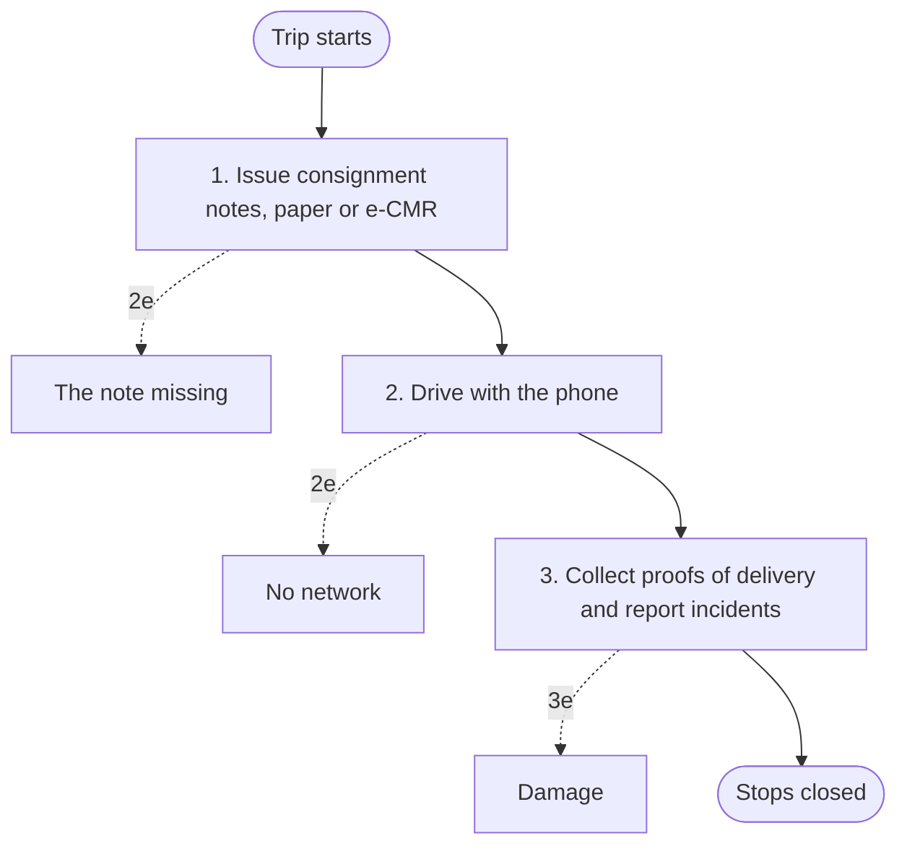

🏠 [Specs](../../../README.md) › 🏷️ [Sectors](../../README.md) › 🚛 [SC07 Transport and logistics](../README.md) ›
🔀 [Flows](README.md) › 🔀 FL-SC07-03 On the road

# 🔀 FL-SC07-03 On the road

**Status:** ✅ specified

## Summary

On the road: notes, the phone and proofs. It covers
[UC-SC07-05 Issue consignment notes, paper or e-CMR](../use-cases/03-on-the-road/uc-sc07-05-issue-consignment-notes-paper-or-e-cmr.md),
[UC-SC07-06 Drive with the phone](../use-cases/03-on-the-road/uc-sc07-06-drive-with-the-phone.md),
[UC-SC07-07 Collect proofs of delivery and report incidents](../use-cases/03-on-the-road/uc-sc07-07-collect-proofs-of-delivery-and-report-incidents.md).

## Personas

- [U29 Dispatcher](../../../01-users/personas/u29-dispatcher.md)
- [U30 Driver](../../../01-users/personas/u30-driver.md)

## Flowchart

## Sequence diagram

See each use case.

## Steps

| Step | Persona | Screen | Use case | What happens |
|---|---|---|---|---|
| 1 | U29, U30 | [S-SC07-05](../screens/03-on-the-road/s-sc07-05-consignment-notes.md) | [UC-SC07-05](../use-cases/03-on-the-road/uc-sc07-05-issue-consignment-notes-paper-or-e-cmr.md) | The dispatcher generates a consignment note per shipment, the driver has it signed at loading and at delivery, on paper or electronically |
| 2 | U30 | [S-SC07-06](../screens/03-on-the-road/s-sc07-06-driver-app.md) | [UC-SC07-06](../use-cases/03-on-the-road/uc-sc07-06-drive-with-the-phone.md) | The driver starts the trip on the phone, checks in at each stop, scans the goods and goes on, offline when needed through the offline phone forms |
| 3 | U30, U29 | [S-SC07-07](../screens/03-on-the-road/s-sc07-07-proof-of-delivery.md) | [UC-SC07-07](../use-cases/03-on-the-road/uc-sc07-07-collect-proofs-of-delivery-and-report-incidents.md) | At delivery the driver collects a signature, photo or code, notes the consignee's reservations and reports incidents to the dispatcher |

### Entities and screens

| Entity | States in this flow | Shown at step and screen | Aggregated view |
|---|---|---|---|
| [E-SC07-02 Trip](../data/e-sc07-02-trip.md) | Planned, Sent, Assigned | Shown elsewhere: [S-SC07-02 Trip planning](../screens/01-orders-and-planning/s-sc07-02-trip-planning.md) | Trips |
| [E-SC07-05 Consignment note](../data/e-sc07-05-consignment-note.md) | Recorded | 1 [S-SC07-05](../screens/03-on-the-road/s-sc07-05-consignment-notes.md) | Consignment notes |
| [E-F7-04 Transfer](../../../02-functional/f07-purchasing-and-stock/data/e-f07-04-transfer.md) | Sent, Received, Lost, Reserved, Flagged | Shown elsewhere: [S-F10-25 Store stock and transfers](../../../02-functional/f10-point-of-sale/screens/10-clienteling-transfers-and-tax-free/s-f10-25-store-stock-and-transfers.md) | Transfers |
| [E-SC07-07 Transport incident](../data/e-sc07-07-transport-incident.md) | Active | 3 [S-SC07-07](../screens/03-on-the-road/s-sc07-07-proof-of-delivery.md) | Transport incidents |
| [E-SC07-06 Stop](../data/e-sc07-06-stop.md) | New, Open, Done, Closed | 2 [S-SC07-06](../screens/03-on-the-road/s-sc07-06-driver-app.md); 3 [S-SC07-07](../screens/03-on-the-road/s-sc07-07-proof-of-delivery.md) | Stops |

## Errors

- [UC-SC07-05](../use-cases/03-on-the-road/uc-sc07-05-issue-consignment-notes-paper-or-e-cmr.md) 2e. The note missing:
  the trip cannot start.
- [UC-SC07-05](../use-cases/03-on-the-road/uc-sc07-05-issue-consignment-notes-paper-or-e-cmr.md) 3e. No network at
  delivery: the signature is kept on the phone and synced.
- [UC-SC07-06](../use-cases/03-on-the-road/uc-sc07-06-drive-with-the-phone.md) 2e. No network: check-ins and scans are
  kept and synced in order,
  [BR-F2-21](../../../02-functional/f02-no-code-configuration/business-rules/br-f02-21-offline-forms-keep-only-what-is-needed-and-sync-in-order.md).
- [UC-SC07-06](../use-cases/03-on-the-road/uc-sc07-06-drive-with-the-phone.md) 3e. A pallet missing at loading: the
  reservation is recorded.
- [UC-SC07-07](../use-cases/03-on-the-road/uc-sc07-07-collect-proofs-of-delivery-and-report-incidents.md) 3e. Damage: an
  incident is opened and the client told.
- [UC-SC07-07](../use-cases/03-on-the-road/uc-sc07-07-collect-proofs-of-delivery-and-report-incidents.md) 1e. No proof:
  the stop cannot close.

## Images

Every step and error, for each persona taking part, in light and dark mode (D120). Steps are numbered as in the Steps
table; E rows are the error cases.

| Step | Persona | Device | Light | Dark |
|---|---|---|---|---|
| 1 | U30 | phone | [light](../images/03-on-the-road/u30-driver/1-consignment-note-phone-light.png) | [dark](../images/03-on-the-road/u30-driver/1-consignment-note-phone-dark.png) |
| 1 | U29 | desktop | [light](../images/03-on-the-road/u29-dispatcher/1-consignment-note-desktop-light.png) | [dark](../images/03-on-the-road/u29-dispatcher/1-consignment-note-desktop-dark.png) |
| 1 | U29 | phone | [light](../images/03-on-the-road/u29-dispatcher/1-consignment-note-phone-light.png) | [dark](../images/03-on-the-road/u29-dispatcher/1-consignment-note-phone-dark.png) |
| 2 | U30 | phone | [light](../images/03-on-the-road/u30-driver/2-trip-phone-light.png) | [dark](../images/03-on-the-road/u30-driver/2-trip-phone-dark.png) |
| 3 | U30 | phone | [light](../images/03-on-the-road/u30-driver/3-proof-phone-light.png) | [dark](../images/03-on-the-road/u30-driver/3-proof-phone-dark.png) |
| 3 | U29 | desktop | [light](../images/03-on-the-road/u29-dispatcher/3-proof-desktop-light.png) | [dark](../images/03-on-the-road/u29-dispatcher/3-proof-desktop-dark.png) |
| 3 | U29 | phone | [light](../images/03-on-the-road/u29-dispatcher/3-proof-phone-light.png) | [dark](../images/03-on-the-road/u29-dispatcher/3-proof-phone-dark.png) |
| E1 | U30 | phone | [light](../images/03-on-the-road/u30-driver/e1-no-note-phone-light.png) | [dark](../images/03-on-the-road/u30-driver/e1-no-note-phone-dark.png) |

## Open questions

None.

---

⬅️ [FL-SC07-02 Fleet and drivers](fl-sc07-02-fleet-and-drivers.md) · ⬆️ [Up](README.md) ·
➡️ [FL-SC07-04 Compliance](fl-sc07-04-compliance.md)
