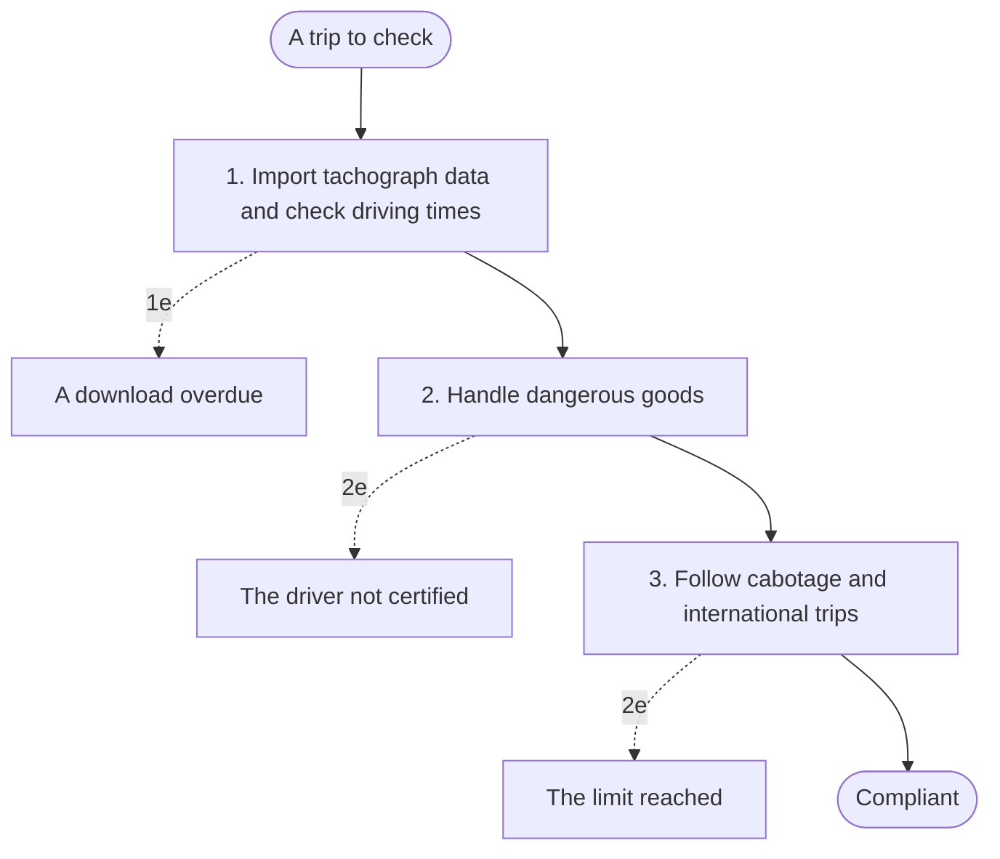

🏠 [Specs](../../../README.md) › 🏷️ [Sectors](../../README.md) › 🚛 [SC07 Transport and logistics](../README.md) ›
🔀 [Flows](README.md) › 🔀 FL-SC07-04 Compliance

# 🔀 FL-SC07-04 Compliance

**Status:** ✅ specified

## Summary

Compliance: tachograph, dangerous goods and cabotage. It covers
[UC-SC07-08 Import tachograph data and check driving times](../use-cases/04-compliance/uc-sc07-08-import-tachograph-data-and-check-driving-times.md),
[UC-SC07-09 Handle dangerous goods](../use-cases/04-compliance/uc-sc07-09-handle-dangerous-goods.md),
[UC-SC07-19 Follow cabotage and international trips](../use-cases/04-compliance/uc-sc07-19-follow-cabotage-and-international-trips.md).

## Personas

- [U29 Dispatcher](../../../01-users/personas/u29-dispatcher.md)
- [U30 Driver](../../../01-users/personas/u30-driver.md)

## Flowchart

## Sequence diagram

See each use case.

## Steps

| Step | Persona | Screen | Use case | What happens |
|---|---|---|---|---|
| 1 | U29 | [S-SC07-08](../screens/04-compliance/s-sc07-08-tachograph.md) | [UC-SC07-08](../use-cases/04-compliance/uc-sc07-08-import-tachograph-data-and-check-driving-times.md) | The dispatcher imports tachograph downloads, checks driving and rest times and acts on infringements |
| 2 | U29, U30 | [S-SC07-09](../screens/04-compliance/s-sc07-09-dangerous-goods.md) | [UC-SC07-09](../use-cases/04-compliance/uc-sc07-09-handle-dangerous-goods.md) | The dispatcher marks a load as dangerous goods, checks the driver's training and the vehicle's equipment, and issues the documents |
| 3 | U29 | [S-SC07-19](../screens/04-compliance/s-sc07-19-international-trips.md) | [UC-SC07-19](../use-cases/04-compliance/uc-sc07-19-follow-cabotage-and-international-trips.md) | The dispatcher plans trips abroad, counts cabotage operations against their limits and declares posted drivers |

### Entities and screens

| Entity | States in this flow | Shown at step and screen | Aggregated view |
|---|---|---|---|
| [E-SC07-02 Trip](../data/e-sc07-02-trip.md) | Planned, Sent, Assigned | 3 [S-SC07-19](../screens/04-compliance/s-sc07-19-international-trips.md) | Trips |
| [E-SC07-08 Tachograph file](../data/e-sc07-08-tachograph-file.md) | Active | 1 [S-SC07-08](../screens/04-compliance/s-sc07-08-tachograph.md) | Tachograph files |
| [E-SC07-09 Dangerous goods declaration](../data/e-sc07-09-dangerous-goods-declaration.md) | Active | 2 [S-SC07-09](../screens/04-compliance/s-sc07-09-dangerous-goods.md) | Dangerous goods declarations |
| [E-SC07-15 Cabotage operation](../data/e-sc07-15-cabotage-operation.md) | Active | 3 [S-SC07-19](../screens/04-compliance/s-sc07-19-international-trips.md) | Cabotage operations |

## Errors

- [UC-SC07-08](../use-cases/04-compliance/uc-sc07-08-import-tachograph-data-and-check-driving-times.md) 1e. A download
  overdue: the dispatcher is alerted.
- [UC-SC07-08](../use-cases/04-compliance/uc-sc07-08-import-tachograph-data-and-check-driving-times.md) 2e. A damaged
  file: it is refused and asked again.
- [UC-SC07-09](../use-cases/04-compliance/uc-sc07-09-handle-dangerous-goods.md) 2e. The driver not certified: the
  assignment is refused.
- [UC-SC07-09](../use-cases/04-compliance/uc-sc07-09-handle-dangerous-goods.md) 2f. The vehicle not equipped: it is
  refused.
- [UC-SC07-19](../use-cases/04-compliance/uc-sc07-19-follow-cabotage-and-international-trips.md) 2e. The limit reached:
  the operation is refused.
- [UC-SC07-19](../use-cases/04-compliance/uc-sc07-19-follow-cabotage-and-international-trips.md) 3e. No declaration: the
  trip cannot start.

## Images

Every step and error, for each persona taking part, in light and dark mode (D120). Steps are numbered as in the Steps
table; E rows are the error cases.

| Step | Persona | Device | Light | Dark |
|---|---|---|---|---|
| 1 | U29 | desktop | [light](../images/04-compliance/u29-dispatcher/1-tachograph-desktop-light.png) | [dark](../images/04-compliance/u29-dispatcher/1-tachograph-desktop-dark.png) |
| 1 | U29 | phone | [light](../images/04-compliance/u29-dispatcher/1-tachograph-phone-light.png) | [dark](../images/04-compliance/u29-dispatcher/1-tachograph-phone-dark.png) |
| 2 | U29 | desktop | [light](../images/04-compliance/u29-dispatcher/2-dangerous-goods-desktop-light.png) | [dark](../images/04-compliance/u29-dispatcher/2-dangerous-goods-desktop-dark.png) |
| 2 | U29 | phone | [light](../images/04-compliance/u29-dispatcher/2-dangerous-goods-phone-light.png) | [dark](../images/04-compliance/u29-dispatcher/2-dangerous-goods-phone-dark.png) |
| 2 | U30 | phone | [light](../images/04-compliance/u30-driver/2-dangerous-goods-phone-light.png) | [dark](../images/04-compliance/u30-driver/2-dangerous-goods-phone-dark.png) |
| 3 | U29 | desktop | [light](../images/04-compliance/u29-dispatcher/3-cabotage-desktop-light.png) | [dark](../images/04-compliance/u29-dispatcher/3-cabotage-desktop-dark.png) |
| 3 | U29 | phone | [light](../images/04-compliance/u29-dispatcher/3-cabotage-phone-light.png) | [dark](../images/04-compliance/u29-dispatcher/3-cabotage-phone-dark.png) |
| E1 | U29 | desktop | [light](../images/04-compliance/u29-dispatcher/e1-cabotage-limit-desktop-light.png) | [dark](../images/04-compliance/u29-dispatcher/e1-cabotage-limit-desktop-dark.png) |
| E1 | U29 | phone | [light](../images/04-compliance/u29-dispatcher/e1-cabotage-limit-phone-light.png) | [dark](../images/04-compliance/u29-dispatcher/e1-cabotage-limit-phone-dark.png) |

## Open questions

None.

---

⬅️ [FL-SC07-03 On the road](fl-sc07-03-on-the-road.md) · ⬆️ [Up](README.md) ·
➡️ [FL-SC07-05 Billing and performance](fl-sc07-05-billing-and-performance.md)
