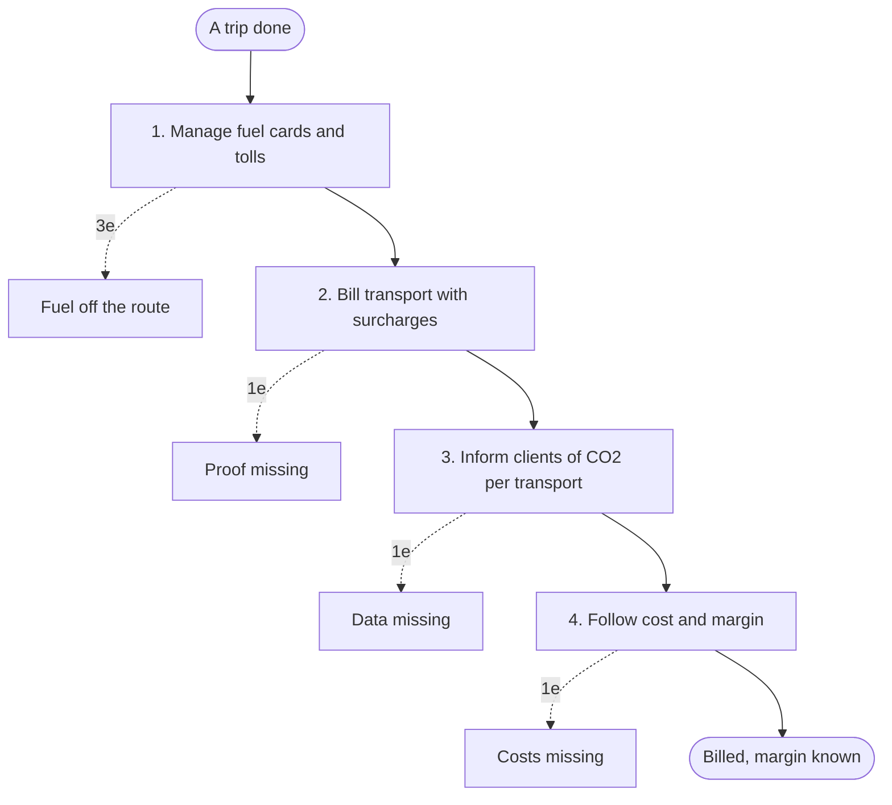

🏠 [Specs](../../../README.md) › 🏷️ [Sectors](../../README.md) › 🚛 [SC07 Transport and logistics](../README.md) ›
🔀 [Flows](README.md) › 🔀 FL-SC07-05 Billing and performance

# 🔀 FL-SC07-05 Billing and performance

**Status:** ✅ specified

## Summary

Costs and billing: fuel, invoices, CO2 and margins. It covers
[UC-SC07-10 Manage fuel cards and tolls](../use-cases/05-billing-and-performance/uc-sc07-10-manage-fuel-cards-and-tolls.md),
[UC-SC07-13 Bill transport with surcharges](../use-cases/05-billing-and-performance/uc-sc07-13-bill-transport-with-surcharges.md),
[UC-SC07-17 Inform clients of CO2 per transport](../use-cases/05-billing-and-performance/uc-sc07-17-inform-clients-of-co2-per-transport.md),
[UC-SC07-18 Follow cost and margin](../use-cases/05-billing-and-performance/uc-sc07-18-follow-cost-and-margin.md).

## Personas

- [U05 Accounting](../../../01-users/personas/u05-accounting.md)
- [U13 Owner](../../../01-users/personas/u13-owner.md)
- [U29 Dispatcher](../../../01-users/personas/u29-dispatcher.md)

## Flowchart

## Sequence diagram

See each use case.

## Steps

| Step | Persona | Screen | Use case | What happens |
|---|---|---|---|---|
| 1 | U29, U05 | [S-SC07-10](../screens/05-billing-and-performance/s-sc07-10-fuel-and-tolls.md) | [UC-SC07-10](../use-cases/05-billing-and-performance/uc-sc07-10-manage-fuel-cards-and-tolls.md) | The dispatcher and accounting import fuel card and toll lines, match them to vehicles and trips and check anomalies |
| 2 | U05, U29 | [S-SC07-13](../screens/05-billing-and-performance/s-sc07-13-transport-billing.md) | [UC-SC07-13](../use-cases/05-billing-and-performance/uc-sc07-13-bill-transport-with-surcharges.md) | Accounting closes the trip and bills freight, fuel surcharge from the index, waiting time and extras |
| 3 | U29, U05 | [S-SC07-17](../screens/05-billing-and-performance/s-sc07-17-co2-information.md) | [UC-SC07-17](../use-cases/05-billing-and-performance/uc-sc07-17-inform-clients-of-co2-per-transport.md) | Simple-ERP computes each transport's emissions, shows them on the invoice and reports them yearly |
| 4 | U13, U29 | [S-SC07-18](../screens/05-billing-and-performance/s-sc07-18-margins.md) | [UC-SC07-18](../use-cases/05-billing-and-performance/uc-sc07-18-follow-cost-and-margin.md) | The owner and the dispatcher follow cost and margin per trip, vehicle, driver and client |

### Entities and screens

| Entity | States in this flow | Shown at step and screen | Aggregated view |
|---|---|---|---|
| [E-SC07-02 Trip](../data/e-sc07-02-trip.md) | Planned, Sent, Assigned | 4 [S-SC07-18](../screens/05-billing-and-performance/s-sc07-18-margins.md) | Trips |
| [E-SC07-10 Fuel and toll line](../data/e-sc07-10-fuel-and-toll-line.md) | Recorded | 1 [S-SC07-10](../screens/05-billing-and-performance/s-sc07-10-fuel-and-tolls.md) | Fuel and toll lines |
| [E-F7-08 Route](../../../02-functional/f07-purchasing-and-stock/data/e-f07-08-route.md) | Active | Shown elsewhere: [S-F7-13 Warehouse setup](../../../02-functional/f07-purchasing-and-stock/screens/03-replenish/s-f07-13-warehouse-setup.md) | Routes |
| [E-SC07-05 Consignment note](../data/e-sc07-05-consignment-note.md) | Recorded | Shown elsewhere: [S-SC07-05 Consignment notes](../screens/03-on-the-road/s-sc07-05-consignment-notes.md) | Consignment notes |
| [E-SC07-17 Transport CO2 statement](../data/e-sc07-17-transport-co2-statement.md) | Active | 3 [S-SC07-17](../screens/05-billing-and-performance/s-sc07-17-co2-information.md) | Transport CO2 statements |

## Errors

- [UC-SC07-10](../use-cases/05-billing-and-performance/uc-sc07-10-manage-fuel-cards-and-tolls.md) 3e. Fuel off the
  route: the line is flagged.
- [UC-SC07-10](../use-cases/05-billing-and-performance/uc-sc07-10-manage-fuel-cards-and-tolls.md) 2e. No trip at that
  time: the line stays unmatched.
- [UC-SC07-13](../use-cases/05-billing-and-performance/uc-sc07-13-bill-transport-with-surcharges.md) 1e. Proof missing:
  the order is held.
- [UC-SC07-13](../use-cases/05-billing-and-performance/uc-sc07-13-bill-transport-with-surcharges.md) 2e. No index for
  the month: the last one is used and flagged.
- [UC-SC07-17](../use-cases/05-billing-and-performance/uc-sc07-17-inform-clients-of-co2-per-transport.md) 1e. Data
  missing: default values are used and flagged.
- [UC-SC07-17](../use-cases/05-billing-and-performance/uc-sc07-17-inform-clients-of-co2-per-transport.md) 3e. A client
  without address: the report is held.
- [UC-SC07-18](../use-cases/05-billing-and-performance/uc-sc07-18-follow-cost-and-margin.md) 1e. Costs missing: they are
  shown as missing.
- [UC-SC07-18](../use-cases/05-billing-and-performance/uc-sc07-18-follow-cost-and-margin.md) 2e. A chartered trip: its
  cost is the charter price.

## Images

Every step and error, for each persona taking part, in light and dark mode (D120). Steps are numbered as in the Steps
table; E rows are the error cases.

| Step | Persona | Device | Light | Dark |
|---|---|---|---|---|
| 1 | U05 | desktop | [light](../images/05-billing-and-performance/u05-accounting/1-fuel-tolls-desktop-light.png) | [dark](../images/05-billing-and-performance/u05-accounting/1-fuel-tolls-desktop-dark.png) |
| 1 | U29 | desktop | [light](../images/05-billing-and-performance/u29-dispatcher/1-fuel-tolls-desktop-light.png) | [dark](../images/05-billing-and-performance/u29-dispatcher/1-fuel-tolls-desktop-dark.png) |
| 1 | U29 | phone | [light](../images/05-billing-and-performance/u29-dispatcher/1-fuel-tolls-phone-light.png) | [dark](../images/05-billing-and-performance/u29-dispatcher/1-fuel-tolls-phone-dark.png) |
| 2 | U05 | desktop | [light](../images/05-billing-and-performance/u05-accounting/2-invoice-desktop-light.png) | [dark](../images/05-billing-and-performance/u05-accounting/2-invoice-desktop-dark.png) |
| 2 | U29 | desktop | [light](../images/05-billing-and-performance/u29-dispatcher/2-invoice-desktop-light.png) | [dark](../images/05-billing-and-performance/u29-dispatcher/2-invoice-desktop-dark.png) |
| 2 | U29 | phone | [light](../images/05-billing-and-performance/u29-dispatcher/2-invoice-phone-light.png) | [dark](../images/05-billing-and-performance/u29-dispatcher/2-invoice-phone-dark.png) |
| 3 | U05 | desktop | [light](../images/05-billing-and-performance/u05-accounting/3-co2-desktop-light.png) | [dark](../images/05-billing-and-performance/u05-accounting/3-co2-desktop-dark.png) |
| 3 | U29 | desktop | [light](../images/05-billing-and-performance/u29-dispatcher/3-co2-desktop-light.png) | [dark](../images/05-billing-and-performance/u29-dispatcher/3-co2-desktop-dark.png) |
| 3 | U29 | phone | [light](../images/05-billing-and-performance/u29-dispatcher/3-co2-phone-light.png) | [dark](../images/05-billing-and-performance/u29-dispatcher/3-co2-phone-dark.png) |
| 4 | U13 | desktop | [light](../images/05-billing-and-performance/u13-owner/4-margins-desktop-light.png) | [dark](../images/05-billing-and-performance/u13-owner/4-margins-desktop-dark.png) |
| 4 | U13 | phone | [light](../images/05-billing-and-performance/u13-owner/4-margins-phone-light.png) | [dark](../images/05-billing-and-performance/u13-owner/4-margins-phone-dark.png) |
| 4 | U29 | desktop | [light](../images/05-billing-and-performance/u29-dispatcher/4-margins-desktop-light.png) | [dark](../images/05-billing-and-performance/u29-dispatcher/4-margins-desktop-dark.png) |
| 4 | U29 | phone | [light](../images/05-billing-and-performance/u29-dispatcher/4-margins-phone-light.png) | [dark](../images/05-billing-and-performance/u29-dispatcher/4-margins-phone-dark.png) |
| E1 | U05 | desktop | [light](../images/05-billing-and-performance/u05-accounting/e1-no-proof-desktop-light.png) | [dark](../images/05-billing-and-performance/u05-accounting/e1-no-proof-desktop-dark.png) |

## Open questions

None.

---

⬅️ [FL-SC07-04 Compliance](fl-sc07-04-compliance.md) · ⬆️ [Up](README.md) ·
➡️ [FL-SC07-06 Logistics for clients](fl-sc07-06-logistics-for-clients.md)
