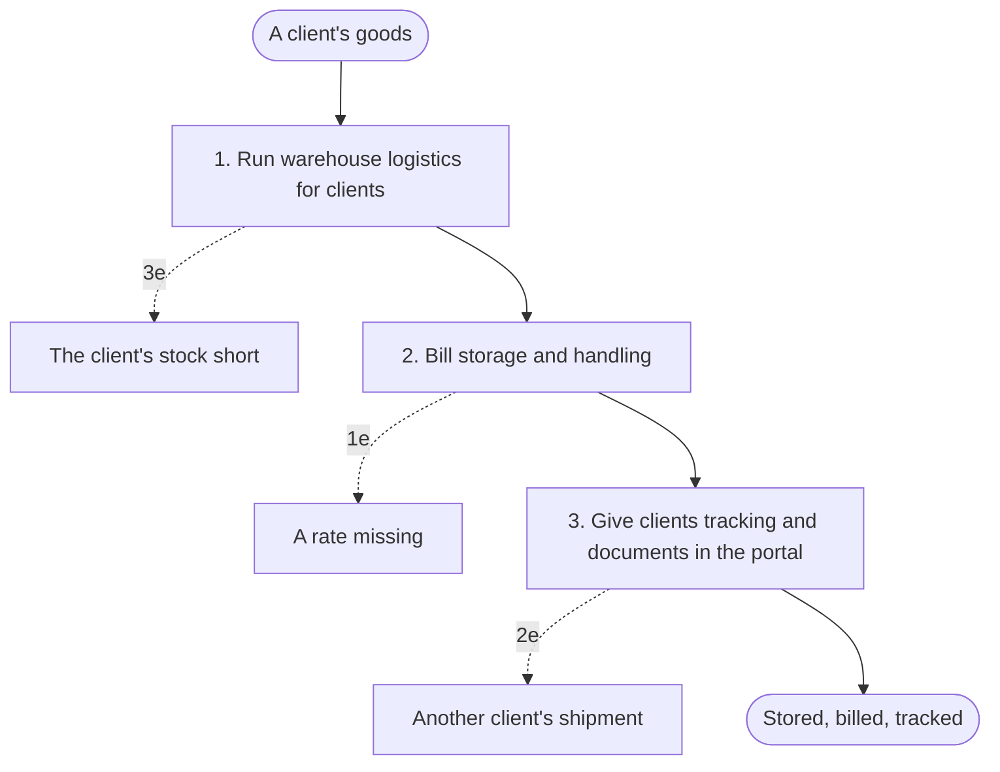

🏠 [Specs](../../../README.md) › 🏷️ [Sectors](../../README.md) › 🚛 [SC07 Transport and logistics](../README.md) ›
🔀 [Flows](README.md) › 🔀 FL-SC07-06 Logistics for clients

# 🔀 FL-SC07-06 Logistics for clients

**Status:** ✅ specified

## Summary

Logistics for clients: warehouse, storage billing and the portal. It covers
[UC-SC07-14 Run warehouse logistics for clients](../use-cases/06-logistics-for-clients/uc-sc07-14-run-warehouse-logistics-for-clients.md),
[UC-SC07-15 Bill storage and handling](../use-cases/06-logistics-for-clients/uc-sc07-15-bill-storage-and-handling.md),
[UC-SC07-16 Give clients tracking and documents in the portal](../use-cases/06-logistics-for-clients/uc-sc07-16-give-clients-tracking-and-documents-in-the-portal.md).

## Personas

- [U05 Accounting](../../../01-users/personas/u05-accounting.md)
- [U09 Customer](../../../01-users/personas/u09-customer.md)
- [U15 Warehouse operator](../../../01-users/personas/u15-warehouse-operator.md)
- [U29 Dispatcher](../../../01-users/personas/u29-dispatcher.md)

## Flowchart

## Sequence diagram

See each use case.

## Steps

| Step | Persona | Screen | Use case | What happens |
|---|---|---|---|---|
| 1 | U15, U29 | [S-SC07-14](../screens/06-logistics-for-clients/s-sc07-14-client-warehouse.md) | [UC-SC07-14](../use-cases/06-logistics-for-clients/uc-sc07-14-run-warehouse-logistics-for-clients.md) | The warehouse operator receives, stores and picks clients' goods, the client's stock is kept apart |
| 2 | U05 | [S-SC07-15](../screens/06-logistics-for-clients/s-sc07-15-storage-billing.md) | [UC-SC07-15](../use-cases/06-logistics-for-clients/uc-sc07-15-bill-storage-and-handling.md) | Accounting computes pallet-days and movements per client from the warehouse's records and bills them per the contract |
| 3 | U09, U29 | [S-SC07-16](../screens/06-logistics-for-clients/s-sc07-16-client-portal.md) | [UC-SC07-16](../use-cases/06-logistics-for-clients/uc-sc07-16-give-clients-tracking-and-documents-in-the-portal.md) | Clients sign in to the portal to follow shipments, see ETAs and download proofs and invoices |

### Entities and screens

| Entity | States in this flow | Shown at step and screen | Aggregated view |
|---|---|---|---|
| [E-SC07-14 Client stock](../data/e-sc07-14-client-stock.md) | Active | 1 [S-SC07-14](../screens/06-logistics-for-clients/s-sc07-14-client-warehouse.md); 2 [S-SC07-15](../screens/06-logistics-for-clients/s-sc07-15-storage-billing.md) | Client stocks |
| [E-F7-07 Location](../../../02-functional/f07-purchasing-and-stock/data/e-f07-07-location.md) | Active | Shown elsewhere: [S-F7-23 Dangerous goods](../../../02-functional/f07-purchasing-and-stock/screens/02-receive-and-store/s-f07-23-dangerous-goods.md) | Locations |
| [E-F7-06 Item](../../../02-functional/f07-purchasing-and-stock/data/e-f07-06-item.md) | Active | Shown elsewhere: [S-F7-21 Stock levels](../../../02-functional/f07-purchasing-and-stock/screens/03-replenish/s-f07-21-stock-levels.md) | Items |
| [E-F2-13 Document](../../../02-functional/f02-no-code-configuration/data/e-f02-13-document.md) | To sort, To validate, Done | Shown elsewhere: [S-F2-13 Documents workspace](../../../02-functional/f02-no-code-configuration/screens/07-benchmark-additions/s-f02-13-documents-workspace.md) | Documents |
| [E-F1-17 Portal account](../../../02-functional/f01-administration/data/e-f01-17-portal-account.md) | Invited, Active, Blocked, Deactivated | Shown elsewhere: [S-F1-19 Portal accounts](../../../02-functional/f01-administration/screens/12-portal-accounts-and-integrations/s-f01-19-portal-accounts.md) | Portal accounts |

## Errors

- [UC-SC07-14](../use-cases/06-logistics-for-clients/uc-sc07-14-run-warehouse-logistics-for-clients.md) 3e. The client's
  stock short: the client is told.
- [UC-SC07-14](../use-cases/06-logistics-for-clients/uc-sc07-14-run-warehouse-logistics-for-clients.md) 1e. Goods not
  announced: they are held.
- [UC-SC07-15](../use-cases/06-logistics-for-clients/uc-sc07-15-bill-storage-and-handling.md) 1e. A rate missing: the
  invoice is held.
- [UC-SC07-15](../use-cases/06-logistics-for-clients/uc-sc07-15-bill-storage-and-handling.md) 2e. A movement disputed:
  it is checked.
- [UC-SC07-16](../use-cases/06-logistics-for-clients/uc-sc07-16-give-clients-tracking-and-documents-in-the-portal.md)
  2e. Another client's shipment: it is never shown,
  [BR-F6-03](../../../02-functional/f06-customers-and-sales/business-rules/br-f06-03-portal-shows-only-the-customer-s-own.md).
- [UC-SC07-16](../use-cases/06-logistics-for-clients/uc-sc07-16-give-clients-tracking-and-documents-in-the-portal.md)
  3e. A proof not yet synced: the portal says it comes.

## Images

Every step and error, for each persona taking part, in light and dark mode (D120). Steps are numbered as in the Steps
table; E rows are the error cases.

| Step | Persona | Device | Light | Dark |
|---|---|---|---|---|
| 1 | U15 | phone | [light](../images/06-logistics-for-clients/u15-warehouse-operator/1-warehouse-phone-light.png) | [dark](../images/06-logistics-for-clients/u15-warehouse-operator/1-warehouse-phone-dark.png) |
| 1 | U15 | tablet | [light](../images/06-logistics-for-clients/u15-warehouse-operator/1-warehouse-tablet-light.png) | [dark](../images/06-logistics-for-clients/u15-warehouse-operator/1-warehouse-tablet-dark.png) |
| 1 | U29 | desktop | [light](../images/06-logistics-for-clients/u29-dispatcher/1-warehouse-desktop-light.png) | [dark](../images/06-logistics-for-clients/u29-dispatcher/1-warehouse-desktop-dark.png) |
| 1 | U29 | phone | [light](../images/06-logistics-for-clients/u29-dispatcher/1-warehouse-phone-light.png) | [dark](../images/06-logistics-for-clients/u29-dispatcher/1-warehouse-phone-dark.png) |
| 2 | U05 | desktop | [light](../images/06-logistics-for-clients/u05-accounting/2-storage-billing-desktop-light.png) | [dark](../images/06-logistics-for-clients/u05-accounting/2-storage-billing-desktop-dark.png) |
| 3 | U09 | phone | [light](../images/06-logistics-for-clients/u09-customer/3-portal-phone-light.png) | [dark](../images/06-logistics-for-clients/u09-customer/3-portal-phone-dark.png) |
| 3 | U29 | desktop | [light](../images/06-logistics-for-clients/u29-dispatcher/3-portal-desktop-light.png) | [dark](../images/06-logistics-for-clients/u29-dispatcher/3-portal-desktop-dark.png) |
| 3 | U29 | phone | [light](../images/06-logistics-for-clients/u29-dispatcher/3-portal-phone-light.png) | [dark](../images/06-logistics-for-clients/u29-dispatcher/3-portal-phone-dark.png) |
| E1 | U05 | desktop | [light](../images/06-logistics-for-clients/u05-accounting/e1-rate-missing-desktop-light.png) | [dark](../images/06-logistics-for-clients/u05-accounting/e1-rate-missing-desktop-dark.png) |

## Open questions

None.

---

⬅️ [FL-SC07-05 Billing and performance](fl-sc07-05-billing-and-performance.md) · ⬆️ [Up](README.md) ·
➡️ [FL-SC07-07 Passengers, removals, courier and freight](fl-sc07-07-passengers-removals-courier-and-freight.md)
