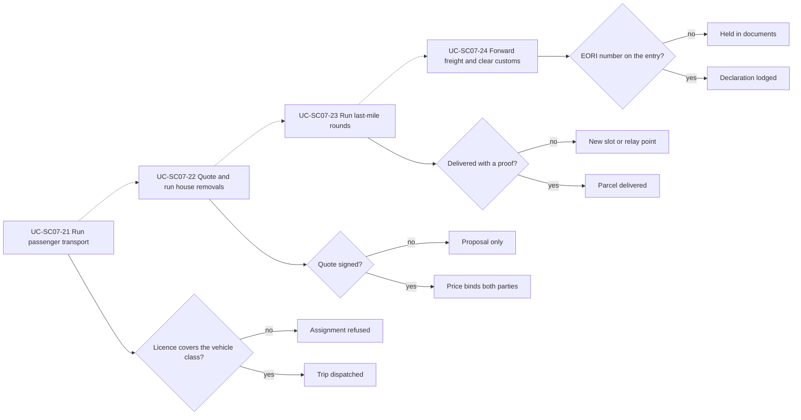
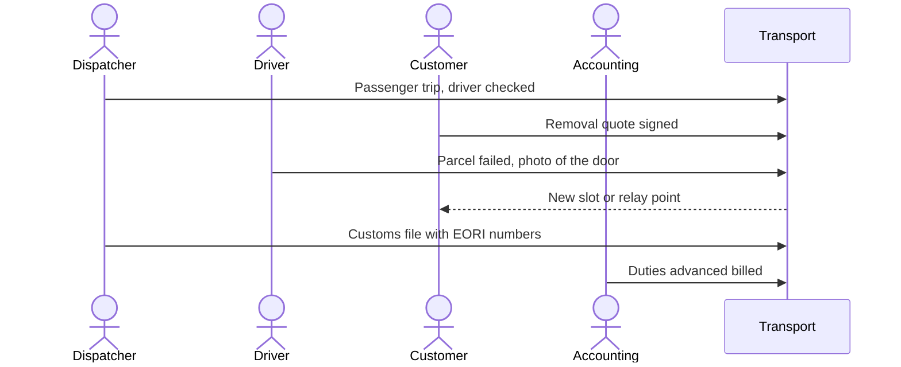

🏠 [Specs](../../../README.md) › 🏷️ [Sectors](../../README.md) › 🚛 [SC07 Transport and logistics](../README.md) ›
🔀 [Flows](README.md) › 🔀 FL-SC07-07 Passengers, removals, courier and freight

# 🔀 FL-SC07-07 Passengers, removals, courier and freight

**Status:** ✅ specified

## Summary

Four situations of transport companies: carrying passengers with drivers licensed for the vehicle, quoting and running
removals with a binding signed quote, running parcel rounds that always give a failed delivery a next step, and
forwarding freight with a complete customs file
([D551](../../../06-decisions/sectors/d551-benchmark-gaps-sc07-transport.md)).

## Personas

- [U29 Dispatcher](../../../01-users/personas/u29-dispatcher.md), who plans trips, removals, rounds and files
- [U30 Driver](../../../01-users/personas/u30-driver.md), who drives and delivers
- [U09 Customer](../../../01-users/personas/u09-customer.md), who signs a removal quote
- [U05 Accounting](../../../01-users/personas/u05-accounting.md), who checks duties and bills

## Flowchart

## Sequence diagram

## Steps

| Step | Persona | Screen | Use case | What happens |
|---|---|---|---|---|
| 1 | [U29](../../../01-users/personas/u29-dispatcher.md) | [S-SC07-21](../screens/07-passengers-removals-courier-and-freight/s-sc07-21-passenger-transport.md) | [UC-SC07-21](../use-cases/07-passengers-removals-courier-and-freight/uc-sc07-21-run-passenger-transport.md) | The dispatcher assigns a driver whose licence covers the vehicle's class and the driver follows the trip on the phone |
| 2 | [U29](../../../01-users/personas/u29-dispatcher.md) | [S-SC07-22](../screens/07-passengers-removals-courier-and-freight/s-sc07-22-removals.md) | [UC-SC07-22](../use-cases/07-passengers-removals-courier-and-freight/uc-sc07-22-quote-and-run-house-removals.md) | The dispatcher quotes a removal, the customer signs it and the crew lists the goods with their condition |
| 3 | [U29](../../../01-users/personas/u29-dispatcher.md) | [S-SC07-23](../screens/07-passengers-removals-courier-and-freight/s-sc07-23-last-mile.md) | [UC-SC07-23](../use-cases/07-passengers-removals-courier-and-freight/uc-sc07-23-run-last-mile-rounds.md) | The dispatcher plans the rounds and the driver delivers, or marks a failure so that the recipient chooses a new slot or a relay point |
| 4 | [U29](../../../01-users/personas/u29-dispatcher.md) | [S-SC07-24](../screens/07-passengers-removals-courier-and-freight/s-sc07-24-freight-forwarding.md) | [UC-SC07-24](../use-cases/07-passengers-removals-courier-and-freight/uc-sc07-24-forward-freight-and-clear-customs.md) | The dispatcher collects the documents and lodges the customs declaration, then accounting bills the duties advanced |

### Entities and screens

| Entity | States in this flow | Shown at step and screen | Aggregated view |
|---|---|---|---|
| [E-SC07-18 Passenger trip](../data/e-sc07-18-passenger-trip.md) | Planned, Dispatched, Running, Completed, Cancelled | 1 [S-SC07-21](../screens/07-passengers-removals-courier-and-freight/s-sc07-21-passenger-transport.md) | Passenger trips |
| [E-SC07-19 Removal](../data/e-sc07-19-removal.md) | Quoted, Signed, Moved, Closed, Lost | 2 [S-SC07-22](../screens/07-passengers-removals-courier-and-freight/s-sc07-22-removals.md) | Removals |
| [E-SC07-20 Parcel](../data/e-sc07-20-parcel.md) | Received, Out, Delivered, Failed, Held, Returned | 3 [S-SC07-23](../screens/07-passengers-removals-courier-and-freight/s-sc07-23-last-mile.md) | Parcels |
| [E-SC07-21 Shipment file](../data/e-sc07-21-shipment-file.md) | Opened, Documents, Declared, Cleared, Closed | 4 [S-SC07-24](../screens/07-passengers-removals-courier-and-freight/s-sc07-24-freight-forwarding.md) | Shipment files |
| [E-SC07-04 Driver document](../data/e-sc07-04-driver-document.md) | Active | Shown elsewhere: [S-SC07-04 Drivers](../screens/02-fleet-and-drivers/s-sc07-04-drivers.md) | Driver documents |

## Errors

- **E1 The licence class is missing.** A driver whose licence does not cover the class of the vehicle is refused for the
  trip and the drivers who qualify are listed
  ([BR-SC07-16](../business-rules/br-sc07-16-drivers-hold-the-licence-for-the-vehicle-class.md), step 1).

## Images

Every step and error, for each persona taking part, in light and dark mode (D120). Steps are numbered as in the Steps
table; E rows are the error cases.

| Step | Persona | Device | Light | Dark |
|---|---|---|---|---|
| 1 | U29 | desktop | [light](../images/07-passengers-removals-courier-and-freight/u29-dispatcher/1-passenger-transport-desktop-light.png) | [dark](../images/07-passengers-removals-courier-and-freight/u29-dispatcher/1-passenger-transport-desktop-dark.png) |
| 1 | U30 | phone | [light](../images/07-passengers-removals-courier-and-freight/u30-driver/1-passenger-transport-phone-light.png) | [dark](../images/07-passengers-removals-courier-and-freight/u30-driver/1-passenger-transport-phone-dark.png) |
| 1 | U29 | phone | [light](../images/07-passengers-removals-courier-and-freight/u29-dispatcher/1-passenger-transport-phone-light.png) | [dark](../images/07-passengers-removals-courier-and-freight/u29-dispatcher/1-passenger-transport-phone-dark.png) |
| 2 | U29 | desktop | [light](../images/07-passengers-removals-courier-and-freight/u29-dispatcher/2-removals-desktop-light.png) | [dark](../images/07-passengers-removals-courier-and-freight/u29-dispatcher/2-removals-desktop-dark.png) |
| 2 | U09 | phone | [light](../images/07-passengers-removals-courier-and-freight/u09-customer/2-removals-phone-light.png) | [dark](../images/07-passengers-removals-courier-and-freight/u09-customer/2-removals-phone-dark.png) |
| 2 | U29 | phone | [light](../images/07-passengers-removals-courier-and-freight/u29-dispatcher/2-removals-phone-light.png) | [dark](../images/07-passengers-removals-courier-and-freight/u29-dispatcher/2-removals-phone-dark.png) |
| 3 | U29 | desktop | [light](../images/07-passengers-removals-courier-and-freight/u29-dispatcher/3-last-mile-desktop-light.png) | [dark](../images/07-passengers-removals-courier-and-freight/u29-dispatcher/3-last-mile-desktop-dark.png) |
| 3 | U30 | phone | [light](../images/07-passengers-removals-courier-and-freight/u30-driver/3-last-mile-phone-light.png) | [dark](../images/07-passengers-removals-courier-and-freight/u30-driver/3-last-mile-phone-dark.png) |
| 3 | U29 | phone | [light](../images/07-passengers-removals-courier-and-freight/u29-dispatcher/3-last-mile-phone-light.png) | [dark](../images/07-passengers-removals-courier-and-freight/u29-dispatcher/3-last-mile-phone-dark.png) |
| 4 | U29 | desktop | [light](../images/07-passengers-removals-courier-and-freight/u29-dispatcher/4-freight-forwarding-desktop-light.png) | [dark](../images/07-passengers-removals-courier-and-freight/u29-dispatcher/4-freight-forwarding-desktop-dark.png) |
| 4 | U05 | desktop | [light](../images/07-passengers-removals-courier-and-freight/u05-accounting/4-freight-forwarding-desktop-light.png) | [dark](../images/07-passengers-removals-courier-and-freight/u05-accounting/4-freight-forwarding-desktop-dark.png) |
| 4 | U29 | phone | [light](../images/07-passengers-removals-courier-and-freight/u29-dispatcher/4-freight-forwarding-phone-light.png) | [dark](../images/07-passengers-removals-courier-and-freight/u29-dispatcher/4-freight-forwarding-phone-dark.png) |
| E1 | U29 | desktop | [light](../images/07-passengers-removals-courier-and-freight/u29-dispatcher/e1-the-licence-class-is-missing-desktop-light.png) | [dark](../images/07-passengers-removals-courier-and-freight/u29-dispatcher/e1-the-licence-class-is-missing-desktop-dark.png) |
| E1 | U29 | phone | [light](../images/07-passengers-removals-courier-and-freight/u29-dispatcher/e1-the-licence-class-is-missing-phone-light.png) | [dark](../images/07-passengers-removals-courier-and-freight/u29-dispatcher/e1-the-licence-class-is-missing-phone-dark.png) |

## Open questions

None.

---

⬅️ [FL-SC07-06 Logistics for clients](fl-sc07-06-logistics-for-clients.md) · ⬆️ [Up](README.md)
